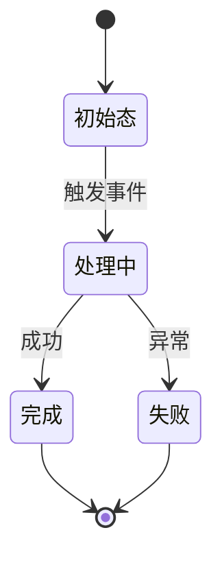

# 【repo】_技术 Spec — 【功能名】

> 单仓库的详细技术规范。遵循 `references/core/spec写作纪律.md`：零上下文可动手、RFC2119、无占位符。
> 输出：`docs/spec/<repo>-<feature>-eng-spec.md`。
> 含 AI/LLM 功能时，在下列相应章节**叠加** `references/core/AI-LLM-overlay.md` 的 AI 契约。

## 0. 阅读导引（MUST，前置）

> 让人类与零上下文 coding agent 先建立端到端心智模型，再进入细节。**这一节必写**——哪怕功能很小也要有一句话目的 + 一张流程图。

- **一句话目的**：这份 spec 让系统能做到【一句话】。
- **端到端场景**（2–4 条，覆盖主路径 + 关键异常）：
  1. 【谁】在【什么条件】下【做什么】→ 系统【怎么响应】→ 最终【什么结果】。
  2. 【异常/边界场景】…
- **核心流程图**（Mermaid，画主路径与关键分支，不画实现细节）：
  ```mermaid
  flowchart TD
    A[入口] --> B{关键判定}
    B -->|条件1| C[分支1]
    B -->|条件2| D[分支2]
  ```
- **决策表**（把"什么输入/状态 → 走哪条路 → 什么结果"列清楚，读者不用读正文就能判断分支）：
  | 输入 / 状态 | 条件 | 走向 / 处置 | 结果 |
  |---|---|---|---|
  | 【】 | 【】 | 【】 | 【】 |

## 1. 范围
- 本仓库做什么：【】
- **不做什么**：【明确边界】
- 依赖的上游 / 被依赖的下游：【团队版附 ctx cite】

## 2. 数据模型 / 数据结构
【表结构 / DTO / 状态字段。前后端数据结构要对齐。】
> **稳定标识与归一化**：哪个字段是实体的稳定唯一标识（跨重试/跨服务不变）？外部输入如何归一化（大小写、空白、编码）到规范形态，避免"同一实体多种写法"。

## 3. 接口契约
| 接口 | 入参 | 出参 | 调用方 | 版本 |
|---|---|---|---|---|
| 【】 | 【】 | 【】 | 【】 | 【V?】 |
> 含 AI：补输出契约与校验（期望结构、校验失败处理）。

## 4. 核心逻辑 / 流程
【关键流程分步描述，指到具体模块。】

## 5. 错误处理 / 降级
【每类错误怎么处理；外部依赖不可用时的兜底。含 AI：模型不可用/超预算/校验失败的降级行为。】

## 6. 安全 / 鉴权
【权限校验点；敏感数据处理。含 AI：输入输出过滤、注入防护。】

## 7. 可观测性
【日志/指标埋点。含 AI：记录 prompt 版本、耗时、token、置信度、是否降级。】

## 8. 兼容性 / 迁移
【向后兼容、数据迁移、灰度切换、兼容窗口。】

## 9. 【含 AI 时】AI 契约补充
【模型/prompt 版本化、推理生命周期、置信度路由、成本/token 预算、eval 质量门、数据边界、可审计性——按 AI-LLM-overlay 逐项。】

## 10.（有状态时）状态机
仅当功能含明确状态流转（订单、会话、任务、续接等）时填。

**转移图（MUST，先于状态表）**：先画一张 Mermaid 转移图，再写下面的状态表。**每个状态必须有进有出**，或显式标为终态——图上能一眼看出的孤儿态/死态就是设计漏洞。


| 状态 | 含义 | 允许的转移 → 目标态 | 触发条件 | 幂等/恢复 |
|---|---|---|---|---|
| 【】 | 【】 | 【→ 】 | 【】 | 【重复触发是否幂等；崩溃/重启后如何恢复到一致态】 |

## 11. 完成定义（Definition of Done）
交付前逐项打勾，避免"看起来做完了"。
- [ ] §0 阅读导引齐全（一句话目的 + 端到端场景 + 流程图 + 决策表）
- [ ] 所有 §3 接口按契约实现并通过测试
- [ ] §5 错误/降级路径都有覆盖
- [ ] 【含状态机】所有转移与幂等/恢复验证过
- [ ] 【含 AI】§9 AI 契约各项落地（版本化/校验/预算/eval 门）
- [ ] 日志/指标埋点就位（§7）
- [ ] 向后兼容/迁移验证（§8）
- [ ] 文档/card 已更新（若触碰权威面）

## 12. 待澄清点
【需要产品/技术负责人确认的具体问句。先过 fact-gate（见 spec写作纪律 §6）：能查的先查，别塞可读事实。】
