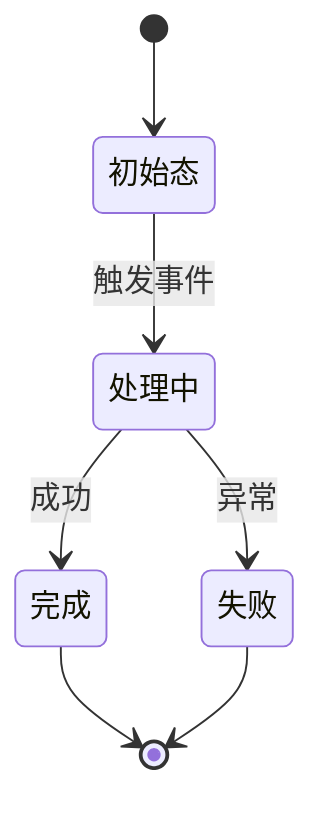

# 【repo】_技术 Spec — 【功能名】

> 单仓库的详细技术规范。遵循 `references/core/spec写作纪律.md`：零上下文可动手、RFC2119、无占位符。
> 输出：`docs/spec/<repo>-<feature>-eng-spec.md`。
> 含 AI/LLM 功能时，在下列相应章节**叠加** `references/core/AI-LLM-overlay.md` 的 AI 契约。
> 本文档属于工程内部详细设计，由 AI 与工程侧自主完成并自检，不要求业务用户确认。业务开放问题必须改写成业务语言后再提问。
> **路径分工**：spec 里出现的文件路径/代码引用是**现状事实的锚点**（带来源；团队版为 ctx 输出的 cite，指认权威实体），不是实现指令；"改哪个文件、写什么代码"的实现落点归 coding plan（Step 6）承载——避免 spec 因实现细节漂移而过时。

## 0. 阅读导引（MUST，前置）

> 让人类与零上下文 coding agent 先建立端到端心智模型，再进入细节。**这一节必写**——哪怕功能很小也要有一句话目的 + 一张流程图。

- **一句话目的**：这份 spec 让系统能做到【一句话】。
- **端到端场景**（2–4 条，覆盖主路径 + 关键异常）：
  1. 【谁】在【什么条件】下【做什么】→ 系统【怎么响应】→ 最终【什么结果】。
  2. 【异常/边界场景】…
- **核心流程图**（Mermaid，画主路径与关键分支，不画实现细节）：
  ```mermaid
  flowchart TD
    A[入口] --> B{关键判定}
    B -->|条件1| C[分支1]
    B -->|条件2| D[分支2]
  ```
- **决策表**（把"什么输入/状态 → 走哪条路 → 什么结果"列清楚，读者不用读正文就能判断分支）：
  | 输入 / 状态 | 条件 | 走向 / 处置 | 结果 |
  |---|---|---|---|
  | 【】 | 【】 | 【】 | 【】 |

## 1. 范围
- 本仓库做什么：【】
- **不做什么**：【明确边界】
- 依赖的上游 / 被依赖的下游：【团队版附 ctx 输出的 cite】

## 2. 数据模型 / 数据结构
【表结构 / DTO / 状态字段。前后端数据结构要对齐。】
> **稳定标识与归一化**：哪个字段是实体的稳定唯一标识（跨重试/跨服务不变）？外部输入如何归一化（大小写、空白、编码）到规范形态，避免"同一实体多种写法"。

## 3. 接口契约
| 接口 | 入参 | 出参 | 调用方 | 版本 |
|---|---|---|---|---|
| 【】 | 【】 | 【】 | 【】 | 【V?】 |
> 含 AI：补输出契约与校验（期望结构、校验失败处理）。

**外部集成契约**（调用外部系统时）：列每个外部依赖的 REQUIRED 操作、传输语义（endpoint/鉴权/超时/易漂移点）、payload→领域模型的归一化、以及**机器可读错误码**——用稳定的 `<系统>_request` / `<系统>_status` / `<系统>_payload_error` / `<系统>_auth` 这类 lowercase_underscore 码，日志/指标/测试都用它，**事后改名会打断看板**。并一句话写清"本集成不做哪些写操作"（边界，呼应 §1）。

## 4. 核心逻辑 / 流程
【关键流程分步描述，指到具体模块。】
> **参考算法**：复杂算法（排序/匹配/调度/并发/状态推导/退避）SHOULD 给一段**语言无关伪码**，别只用散文——伪码消除歧义，让零上下文实现者不用猜。给伪码时把边界与终止条件一并写出。

## 5. 错误处理 / 降级 / 失败模型
【每类错误怎么处理；外部依赖不可用时的兜底。含 AI：模型不可用/超预算/校验失败的降级行为。】

**失败模型**（有持久状态/后台处理时必写）：
| 失败分类 | 恢复行为 | 重启后存活性（什么存活/什么丢失）| 操作员干预点 |
|---|---|---|---|
| 【如：外部依赖超时】 | 【重试/降级/丢弃】 | 【已提交的存活；in-flight 丢失并可重放】 | 【需人工介入的信号/开关】 |

## 6. 安全 / 鉴权 / 配置 / 不变量
- **信任边界**：哪些输入不可信、在哪一层校验；权限校验点；敏感数据处理。含 AI：输入输出过滤、注入防护。
- **密钥处理**：密钥/凭证**不写死、不进日志**；配置里用 `$VAR` 间接引用，不落明文。
- **配置纪律**（系统有配置时）：给配置解析管线（文件选择→解析→默认值→`$VAR`/`~` 解引用→校验）；env 变量策略（推荐：只对显式声明 `$VAR` 的字段生效，不全局覆盖）；动态 reload 语义（哪些运行时生效、哪些要重启、**非法 reload 不崩溃、保留 last known good 并报操作员可见错误**）；启动 preflight 校验；末尾附一张 **配置 Cheat Sheet**（每字段一行：名/类型/REQUIRED/默认/是否动态）。
- **安全不变量**（创建/改/删持久资源时必写，用编号 `Invariant N:` 格式，"显而易见"的也要写）：
  ```
  Invariant 1: 【一句话不变量，如"worker 只在 per-task 工作区路径内运行"】
  - 强制机制：【启动子进程前校验 cwd == workspace_path】
  - 违反时：【拒绝并 abort 本次运行】
  ```

## 7. 可观测性
- **日志约定**：每类日志行的 REQUIRED 上下文字段（如 traceId/requestId/caller/costMs/errorCode）、`key=value` 措辞、payload 大小上限。
- **sink**：哪些 REQUIRED、哪些实现自定；**sink 失败不得让主流程崩溃**。
- **指标/记账**：聚合量（如 token 总数、耗时秒）给公式；对会重复上报的事件写**去重规则**。
- **状态查询面**：同步状态查询的响应形状（标 OPTIONAL/RECOMMENDED）；任何人读 UI 都是 OPTIONAL，不得成为正确性的前提。
- 含 AI：记录 prompt 版本、耗时、token、置信度、是否降级、safety_verdict、outcome（见 AI-LLM-overlay）。

## 8. 兼容性 / 迁移

### 8.1 兼容取舍决策（用户拍板，MUST）
本次改变的每项**既有可观察行为**一行，由用户在兼容取舍确认门逐条选定（流程见 `00-流程总纲.md` §兼容取舍确认门）。**兼容不是默认项**；不改变任何既有行为时写一行"本次不改变既有可观察行为，无兼容取舍"。

| 被改变的既有行为 | 谁在依赖它 | 用户决定 | 到期日 | 到期动作 | 确认时间 |
|---|---|---|---|---|---|
| 【如：下单接口返回的 `price` 由分改为元】 | 【老版本 App / 报表任务】 | 【不兼容 / 兼容到期 / 永久兼容】 | 【兼容到期才填，否则 —】 | 【到期后删除旧字段】 | 【YYYY-MM-DD】 |

### 8.2 替换清单（Replacement Ledger，MUST）
本次新逻辑取代了哪些旧物，逐条登记；编码后的代码评审门按此核销（规则见 `references/core/代码评审纪律.md` §替换清单）。**登记在这里，删除动作要在 coding plan 里成为具体任务。**

| 被取代物 | 类型（函数/文件/配置/开关/DB 字段/接口版本）| 取代者 | 处置 | 保留理由 + 到期日 |
|---|---|---|---|---|
| 【`calcPriceV1()`】 | 【函数】 | 【`calcPrice()`】 | 【删除】 | 【—】 |
| 【`orders.legacy_memo`】 | 【DB 字段】 | 【无，数据已迁走】 | 【保留至迁移窗口结束】 | 【数据迁移未完成；YYYY-MM-DD 起删】 |

> 保留例外只有三类理由成立：对外契约仍在兼容窗口内（与 §8.1 的到期日必须一致）、数据迁移未完成、回滚预案显式依赖。**"以防万一"不是理由。**

### 8.3 数据迁移 / 灰度
【数据迁移方案、灰度切换步骤、回滚路径。】

## 9. 【含 AI 时】AI 契约补充
【模型/prompt 版本化、推理生命周期、置信度路由、成本/token 预算、eval 质量门、数据边界、可审计性——按 AI-LLM-overlay 逐项。】

## 10.（有状态时）状态机
仅当功能含明确状态流转（订单、会话、任务、续接等）时填。

**转移图（MUST，先于状态表）**：先画一张 Mermaid 转移图，再写下面的状态表。**每个状态必须有进有出**，或显式标为终态——图上能一眼看出的孤儿态/死态就是设计漏洞。


| 状态 | 含义 | 允许的转移 → 目标态 | 触发条件 | 幂等/恢复 |
|---|---|---|---|---|
| 【】 | 【】 | 【→ 】 | 【】 | 【重复触发是否幂等；崩溃/重启后如何恢复到一致态】 |

## 11. 完成定义（Definition of Done）
交付前逐项打勾，避免"看起来做完了"。
- [ ] §0 阅读导引齐全（一句话目的 + 端到端场景 + 流程图 + 决策表）
- [ ] 所有 §3 接口按契约实现并通过测试
- [ ] §5 错误/降级路径都有覆盖；【有持久状态】失败模型的重启存活性验证过
- [ ] 【含状态机】所有转移与幂等/恢复验证过
- [ ] 【改持久资源】§6 安全不变量都有强制机制且违反即 abort
- [ ] 【有配置】配置 Cheat Sheet 齐全、非法 reload 不崩（保留 last known good）
- [ ] 【调外部系统】错误码为稳定 lowercase_underscore，已进日志/指标
- [ ] 【含 AI】§9 AI 契约各项落地（版本化/校验/预算/eval 门）
- [ ] 日志/指标埋点就位（§7，REQUIRED 上下文字段齐全，sink 失败不崩）
- [ ] §8.1 兼容取舍每条都有用户确认结论（含"无兼容取舍"的显式声明）；向后兼容/迁移已验证
- [ ] §8.2 替换清单逐条核销：该删的已删（引用数为 0），保留项都带理由与到期日
- [ ] 代码评审门三轴通过，P0/P1 已清零（见 `references/core/代码评审纪律.md`）
- [ ] 【长链路】端到端用例存在且断言了每个环节的中间产物（见 `references/core/测试资产纪律.md` §1）
- [ ] 真实样本已固化进测试资产目录，凭证类进 `secrets/` 且已 gitignore、脱敏副本入库
- [ ] `docs/report/测试场景覆盖度.md` 已更新，缺素材场景已挂账
- [ ] 文档/card 已更新（若触碰权威面）

## 12. 待澄清点
【只保留无法从代码和已有业务材料确定的业务规则、用户可感知行为、权限边界、数据归属或风险取舍。不得要求用户选择程序实现方案。】
