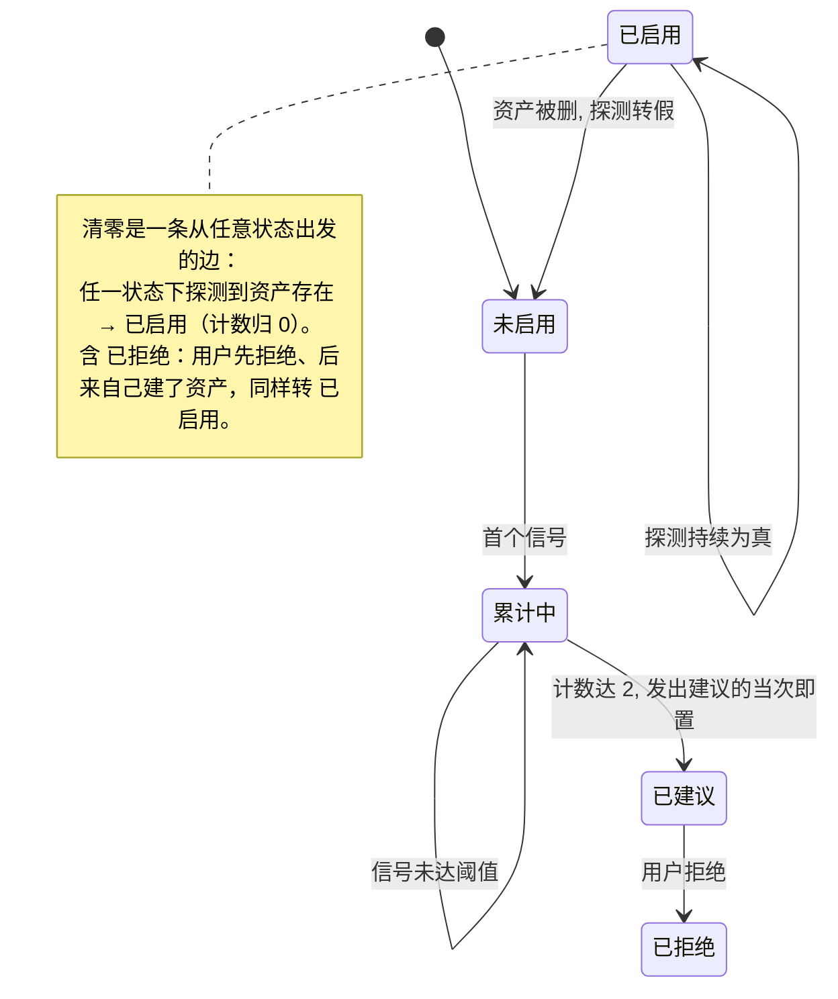

# 资产补建信号（core，条件加载）

> **什么时候读**：① 要**记一条信号**时（评审门残留轴命中、bug 归档、spec 登记替换清单、Step 1 被迫大范围探索）；② 合并完成后的**收尾汇报**要判定"要不要建议用户补建代码事实资产"时。平时不必常驻。
> **本文是本机制的唯一权威定义**：信号判据、账本格式、阈值、状态机、提示时机、拒绝抑制**只在这里定义一次**。`代码评审纪律.md`、`bug诊断纪律.md`、`worktree开发纪律.md`、`文档治理.md`、`00-流程总纲.md` 只留指针，MUST NOT 在那几处重复定义字段或阈值——重复即漂移。
> 本文按 RFC 2119 解释 MUST / MUST NOT / SHOULD / MAY。

> **本文小节**：[§0 解决什么](#0-这份纪律解决什么) · [§1 信号必须是结果性的](#1-信号必须是结果性的不是努力量) · [§2 两个指向](#2-两个指向建议的动作不同) · [§3 账本位置/结构/时机](#3-账本位置结构与写入时机) · [§4 阈值与判定时机](#4-阈值与判定时机) · [§5 状态与转移](#5-状态与转移) · [§6 怎么提这次建议](#6-怎么提这次建议) · [§7 合并失败时](#7-合并失败时)

## 0. 这份纪律解决什么

能力位由**运行时探测项目资产**得出（探测到 `.codegraph/codegraph.db` → 图谱位；探测到已填写的 `engineering-context/capability-registry.md` → 权威位）。探测永远与项目当下状态一致，但它只回答"**你现在有什么**"，**回答不了"你现在没有、但已经该有了**"。

项目会长大：同一能力长出第二处实现、模块多到没人记得住入口。这件事不会敲锣打鼓地宣布，它只以**返工**的形式暴露——改到了废弃副本、被旧实现误导、每次动手都要先把半个仓库翻一遍。本纪律把这些返工记成账，累计到阈值时由 AI 主动提一次建议，而不是等用户自己受够了才想起来。

**边界（MUST NOT 反过来用）**：本机制只产出**建议**。MUST NOT 自动创建**权威位资产**（`capability-registry.md` / `cards/` / `scenes/`）、MUST NOT 自动建代码图谱索引、MUST NOT 因为项目没有这些资产就阻断流程、降级交付或拒绝干活。

  **具名例外：最小探针集**（`engineering-context/probe-set.md`，只含四道交接题）**不在禁令内**。它是**交接门禁**，读的是项目自身文件、与能力位无关，任何项目都该有（`文档治理.md` §三层真相源）。禁令针对的是「看起来有权威口径、实际一条权威事实都查不到」的空壳；建探针集时 MUST 同时说明**这不是权威口径层**，免得用户以为自己已经受权威事实保护——那正是 §5 单列「建了但从没填过」要防的同一个认知风险。无能力位的项目按 `文档治理.md` §三层真相源的最小承载形态即为合规。

## 1. 信号必须是结果性的，不是努力量

只记**已经发生的返工或已经写下的损失记录**。四类，来源全部是流程里本来就要落盘的东西，**不新增采集动作**：

| 信号 | 何时写 | 写在哪一步 | 指向 |
|---|---|---|---|
| 代码评审残留轴命中"**改了非权威副本 / 旧实现未清理**" | 评审报告落盘的同时 | `代码评审纪律.md` §残留轴命中 → 资产补建信号账本 | 权威位 |
| `bug修复历史.md` 新增条目的**根因是"改错了实现 / 被旧实现误导"** | 归档该条目的同时 | `bug诊断纪律.md` Phase 3 §归档问题处理历史 | 权威位 |
| **替换清单出现"同一逻辑的多处副本"** | spec 定稿、登记替换清单时 | eng-spec §8.2 / lean-change-spec 替换清单节 | 权威位 |
| 一次任务内**被迫打开 ≥2 个"入手时不知道它存在"的模块的源码**才推进得下去（判据见 ↓） | 该次探索结束、写〈既有系统清单〉时 | 完整流程 Step 1；Lean 走 `lean-change-spec.md` §影响范围 / 不做什么（`路径-lean.md` 第 4 步） | 图谱位 |

**MUST NOT 记努力量。** 具体地说，MUST NOT 把"grep 了几次""读了多少个文件""搜索花了多久""上下文占用高"记成信号——那是**任何非平凡改动都能凑齐**的正常工作量。用努力量当判据，机制会在几乎所有项目上误触发；用户学会一律拒绝之后，这个提示就等于不存在了，真正需要它的那次也会被一起无视。

判据是一句话：**这次是不是真的做错了、或者真的被迫做了本不该做的事？** 是 → 记；只是"干活比较费劲" → 不记。

**第 4 行那条（图谱位）的判据要额外收紧**，否则它会在无能力位的项目上无差别误触发——那类项目没有 registry、没有 card，"未登记"对所有模块都成立，任何跨两个模块的改动都能凑够 2。所以判据 MUST NOT 写成"未登记"，而是**三条同时成立**才算一个：

1. 该模块**在本次任务开始时**既没出现在需求材料 / PRD 里，也没出现在项目的架构真相源（`文档治理.md` §三层真相源）或 registry 里——即"入手时不知道它存在"；
2. **必须打开它的源码**（或 clone 它的仓库）才推进得下去，不是顺手瞄了一眼；
3. 它最终**进了本次的〈既有系统清单〉**——没进清单说明它其实与本次改动无关，那只是探索走了弯路。

只做了检索（grep / 语义搜索）而没打开源码的，**不算**；同一个模块反复查多次，**记一个**。

## 2. 两个指向，建议的动作不同

| 指向 | 症状（信号在说什么） | 缺的是什么 | 建议的动作 |
|---|---|---|---|
| **权威位** | 同一能力有多处实现，分不清该信哪个，已经改错过 | "**信哪个**"的消歧面 | `ctx init --minimal` 起步：只落 `engineering-context/capability-registry.md` 与一个 `engineering-context/.gitignore`（忽略 `.index/` 机器状态），先把出过问题的那几个能力写成**三行**（能力 / 权威实现 / **陷阱项：相似但不该用的旧实现**），不必一上来铺满 card。第三列 MUST NOT 省——它是最小 schema 里唯一的防误用装置，省掉就只剩一份"该用哪个"的清单，挡不住"改错了那个" |
| **图谱位** | 模块多到每次动手都要先把仓库翻一遍才知道东西在哪 | "**找得到**吗"的检索面 | 建本地代码图谱索引（codegraph；安装器已带这一段，重跑安装器或按其文档 `init` 建索引即可） |

**MUST NOT 把两个指向混成一句"建议升级项目档次"**：两者正交，任一可单独启用（`capability/graph.md` §1）。一个 3 千行但有 v1/v2 并存的项目要的是 registry 三行，不是索引；一个模块极多但实现唯一的项目要的是索引，不是 card。

## 3. 账本：位置、结构与写入时机

**位置**：`docs/report/资产补建信号.md`（固定文件名的单一账本，是 `文档治理.md` §硬规则报告命名规则的显式例外之一）。

**文件不存在时，MUST 按下面这个完整骨架创建**，不能只补一张信号表就开写——从残留轴或 bug 归档进来的 agent 最容易只写自己那一行，结果账本没有 frontmatter、也没有状态表，下次做判定时无从读起：

```markdown
---
lifecycle: active          # 账本恒为 active，MUST NOT 被权威面触发转归档
superseded_by: ''
archived: ''
last_confirmed: '2026-01-01'   # 填创建当天；本账本恒 active，不被权威面触发刷新，填一次即可
authority_refs: ['无']     # 账本不承载权威口径，恒为 无（文档治理.md §文档生命周期）
---

# 资产补建信号

> 记结果性返工，累计到阈值后在收尾汇报里建议补建资产。判据与写法见 skill 的
> `references/core/资产补建信号.md`。**只产出建议，不阻断任何流程。**

## 状态

| 指向 | 状态 | 计数 | 拒绝日期 | 最近信号摘要 |
|---|---|---|---|---|
| 权威位 | 未启用 | 0 | — | — |
| 图谱位 | 未启用 | 0 | — | — |

## 信号

| 日期 | 指向 | 命中的被取代物 / 副本 | 实际后果 | 出处 |
|---|---|---|---|---|
```

两个指向的状态行**建表时就都写上**（初值 `未启用` / 0），别等用到才补——留空会让"没触发过"和"忘了记"分不开。

账本分两部分，**顺序固定**：

### 3.1 状态表（每个指向至多一行）

```markdown
## 状态

| 指向 | 状态 | 计数 | 拒绝日期 | 最近信号摘要 |
|---|---|---|---|---|
| 权威位 | 累计中 | 1 | — | 改到了 calcPriceV1，权威实现未动 |
| 图谱位 | 未启用 | 0 | — | — |
```

- `状态` 取值只有五个：`未启用` / `累计中` / `已建议` / `已启用` / `已拒绝`（§5）。
- `计数` 是**缓存值**：权威值是"自最近一次清零以来、该指向在下方信号账本里的行数"。两者不一致时 **MUST 以信号账本的行数为准**并就地修正状态表——状态表是状态表，就地改行，MUST NOT 追加新行表示变化。

### 3.2 信号账本（追加式，本节即唯一格式定义）

```markdown
## 信号

| 日期 | 指向 | 命中的被取代物 / 副本 | 实际后果 | 出处 |
|---|---|---|---|---|
| 2026-08-16 | 权威位 | `calcPriceV1()` 与 `calcPrice()` 并存 | 本次改到了 V1，权威实现未动，评审门才发现 | `docs/report/<feature>-review-report.md` C 轴 #3 |
| 2026-08-17 | 图谱位 | `billing-worker`、`notify-relay`（入手时均不在需求材料与架构真相源里） | 为查清一个字段的写入方，本次被迫 clone 两个此前不知道存在的仓库并读源码，两个都进了〈既有系统清单〉 | `docs/spec/<repo>-<feature>-eng-spec.md` §1 范围 → 既有系统清单 |
```

上面这张表是**唯一**的格式定义：`代码评审纪律.md`、`bug诊断纪律.md` 等写入入口只留指针，MUST NOT 各抄一份——同一份账本长出两种行格式就谁也统计不了。第 3 列在两个指向下的填法：

- 指向权威位：填冲突的那组实现 / 被取代物 / 副本。
- 指向图谱位：填被迫探索的模块或仓库名（这一列记的是"命中对象"，表头沿用权威位的措辞是为了与既有格式对齐，MUST NOT 因为措辞不贴切就自造一张新表）。

**三条硬规则**：

1. **信号产生处即写入**，MUST NOT 留到收尾汇报再回忆。回忆只覆盖当前会话，跨会话的累计当场清零——那正是这套机制存在的意义所在。
2. **随任务分支提交**。账本是 worktree 内的普通改动，与本次改动一起提交，因而受完成门"worktree 状态干净"的约束，而不是违反它。
3. **一次任务内同一指向的同一件事只记一行**。同一次改动被评审门和 bug 归档各命中一次、说的是同一处副本时，合并成一行，MUST NOT 靠重复记账把计数凑到阈值。

**读取纪律**：收尾汇报只需读**状态表 + 本次任务新增的行**，MUST NOT 把整份账本读进上下文（与另外两个账本同一条纪律，见 `文档治理.md` §5）。

## 4. 阈值与判定时机

**阈值：同一指向累计 2 次，触发一次建议。**

> 为什么是 2：结果性信号每一次都对应一次真实返工或一条 bug 记录，单次即有说服力；取 2 只为排除偶发误判，同时避免让用户白白承受第三次同类损失。该值 SHOULD 在真实反馈后调整，调整时 MUST 连同理由一起改在本节——阈值只在这里定义一次。

**判定与提示点：合并完成后的收尾汇报。MUST NOT 挂进完成与自动合并门。** 两条理由，都不是风格问题：

1. 完成与自动合并门是**非交互门**——`worktree开发纪律.md` 规定满足完成条件后无需再次询问用户即自动合并。把一个需要用户拍板的提问挂进去，要么把自动合并卡住，要么提示在合并流程里被冲掉，两种结果都让这套机制形同虚设。
2. 完成门要求 worktree 状态干净，而**写账本本身就产生新的改动**——判定放进门内会形成"记账 → 不干净 → 过不了门"的死循环。

因此顺序固定为：**信号在产生处写入并随分支提交 → 完成门照常跑（此时账本已是干净状态的一部分）→ 合并 → 收尾汇报里判定、必要时提一次建议。**

## 5. 状态与转移

每个**指向**维护一条独立状态记录（字段即 §3.1 的五列），两个指向互不影响。



> 图里画的是**单个指向**的状态记录，两个指向各有各的状态机、互不影响。两条容易画错的边：
> - **没有 `已拒绝 --> 已建议`**：拒绝之后不会再提同一指向的建议。"拒了权威位不代表图谱位也被拒"说的是**另一条记录**，不是这条边。
> - **有"任意状态 --> 已启用"**（图中 note）：清零只看探测结果，与之前处在哪个状态无关。**MUST NOT** 只画 `已建议 --> 已启用` ——一个本来就有 registry 的项目第一次建账本时，两个指向都从 `未启用` 起步而探测即为真，只画那一条边就无路可走。

- **清零（MUST）**：探测到该指向对应的资产已存在时，该记录状态改 `已启用`、`计数` 归 0，并在摘要列记一句"<日期> 已启用"。信号账本的历史行 **MUST NOT 删除**——它们是发生过的事实，也是下次万一资产烂尾时的证据。
  **写盘时机 MUST 是"在 worktree 内"**：探测发生在路由阶段，而路由在**工作区隔离门之前**（`worktree开发纪律.md` §工作区隔离门：任何文档或代码落盘前必须先进独立 worktree）。此时改 `docs/report/资产补建信号.md` 就是在主工作树落盘，破隔离门。所以**路由阶段只读不写**，把探测结论记在上下文里。

  **唯一合法落点是本次 worktree 内对本账本的写入**（进 worktree 后的结算，见本节末条）。**收尾汇报不是落点**——它发生在合并与 worktree 清理**之后**，那里写盘等于在主工作树留未提交改动，且 `worktree开发纪律.md` §合并后的收尾汇报 明写"到这里只做判定与建议，不再落盘新内容"。

  **本次任务没有写过本账本时，清零就顺延到下一次写它的时候**——**这句宽限只适用于清零**：清零的依据是每次运行的探测结果，随时可现算，晚一个任务落盘不影响任何判定（阈值只看计数）。**MUST NOT 为了"及时"在路由阶段或收尾汇报里写文件。**

  **`已建议` 与拒绝日期不享受这条宽限**：它们**没有任何现算来源**，只存在于账本里，不落盘就等于没发生过——下次收尾读到的仍是 `累计中` + 计数 ≥2，于是同一条建议被再提一次，直接违反本节"此后即使计数继续增长也 MUST NOT 再提"与 §6.4"下次收尾汇报也 MUST NOT 重复提"。因此有一条硬规则：

  **下一次任务进入 worktree 后，MUST 立即结算状态表**（`worktree开发纪律.md` §工作区隔离门过完就做，不排在写信号之后）。**无论本次是否产生新信号、是否会写新的信号行**，进 worktree 后就把上次收尾汇报里定下的 `已建议` / `已拒绝` + 拒绝日期，连同当次探测结果对应的清零，一并就地改进 `docs/report/资产补建信号.md` 的状态表，随本次分支提交。账本因此可能出现"只改了状态表、没有新信号行"的提交，那是正常结果，MUST NOT 因为"这次没信号"就跳过结算。
  唯一的免除情形是**账本文件本来就不存在**（这个项目一条信号都没记过）：此时无状态可结算，**MUST NOT 为了结算而凭空创建账本**——账本只在第一条信号产生时按 §3 的骨架创建。
- **拒绝只抑制同一指向（MUST）**：用户拒绝后，该指向记 `已拒绝` + 拒绝日期，此后**即使计数继续增长也 MUST NOT 再提**同一指向的建议（信号照记不误，只是不提示）。`状态` 恒为 `已拒绝`，MUST NOT 因为来了新信号就改回 `累计中`。（状态表**没有**单独的"已拒绝"列——`状态` 一列已经表达了它，两列并存必然漂移。）**另一指向不受影响**，按自己那条独立记录走到 `已建议`：拒了权威位，不代表图谱位的建议也被拒了。
- **资产消失（MUST NOT 报错）**：探测转假时状态回落到 `未启用`，计数从 0 重新累计。**MUST NOT 报错、MUST NOT 追问用户为什么删**——用户完全可能是有意删除的。唯一例外：该指向曾为 `已启用`、资产看起来是**烂尾被删**（例如 registry 只剩表头、card 长期未更新后被清掉）时，SHOULD 在收尾汇报里**提一次**"这层资产已不在，此前它覆盖的能力现在没有权威口径"——一个看起来权威但已过期的来源比没有来源更危险（`capability/context-engineering.md` §0），因此烂尾删除本身是合理选择，但需要用户知情。提过一次即止，MUST NOT 反复提示。

- **建了但从没填过（MUST，与"资产消失"是两回事，也不是补建建议）**：探测到 `engineering-context/capability-registry.md` **存在但只有模板占位行**时，该位按**未启用**处理（路由已如此判定），并在收尾汇报里**提一次**："能力登记表已创建但还没填内容，本次按直接读代码工作；想启用权威口径，填三列、三行就够。" **提过一次即止**，MUST NOT 每次收尾都提。
  **它是「状态纠偏告知」，不是本文 §1–§6 的补建建议**，因此不受"只由结果性信号驱动"约束，也不进状态表、不计数、不走 `已建议`/`已拒绝` 状态机。区别在于说的是哪件事：补建建议说的是"你该有而没有"（必须先有返工作证据），这一条说的是"**你以为你有，其实没有**"——用户看到目录在、文件在，会误以为自己受权威口径保护，而 agent 一直在直读。纠正一个已经错了的认知不需要等返工发生。`SKILL.md` §路由逻辑第 1 步对这条开了具名例外。
  > 为什么单列：这类项目最容易被误判——目录在、文件在，看起来"已经有 Engineering Context 了"，实际一条权威事实都查不到。不提醒的话，用户会以为自己在受权威口径保护，而 agent 其实一直在直读；一个空壳资产比没有资产更容易造成错误的安全感。它不属于 §5 的"资产消失"（那条只覆盖**曾经启用过**后来被删的情况）。

## 6. 怎么提这次建议

在收尾汇报的末尾**单独一段**，一次说完，按 `用户沟通纪律.md` 用业务语言：

1. **摆事实**：把该指向账本里的那几行摊出来（各一句话：什么时候、什么事、造成了什么返工），MUST NOT 只说"建议你补建资产"这类空结论——没有事实的建议只会被当成噪音。
2. **给一个具体的、小到能当场答应的动作**（§2 表的最后一列），并说明它大概值多少工作量。MUST NOT 开一张"先建全套 card"的大单。
3. **明确这是建议不是门**：本次交付已经完成，用户可以直接说不要。
4. **发出建议的当次，该指向在逻辑上即进入 `已建议`**（不是等用户同意才进——§5 的状态图以此为准）。随后按用户表态定出最终状态：同意 → **保持** `已建议`，等资产真建好、被下次探测到时才转 `已启用`（§5 清零）；拒绝 → `已拒绝` + 拒绝日期；未表态 → 保持 `已建议`，本次不再追问，下次收尾汇报也 MUST NOT 重复提（等同已提过）。
   **落盘时机按 §5**：收尾汇报在 worktree 清理之后，那里 MUST NOT 写文件；这里定出的状态与拒绝日期，在**下一次任务进入 worktree 后立即结算**时写进账本。

## 7. 合并失败时

合并失败、门禁未过、任务被中止时，worktree 与任务分支按 `worktree开发纪律.md` §失败与阻塞 保留，**账本随分支一起留存，下次继续累计**。

**MUST NOT 因为任务没合并就丢弃或清空已记的信号**——任务失败恰恰是最强的信号来源，把它抹掉等于专门把最有说服力的证据删掉。同理，收尾汇报没有发生（任务没走到那一步）时，判定顺延到该分支下一次真正合并后的收尾汇报，MUST NOT 提前在失败报告里追问用户。

## 一句话

只记真的返工、记在发生的地方、同一指向累计两次、在合并完成后的收尾汇报里提一次具体到一条命令的建议——拒了就不再提同一件事，资产建好或被删都以探测为准，永远不阻断干活。
