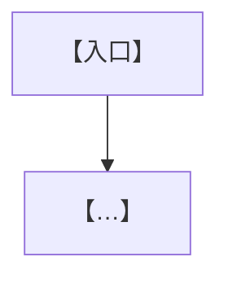

# 【项目/需求名】PRD

> 更新时间：【YYYY-MM-DD HH:MM】
> 状态：【PRD 评审版，用于业务与交付团队对齐】
> 语言要求：【全文只使用业务语言，不描述程序实现和技术选型】
> 核心目标：【一句话说清做什么、做完的标志】

## 一句话结论

【接入/新增后，做且只做哪几件事——用编号列 2~4 条。既有能力/职责继续成立，本次只新增/改动什么。】

## 背景

【为什么现在做：触发它的问题、机会或事故。当前哪里不够稳/不够用，逐条列。】

## 目标与非目标

### 产品目标

1. 【尽量可衡量的目标】
2. 【…】

### 非目标（必填，逐条具体）

> 本节写的是**当前边界**——本次及可预见的将来都不做的事。
> **「这次不做、以后想做」MUST NOT 写进这里**：它属于 `docs/TODO.md` 的〈想做的功能〉。写进非目标会随本 PRD 一起归档消失，而写进 TODO 才留得住；两者混在一起，读真相源的人也分不出哪些是故意不做、哪些是还没做。

1. 【不改变哪项现有业务职责】
2. 【不扩大到哪些用户或场景】
3. 【不影响哪些进行中的历史业务】

## 现状与当前逻辑

【现在这项业务如何运作：参与角色、业务环节、协作关系和当前结果。每条现状附事实来源注记：卡片命中时用 ctx 输出的 cite，本次现读源码的条目注明 `文件:行`，只有用户口述的注明"用户口述"，并在本节照抄规定的适用标注原文——取证顺序与标注原文见 `00-prd生成流程.md` §批 B → 现状怎么取证。复杂流程可配图。】

## 改动范围

【本次新增什么、改造什么。用表格逐项：对象 | 改造目标 | 备注。】

| 对象 | 改造目标 |
|---|---|
| 【…】 | 【…】 |

## 不改的现有业务（边界护栏）

【逐条列本次明确不动的业务流程、规则、职责和用户可见行为——防止交付越界。】

| 不改的现有业务 | 本次边界 |
|---|---|
| 【…】 | 【仍按线上原流程执行】 |

## 详细业务行为与信息要求

【逐条写清角色、场景、触发条件、业务动作、业务信息和可见结果。信息调整用表格：信息项 | 业务含义 | 提供者 | 使用者 | 规则。】

## 流程图

## UI 原型（如适用）

| 项 | 内容 |
|---|---|
| 原型文件 | 【docs/spec/YYYY-MM-DD-<name>-prototype.html；不涉及 UI 或纯文案改动时写“不适用 + 原因”】 |
| 覆盖路径 | 【原型覆盖的核心用户路径、页面和状态】 |
| 样式依据 | 【现有设计 token / 组件库 / 现有页面 / 截图 / 临时视觉假设，写清具体来源】 |
| 关键状态 | 【默认 / 加载 / 空态 / 错误或无权限 / 成功反馈等】 |
| 不在用户界面内展示 | 【面向 PM 的解释、设计理由、开放问题；指向单个元素的说明写成原型里该元素的 data-anno 悬浮气泡，整体性说明留在画布外的设计说明栏】 |

## 核心规则

【优先级、协作、前置条件、异常处理和人工兜底等业务规则，表格化。每种情况 → 处理方式。】

| 情况 | 处理 |
|---|---|
| 【…】 | 【…】 |

## 特殊场景与冲突

| 场景 | 处理 |
|---|---|
| 【同时或重复操作/信息迟到/前置条件不满足/失败/过期/跨阶段继续…】 | 【期望处理】 |

## 验收标准

### 业务信息验收

| 验收项 | 标准 |
|---|---|
| 【…】 | 【可勾验的明确预期】 |

### 流程与规则验收

| 验收项 | 标准 |
|---|---|
| 【…】 | 【…】 |

### 场景验收

| 场景 | 预期 |
|---|---|
| 【给定输入/场景】 | 【明确预期结果】 |

## 运营度量与看板

【协作面 = team 时必填，= solo 时可精简。说明上线后要回答哪些经营问题；关键指标带公式与统计粒度。】

| 指标 | 公式 | 粒度 |
|---|---|---|
| 【…成功率】 | 【分子 / 分母】 | 【按题/按轮/按动作】 |

## 风险与兜底

| 风险 | 说明 | 兜底 |
|---|---|---|
| 【…】 | 【…】 | 【…】 |

## 改动说明（changelog）

- 【YYYY-MM-DD HH:MM：本次补充/修订了什么。】
