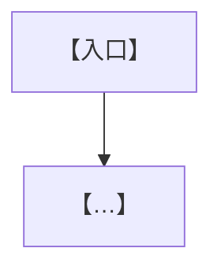

# 【项目/需求名】PRD

> 更新时间：【YYYY-MM-DD HH:MM】
> 状态：【PRD review 版，用于产品 / 研发对齐】
> 核心目标：【一句话说清做什么、做完的标志】

## 一句话结论

【接入/新增后，做且只做哪几件事——用编号列 2~4 条。既有能力/职责继续成立，本次只新增/改动什么。】

## 背景

【为什么现在做：触发它的问题、机会或事故。当前哪里不够稳/不够用，逐条列。】

## 目标与非目标

### 产品目标

1. 【尽量可衡量的目标】
2. 【…】

### 非目标（必填，逐条具体）

1. 【不重写 X】
2. 【不改 Y 状态机】
3. 【不为 Z 暂停/牺牲某能力】

## 现状与当前逻辑

【现在这块怎么运作：分层/主链路描述。团队版每条现状带 cite：`[cite: cards/<repo>.md#<域> @YYYY-MM-DD]`。复杂链路配 mermaid。】

## 改动范围

【本次新增什么、改造什么。用表格逐项：对象 | 改造目标 | 备注。】

| 对象 | 改造目标 |
|---|---|
| 【…】 | 【…】 |

## 不改的线上逻辑（边界护栏）

【逐条列本次明确不动的链路/接口/状态机——防止实现越界。】

| 不改的线上逻辑 | 本次边界 |
|---|---|
| 【…】 | 【仍按线上原流程执行】 |

## 详细行为与字段要求

【逐条写关键行为、数据结构/字段、触发条件。字段升级用表格：字段 | 定义 | 约束。行为规则表格化。】

## 流程图

## 核心规则

【调度/优先级/联动/补偿等规则，表格化。每种情况 → 处理方式。列出核心原则。】

| 情况 | 处理 |
|---|---|
| 【…】 | 【…】 |

## 边界 case 与冲突

| 场景 | 处理 |
|---|---|
| 【并发/迟到/依赖不满足/失败/过期/跨轮…】 | 【期望处理】 |

## 验收标准

### 字段/结构验收

| 验收项 | 标准 |
|---|---|
| 【…】 | 【可勾验的明确预期】 |

### 行为/调度验收

| 验收项 | 标准 |
|---|---|
| 【…】 | 【…】 |

### 场景验收

| 场景 | 预期 |
|---|---|
| 【给定输入/场景】 | 【明确预期结果】 |

## 埋点与看板

【团队版必填、个人版可精简。埋点要能回答哪些问题；关键指标带公式与统计粒度。】

| 指标 | 公式 | 粒度 |
|---|---|---|
| 【…成功率】 | 【分子 / 分母】 | 【按题/按轮/按动作】 |

## 风险与兜底

| 风险 | 说明 | 兜底 |
|---|---|---|
| 【…】 | 【…】 | 【…】 |

## 改动说明（changelog）

- 【YYYY-MM-DD HH:MM：本次补充/修订了什么。】
