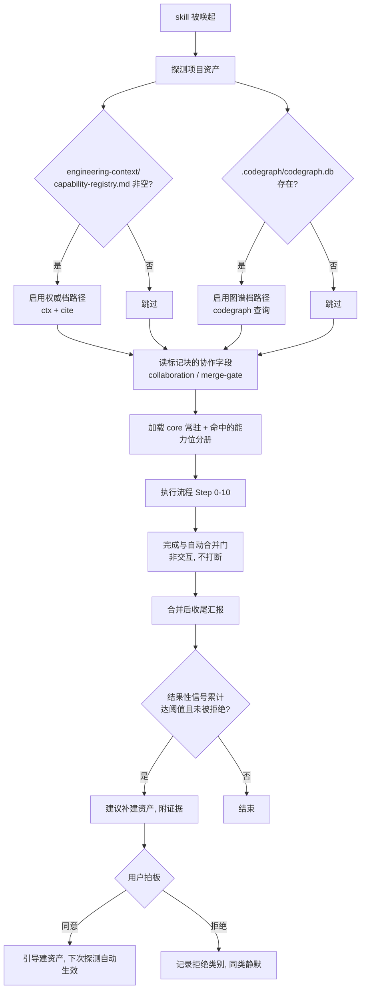
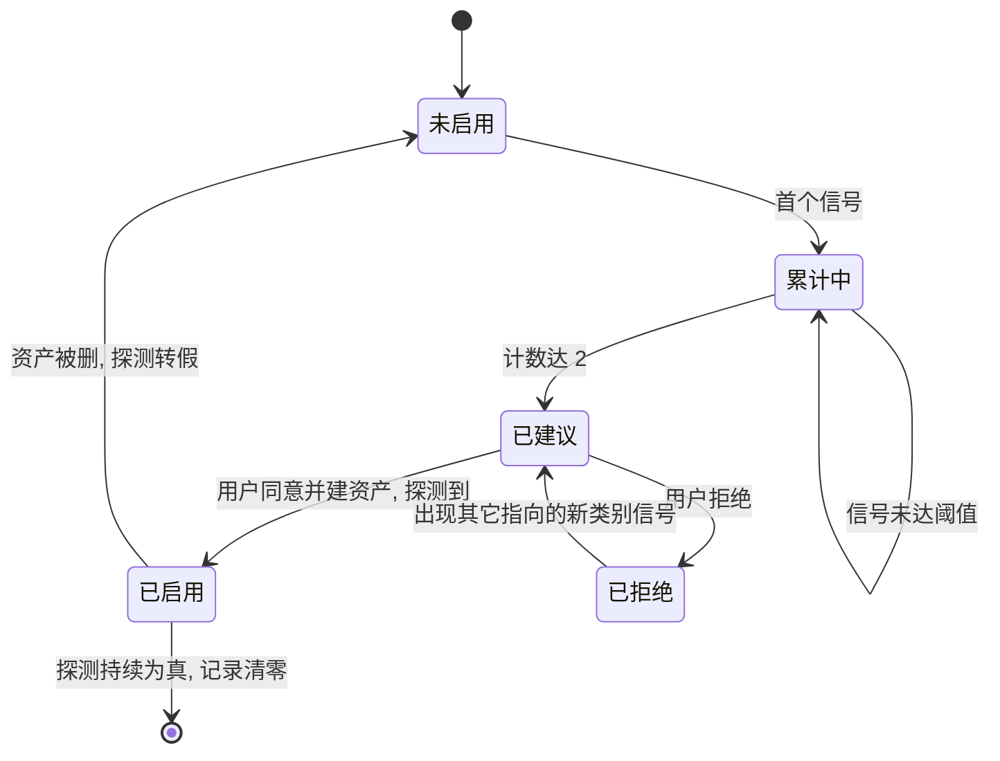

# ai-dev-system_技术 Spec — 项目真相源分层与 mode 二分重构

> 本仓库是方法论分发包，"实现"即 skill markdown + `install.mjs`。本 spec 的接口契约指**标记块格式与安装器契约**，数据模型指**标记块字段模型**。
> 遵循 `references/core/spec写作纪律.md`：零上下文可动手、RFC2119、无占位符。
> **本轮范围只到 spec 定稿**，不含实现。§8.1 兼容取舍未经用户拍板前，MUST NOT 进入 coding plan。
>
> **修订说明（2026-08-16 第二稿）**：第一稿经 Codex 与 Opus 5 两个独立子代理评审，共提出 4 项 P0、13 项 P1。本稿据此重写，主要变更有三：①**代码事实供给档位由标记块字段改为运行时探测**（消除配置漂移，原第一稿 §4 整套升降档对抗机制随之大幅简化）；②**协作维度保留独立字段**（第一稿主张它可以消失，被反例证伪，见 §2.3）；③标记块保留 `mode` 墓碑字段以消除双向迁移的硬失败窗口（见 §8.3）。第一稿中若干引证的过度解读已在 §2.1 逐条修正。

## 0. 阅读导引

**一句话目的**：删除失效的 `personal|team` 二分，让**代码事实供给方式由项目资产自动决定、协作约定由显式字段承载**，使任何项目都能对人和 AI 一律零上下文交接，并在项目长大时主动提示补建资产。

**端到端场景**：

1. 新人（或零上下文 agent）接手项目 → 从 `docs/index.md` 或 README 找到需求真相源 → 从架构真相源建立心智模型 → 从实现真相源定位到权威代码 → 无需任何人口头介绍即可动手。
2. 一个人的项目从 3 千行长到 5 万行 → agent 在若干次任务中因**改错了非权威实现**而返工 → 完成门后的收尾汇报里提示"建议建立代码图谱索引" → 用户同意 → 跑 `codegraph init`，下次唤起时探测到索引，供给方式自动切换。
3. 项目出现 v1/v2 并存的支付实现 → 代码评审残留轴命中"改了非权威副本" → 提示补 `capability-registry.md` 的**三行条目**（不是全套 card 体系）→ 探测到 registry 后自动启用权威档路径。
4. **异常**：用户拒绝建资产 → 记录拒绝类别，同类信号不再重复提示 → agent 在现有供给方式下继续工作，MUST NOT 因资产缺失而拒绝干活。

**核心流程图**：



**决策表**：

| 输入 / 状态 | 条件 | 走向 / 处置 | 结果 |
|---|---|---|---|
| `capability-registry.md` 存在且有非模板行 | — | 启用权威档路径 | `ctx` 优先，事实附 cite |
| `.codegraph/codegraph.db` 存在 | — | 启用图谱档路径 | 结构性检索走 codegraph |
| 两者皆无 | — | 直读档 | 直接读源码；大范围探索外包子 agent |
| 两者皆有 | — | 两条路径并存 | 权威判定用 card，结构检索用图谱 |
| 标记块缺 `collaboration` | 有旧 `mode` | 按 §8.3 映射 | `personal→solo`、`team→team` |
| 标记块缺 `collaboration` | 无旧 `mode` | 走初始化询问 | 写入两个协作字段 |
| 结果性信号累计达阈值 | 该类未被拒绝 | 合并后收尾汇报里建议 | 用户拍板 |

## 1. 范围

**做什么**：

- 废弃 `mode="personal|team"` 的行为分流作用（字段本身保留为墓碑，见 §8.3）。
- **代码事实供给方式改为运行时资产探测**，不再由配置声明（§3.2）。
- 新增两个协作字段 `collaboration` 与 `merge-gate`，承载探测不出来的协作约定（§3.3）。
- 定义三层真相源与能力位的对应关系，并**同步修改 `文档治理.md`** 使二者不冲突（§3.4）。
- 定义 core 与各分册的**外壳内容契约**——逐条说明现有 personal/team 外壳的每一条去哪（§3.5）。
- 重做升档提示：结果性信号、落点、状态转移（§4）。
- 给出受影响清单、按兼容门格式的待拍板项、双向迁移方案。

**不做什么**：

- 不实现。本轮仅产出本 spec。
- 不规定使用者的架构选择（是否拆仓、是否微服务）。
- 不新增运行时第三方依赖。**codegraph 不作为任何路径的硬依赖**（§3.3 图谱位可回退，理由见 §6.4）。

**本 spec 会改动 skill 之外的两处现行契约**（第一稿遗漏，评审指出）：

1. `references/core/文档治理.md` §2 索引分层的适用条件——现行按 mode 分（团队 MUST / 个人 SHOULD），mode 废弃后须改判据（§3.4）。
2. `scripts/ctx/src/commands.js` 的 `initScaffold`——需支持只生成 registry 的最小脚手架（§6.4）。§1 第一稿声称"不改 ctx CLI"与 §9 引导 `ctx init` 冲突，本稿纠正：**改**，但只加一个选项，不动命令语义。

## 2. 问题：现行二分为何失效

> **本节的引证已逐条回原文核对。** 第一稿有三处过度解读、一处选择性引用、一处事实错误，均在本稿修正并标注。

### 2.1 三个失效点（修正后表述）

**失效点 A — 个人版缺少跨会话的仓级消歧层。**

`references/personal/mode-personal.md:10` 规定「无 Engineering Context 层 / 无 ctx CLI。**个人项目仓库你自己熟**，直接读代码即可」。该条的前提是"人熟悉"，而 `references/core/上下文卫生.md:14` 规定「**编码任务零上下文起步**」「任务间 MUST NOT 依赖'上个任务的会话记忆'传递信息」。

> **第一稿称二者"互斥/自相矛盾"，此表述过强，本稿撤回。** 核对原文后：`上下文卫生.md:14` 讨论的是**同一次开发内任务间的信息传递**，且明确指定承载物是 coding plan 的 Interfaces；`上下文卫生.md:4` 更自述「个人版与团队版同样适用」。二者作用域不同，不构成同一 skill 内的逻辑互斥。
>
> **成立的表述是**：个人版**没有任何跨会话的仓级消歧承载物**。coding plan 只在一次开发内有效，plan 之外的"哪个是权威实现"没有落点。项目一大，这个空缺就会被 agent 用猜测填补。

**同时须记录一个现行的缓解路径**（第一稿选择性跳过，评审指出）：`上下文卫生.md:15` 规则 4 规定「大范围代码探索、全仓检索……SHOULD 交给子 agent……团队版优先用 `ctx`，其次才是子 agent 读码」。**个人版并非无路可走**，它有子 agent 外包这条路。因此本 spec MUST NOT 声称个人版"被明令退化为裸 grep"——原文说的是"不建 card 体系"（一个维护成本判断），既没有禁用工具，体系也另有外包路径。子 agent 外包解决的是"读得多"，不解决"哪个权威"，这才是空缺所在。

**失效点 B — 消歧成因大部分与协作规模无关。**

`references/company/context-engineering.md:9` 列出 AI 被误导的四个成因：相似命名、旧实现、重构中间产物、多仓副本。

> **第一稿称"其余三项是代码量 × 存活时间的函数"，此为本 spec 的推断而非原文表述，本稿改为标注为推断。** 另，第一稿称"多仓副本由多仓/协作产生"亦不准确——单人维护多仓、或单仓内的目录级副本同样成立。

成立的表述：四个成因中，只有"多仓副本"与仓库数量相关，而仓库数量与**人数**并无必然关系（一个人可维护 10 个仓，10 个人可共维护 1 个仓）。其余三项在单人单仓的长寿项目中同样成立。**因此以人数为轴分配消歧能力，与成因分布不匹配。**

**失效点 C — 加载条件把两个可独立变化的变量绑死。**

`references/company/mode-team.md:3` 写明加载条件为「多人多项目（5~20 人、10~30 仓）」。

> 第一稿据此称"该维度必然失效"，超出引文所能支撑的范围。**成立的表述**：该描述把人数与仓数绑成单一条件，因此"5 人 3 小仓"与"1 人 30 大仓"这两种真实组合都无法被正确路由——这是**覆盖缺口**，不是"维度失效"。

### 2.2 协作机制在纯 AI 开发下的归属重判

协作方从人变为 agent 后，多数 team 侧机制并未消失，但**并非全部**：

| team 机制 | 单人 + 多 agent 下 | 归属判定 |
|---|---|---|
| 三轴子代理评审 | `mode-personal.md:14` 已自述"子代理就是你唯一的第二双眼睛" | **升 core**（现已是 core，维持） |
| 小而可 review 的 PR 粒度 | agent 单次可产出 2000 行，粒度限制是人类唯一审查窗口 | **升 core** |
| 按边界拆 spec / 垂直切片 | 目的是让零上下文 agent 独立执行一个切片 | **升 core** |
| 文档作为交接载体 | agent 无跨会话记忆，文档是 agent 间唯一通信信道 | **升 core** |
| **owner 归属** | solo 项目不存在"别人的仓" | **保留在协作字段下** |
| **评审会** | solo 项目无人可评 | **保留在协作字段下** |
| **"不得要求业务用户理解技术方案后拍板"**（`mode-team.md:8`） | solo 项目的用户既是产品又是技术 | **保留在协作字段下** |
| **多仓合并顺序协商** | 单人多仓仍需顺序，但无需协商 | **保留在协作字段下** |
| **PR / CI / 保护分支门** | 与人数无关，取决于仓库配置 | **独立字段 `merge-gate`** |

> **第一稿第 1 行用 `context-engineering.md:50`（"哪个接口权威必须人确认"）去支撑"owner 归属存活"，引文与论点不对应，本稿删除该行。** 前者讲人在回路的权威确认，后者讲跨仓责任人归属（`mode-team.md:9`「改动别人仓库前先对齐 owner」），是两个概念。

### 2.3 协作维度不能删除（第一稿主张的证伪）

第一稿主张"纯 AI 开发下协作维度恒为真，常量不该做开关"，据此删除所有协作字段。**该主张被以下反例证伪，本稿撤回。**

**反例**：一个人维护的十万行遗留系统。按供给判据它需要权威档，于是加载由 `mode-team.md` 拆分而来的外壳，该外壳会告诉 agent：改动前先对齐 owner（`mode-team.md:9`）、跨 ≥3 仓开评审会（:12）、**"不得要求业务用户理解技术方案后拍板"**（:8）。而这个项目的用户就是开发者本人、既是产品又是技术（`mode-personal.md:8`）。结果：**agent 向不存在的 owner 求证，并对唯一的技术型用户隐藏技术细节**——这是新模型引入的、旧模型没有的确定性回归。

同理，`worktree开发纪律.md:40-41` 规定合并走"本地非快进合并"还是"推送 + PR + 平台自动合并"，取决于仓库是否有保护分支——这是项目级常量，与人数无关，也与代码规模无关，**必须有独立落点**。

**结论修正**：§2.2 证明的是"**大部分** team 机制应升为 core"，不是"所有协作差异都消失"。残留的协作差异 MUST 由显式字段承载（§3.3）。

### 2.4 personal 外壳的实际残留

`mode-personal.md` 十条默认逐条检验：

| 条目 | 内容 | 检验结果 |
|---|---|---|
| 1 | 默认走 Lean | **独有且成立**（见下方修正） |
| 2 | 可跳步（省 Step 2/3） | 理由是"没有协作方要对齐"，对 solo 成立，归入协作字段 |
| 3 | 不需要评审会 / owner | 对 solo 成立，归入协作字段 |
| 4 | 无 Engineering Context / 无 ctx | 被 §2.1 失效点 A 否定 |
| 5–10 | 目录 / 沟通 / worktree / 评审门 / 兼容 / 测试 | **原文即标注"不裁剪"**——它们是**否定式护栏**，防止 agent 从"轻量"推出"可省"，MUST 原样保留进 core（见 §3.5） |

> **第一稿称条目 1「Triage 四问已覆盖，不需要 mode 承载」，此为事实错误，本稿更正。** `00-流程总纲.md:53-54` 原文：「**个人版**：默认所有需求先假设走 Lean Spec，只有自己都 hold 不住的复杂改动才升级。**团队版**：跨仓 / 影响面不清时，宁可升级到 Step 2 出 Overview」——两档的**默认假设方向相反**，这正是 Triage 之外、由 mode 承载的东西。
>
> 但该差异的正确归属**不是协作维度**：一个人维护的十万行单体，"默认假设走 Lean"是危险的；一个 5 人小组维护的 3 千行工具，"宁可升级出 Overview"是浪费。**默认假设方向应随代码事实供给档位走**（直读档默认 Lean，权威档默认升级），见 §3.5。

第一稿"personal 外壳实质为空"的结论**过强，本稿撤回**：外壳有两条独有内容（默认假设方向、memory 约定）与六条否定式护栏，它们不会消失，只是改换承载位置。

### 2.5 两个错配象限

| 象限 | 现判定 | 实际后果 |
|---|---|---|
| **单人 / 大仓**（一人维护的十万行遗留系统） | personal | 无任何跨会话消歧承载物；子 agent 外包能缓解"读得多"，不解决"哪个权威" |
| **小团队 / 小仓**（4 人 / 3 个各 5 千行服务） | team | 被要求建 card + registry + scene + probe 全套，成本远超收益。`context-engineering.md:11` 自述"一个看起来权威但已过期的来源，比没有来源更危险"——**烂尾的 card 层是负资产** |

### 2.6 为什么不能只把 team 机制升 core 就收工

§2.2 的直接推论是"把多数 team 机制升为 core"，这一步**非破坏、零迁移成本**，且能止住象限 2 的部分伤害。但它单独**不能**关闭本 spec 要解决的问题：

1. 象限 1 的空缺（单人大仓无消歧层）需要的是"**按项目实际需要启用消歧能力**"，升 core 不提供这个开关——除非把 Engineering Context 无条件升为 core，那就等于要求 3 千行的项目也建 card，直接制造象限 2。
2. `文档治理.md:66` 的索引分层判据、`00-流程总纲.md:53-54` 的默认假设方向，都**显式引用 mode**。mode 若保留原语义，这些判据继续按人数分配，覆盖缺口不变。
3. 因此必须有一个**替代判据**。本 spec 主张该判据不应是新的配置字段（会同样漂移），而应是**可观测的项目资产**（§3.2）。

## 3. 新模型

### 3.1 目标（本重构的验收标尺）

**项目对任何接手者——人或 agent——都做到零上下文交接**：需求、架构、实现三层真相源均能从项目自身定位，无需任何人口头介绍。

真相源**层次固定为三层**，各层的**承载形态**随项目资产变化。可验证形式见 §3.6。

### 3.2 代码事实供给方式：探测，不是配置

**核心设计决定**：供给方式 MUST 由运行时探测项目资产得出，MUST NOT 写成标记块字段。

| 探测项 | 判定条件 | 启用的能力位 |
|---|---|---|
| `engineering-context/capability-registry.md` | 文件存在，且**除模板注释与表头外至少有一行数据行** | `curated`（权威位） |
| `.codegraph/codegraph.db` | 文件存在 | `graph`（图谱位） |
| 以上皆无 | — | 直读（无附加能力位） |

**为什么不设字段**：档位若写成配置，就会与项目实际状态漂移——项目长大、card 烂尾、索引被删，配置都不会自己变。第一稿为对抗这种漂移，不得不引入升档机制、降档规则、信号账本与拒绝记忆四套装置，**这是自造问题再自造解药**。探测得到的结论永远与项目当前状态一致，上述四套装置中的三套（降档、档位漂移修复、档位一致性校验）随之消失。

> 这同时消除了第一稿的另一处矛盾：§5 曾以"同一项目的人数会变，配置会过期"为由拒绝给协作维度设字段，却给更易变的供给档位设了字段。本稿的判据统一为：**探测得出来的不设字段，探测不出来的才设字段。**

**探测成本**：三次 `fs.existsSync` + 一次小文件读取，在 skill 唤起时的路由阶段完成，MUST NOT 放进任何流程门内部。

### 3.3 能力位是正交的，不是有序三档

第一稿把三者排成 `direct < graph < curated` 的有序链，导致 §3.2 矩阵（curated 列写"同左 +"，即 curated ⊇ graph）与 §3.3 判据（允许"读得完但有歧义"→ curated）冲突：一个不需要索引的小项目被要求同时具备 codegraph 与全套 card。**本稿改为正交能力位。**

| 能力位 | 回答的问题 | 承载物 | 与其它位的关系 |
|---|---|---|---|
| **图谱位** | "**找得到**吗"（检索） | codegraph 索引；**缺失时回退子 agent 重探索外包**（`上下文卫生.md:15` 规则 4） | 独立 |
| **权威位** | "**信哪个**"（消歧） | `capability-registry.md`，按需递进到 card / scene / probe | 独立 |

两位可任意组合，四种状态均合法：无（直读）、仅图谱、仅权威、两者兼备。**权威位不蕴含图谱位**：一个 3 千行但有 v1/v2 并存的项目，只需 registry 三行，不需要索引。

**对外沟通用的档位名**（仅用于与用户对话，MUST NOT 作为配置值或判据）：无能力位称"直读"，仅图谱称"图谱档"，含权威位称"权威档"。

### 3.4 三层真相源与能力位的对应

| 真相源层 | 无能力位 | 图谱位 | 权威位 |
|---|---|---|---|
| **需求** | README 一节 或 `docs/index.md`（**二选一即可**） | 同左；文档数 >20 篇时 SHOULD 升为 `docs/index.md` + `REQUIREMENTS.md` | 同左 |
| **架构** | README 一节"架构与边界"（模块划分 / 各自职责一句话 / 对外边界 / 不做什么，可短至 10 行） | SHOULD 升为 `docs/ARCHITECTURE.md` | 同左；**跨服务场景存在时**才补 `engineering-context/scenes/` |
| **实现** | 代码本身 + 子 agent 外包探索 | codegraph 查询 | `ctx` + cite；结构检索仍走图谱位（若有） |

**与现行 `文档治理.md` 的冲突及其解决**（第一稿遗漏，评审指出）：

`文档治理.md:66` 现行规定「索引分层（MUST，团队版；个人版 SHOULD）」，:73 规定「**项目没有 `docs/index.md` 时**（个人版常见）：只做'改 frontmatter + 插入归档头注'两个动作，**MUST NOT 为了归档而临时造一个索引**」。第一稿要求所有档位都必须有 `docs/index.md`，与之直接冲突。

**本稿的解决**：

1. 上表需求层放宽为"README 一节**或** `docs/index.md` 二选一"，与 `文档治理.md:73` 相容。
2. `文档治理.md:66` 的判据 MUST 从"团队版 / 个人版"改为**文档数量**：现行区文档 >20 篇时 MUST 分层，否则 SHOULD。理由：索引分层要解决的是"索引长到没人读"，这是文档数量的函数，与人数和代码规模都无必然关系。
3. **上表的 SHOULD 项不由初始化创建**。初始化只检查并报告缺失，由用户决定何时补。MUST 项（三层各有其一）在初始化时若缺失，MUST 报告为"零上下文交接缺口"，但 MUST NOT 阻断流程——旧项目补齐需要时间。

> **第一稿声称"任何档位 MUST 三层齐全"却未定义谁来创建，导致仅改标记块不会让已有项目获得三层真相源，自身的 MUST 落空。** 本稿以上述第 3 条关闭该缺口。

### 3.5 外壳内容契约（现有两个外壳的逐条去向）

> 第一稿只规定了档位在真相源形态上的差异，未定义被删外壳的替代内容，导致首批任务无法零上下文动手。本节关闭该缺口。

**文件结构**：

```
references/
  core/                       常驻，与项目形态无关
  collab/
    solo.md                   collaboration="solo" 时加载
    team.md                   collaboration="team" 时加载
  capability/
    graph.md                  探测到图谱位时加载
    curated.md                探测到权威位时加载
    context-engineering.md    权威位的完整设计（原 company/ 下同名文件移位）
```

**逐条去向表**（覆盖现有两个外壳与两个 config-snippet 的全部条目）：

| 现有条目 | 出处 | 去向 |
|---|---|---|
| 六条"不裁剪"护栏（目录 / 沟通 / worktree / 评审门 / 兼容 / 测试） | `mode-personal.md:11-16` | **core**，且 MUST 保留其否定式措辞——它们的价值就是阻断"轻量⇒可省"的推断 |
| 默认走 Lean vs 宁可升级 | `mode-personal.md:7`、`00-流程总纲.md:53-54` | **capability/**：无能力位 → 默认 Lean；含权威位 → 影响面不清时宁可升级 |
| 可跳步（省 Step 2/3） | `mode-personal.md:8` | **collab/solo.md** |
| 个人 memory 约定 | `mode-personal.md:28-34` | **core**（对团队同样成立） |
| owner 归属、评审会、业务方 vs 你拍板 | `mode-team.md:8-13` | **collab/team.md** |
| 按仓拆 spec、垂直切片拆 Issue | `mode-team.md:15-18` | **core**（泛化为"按边界拆"：仓 / 模块 / 限界上下文） |
| PR 粒度、评审门是 PR 前地板、死代码检查挂 PR gate | `mode-team.md:20-23` | **core**（粒度）+ **collab/team.md**（PR 平台动作） |
| 保护分支自动合并 vs 本地合并 | `mode-team.md:25`、`worktree开发纪律.md:40-41` | **`merge-gate` 字段**（§5） |
| 多仓合并顺序 | `mode-team.md:25` | **core**（顺序）+ **collab/team.md**（协商） |
| `REQUIREMENTS.md` / `ARCHITECTURE.md` / 索引分层 | `mode-team.md:28-31` | **core**，判据改为文档数量（§3.4 第 2 条） |
| 准出归并 PRD、结算文档生命周期 | `mode-team.md:32-33` | **core** |
| `ctx` 调用方式、业务全景门限、cite 纪律、检索纪律、clone 决策树 | `mode-team.md:39-58` | **capability/curated.md** |
| 新鲜度纪律、会话开始看增量 | `mode-team.md:60-65` | **capability/curated.md** |
| 兼容由"你"拍板 vs 由"业务方"拍板 | 两个 snippet | **collab/**：solo → 你；team → 业务方 |
| "开发全程独立 worktree" vs "每个仓库全程独立 worktree" | 两个 snippet | **core**（单仓表述）+ **core 多仓节**（多仓时每仓一个，与人数无关） |
| worktree 目录设置 | 两个 snippet 末尾第二条 | **标记块字段**，见 §5（第一稿数据模型遗漏此项） |

**config-snippet 结构**：由 `{personal,team}.md` 改为 `base.md`（无条件注入）+ `collab-{solo,team}.md`（二选一）。**能力位不进 snippet**——它是探测结果，写进静态配置就会漂移。

> 这同时关闭了 CLAUDE.md §改动时注意 中"codegraph 不得写进任何 skill 的 references/ 或 config-snippet"的边界问题：codegraph 只出现在 `capability/graph.md` 的**可回退**描述里，且 §6.4 明确它非硬依赖。本 spec 会同步更新 CLAUDE.md 该条与 `docs/spec/2026-08-14-codegraph自动安装与索引-lean-change-spec.md`。

### 3.6 零上下文交接的可验证性

§3.1 的目标 MUST 可验证。第一稿设计的四道开放式问答题**不满足 `ctx probe` 的两条硬约束**（机器可判定、探针自防腐，见 `context-engineering.md:79-89`），本稿改为可脚本化的**可达性检查**：

| 检查项 | 判定方式 | 通过标准 |
|---|---|---|
| 需求真相源可达 | 从 README 或 `docs/index.md` 出发，链接跳转 | ≤2 跳到达 |
| 架构真相源可达 | 同上 | ≤2 跳到达 |
| 实现真相源可用 | 无能力位：架构节列出的模块路径均存在；图谱位：索引可查询；权威位：`ctx list-services` 非空 | 全部成立 |
| 设计理由可追 | `docs/index.md` 现行区各 spec 的 `authority_refs` 非空 | 全部成立 |

四项均为机器可判定，MUST 作为新题型进入 `ctx probe`，并**与现有探针共用 `authority_refs` 自防腐机制**（`context-engineering.md:89`）。**该实现列入本重构的范围**（§11），不再作为"仅冻结设计"外推——否则本重构的核心目标无法被验证。

## 4. 补建资产提示（原"升档提示"）

探测消除了档位漂移，但**不能回答"你现在没有、但该有了"**。该提示是用户明确要求的能力，保留，但按评审意见重做。

### 4.1 信号必须是结果性的，不是努力量

> 第一稿用"≥3 次 grep""读了 ≥5 个文件"作信号。**这是正常工作量，不是失败**——任何非平凡改动都能凑齐，机制会在几乎所有项目上误触发，用户学会一律拒绝后即失效。本稿改用已有留痕的**结果性**信号。

| 信号 | 来源（均已存在，无需新增采集） | 指向 |
|---|---|---|
| 代码评审残留轴命中"改了非权威副本 / 旧实现未清理" | 评审报告（`代码评审纪律.md` 三轴） | 权威位 |
| `bug修复历史.md` 新增条目的根因为"改错了实现 / 被旧实现误导" | `bug诊断纪律.md` Phase 3 归档 | 权威位 |
| 一次任务内被迫 clone 或全仓检索 ≥2 个此前未登记的模块 | Step 1 既有系统清单 | 图谱位 |
| 替换清单出现"同一逻辑的多处副本" | spec §8.2 | 权威位 |

**阈值**：同一指向累计 **2 次**触发一次建议。

> 阈值依据（第一稿无依据）：结果性信号每次都对应一次真实返工或一条 bug 记录，单次即有说服力；取 2 是为排除偶发误判，同时避免让用户承受第三次同类损失。该值 SHOULD 在首个版本发布后按真实反馈调整，并记录调整理由。

### 4.2 落点与时机

- **采集点**：信号产生处即写入（评审报告落盘时、bug 归档时、spec 定稿时），MUST NOT 留到完成门再回忆——回忆只能覆盖当前会话，等于退化为单会话计数。
- **判定与提示点**：**合并完成后的收尾汇报**，MUST NOT 放进完成与自动合并门内部。

> 理由（评审指出，第一稿设计错误）：`worktree开发纪律.md:38` 规定「满足完成条件后，**无需再次询问用户**，自动合并任务分支」——完成门是**非交互门**。把需要用户拍板的提问挂进去，要么阻塞自动合并，要么提示被合并流程冲掉。同时完成门要求"worktree 状态干净"，而写账本本身产生新改动，会形成"记账→不干净→过不了门"的死循环。

- **账本位置**：`docs/report/资产补建信号.md`，属报告类账本，遵循 `文档治理.md` 的 `lifecycle` 与索引规则，**在任务分支内随信号产生而提交**（因而受完成门的"干净"要求约束，而非违反它）。
- **合并失败时**：worktree 按 `worktree开发纪律.md` §失败与阻塞 保留，账本随分支留存，下次继续累计——**任务失败恰是最强信号，MUST NOT 丢弃**。

### 4.3 状态与转移

> 第一稿 §10 称"状态机不适用"。**这是错的**（评审指出）：拒绝抑制、跨会话计数、清零、迁移提示都需要持久状态。本节补齐。

每个能力位维护一条状态记录，字段：`指向`（图谱位 / 权威位）、`计数`、`已拒绝`（布尔）、`拒绝日期`、`最近信号摘要`。



- **清零**：探测到该能力位资产后，对应记录清零并记升级日期。
- **拒绝失效**：`已拒绝` 仅抑制**同一指向**的提示；出现另一指向的信号时独立走自己的状态。
- **资产消失**：探测转假时状态回落，MUST NOT 报错——用户可能有意删除。若该位曾为"已启用"且资产是被烂尾删除的，SHOULD 在收尾汇报提示一次（对应 `context-engineering.md:11` 的"过期权威源比没有更危险"）。

## 5. 数据模型：标记块

```
<!-- ai-dev-workflow:start -->
> **本项目采用 ai-dev-workflow**
> (mode="team" collaboration="solo|team" merge-gate="direct|pr" worktree-dir="./.worktrees/")
> ...正文...
<!-- ai-dev-workflow:end -->
```

| 字段 | 值域 | 必填 | 语义 |
|---|---|---|---|
| `collaboration` | `solo` \| `team` | 是 | 是否存在其他人类协作方。决定 owner 对齐、评审会、由谁拍板兼容、是否可省 Step 2/3 |
| `merge-gate` | `direct` \| `pr` | 是 | 合并走本地非快进合并还是推送 + PR + 平台自动合并（`worktree开发纪律.md:40-41`） |
| `worktree-dir` | 路径 | 是 | worktree 目录，默认 `./.worktrees/`。**第一稿数据模型遗漏此项**，而两个 snippet 末尾第二条与 SKILL.md §关键纪律 都要求"每次从本设置读取" |
| `mode` | 恒为 `team` | 是 | **墓碑字段**，新版 skill 完全忽略。存在的唯一目的见 §8.3 |

**代码事实供给不设字段**——探测得出（§3.2）。

## 6. 接口契约

### 6.1 安装器（`install.mjs`）

| 契约点 | 现状 | 目标 |
|---|---|---|
| `getWorkflowMode`（`install.mjs:382-385`） | `/mode="(personal\|team)"/` | 保留该正则用于识别旧块；新增 `collaboration` / `merge-gate` 解析 |
| 标记块校验（`install.mjs:1032-1034`） | 块存在但读不出 mode 即 `throw` | 改为：块存在但读不出**任何**已知字段才报错；只有 `mode` 无协作字段 → 走迁移改写；有协作字段 → 正常 |
| snippet 选择（`install.mjs:1036-1038`） | `${workflowMode}.md` | `base.md` + `collab-${collaboration}.md` |
| 双入口幂等同步（`install.mjs:1216`） | 同步 mode 块 | 逻辑不变，同步新块 |
| 混合状态 | 未定义 | MUST 定义四种组合的处置（§8.3） |

### 6.2 skill 路由

`ai-dev-workflow/SKILL.md` §路由逻辑 MUST 改为：①探测资产得能力位；②读标记块得协作字段；③加载 core + 命中的 `capability/` 分册 + 对应 `collab/` 分册。

`ai-prd/SKILL.md` 同构。**注意其特殊性**（第一稿遗漏，评审指出）：`ai-prd/SKILL.md:33-34` 规定"无标记 → 本会话临时问一次，但**不写文件**"，因此"读到旧值提示升级一次"在 ai-prd 侧**无法保证只提示一次**。本稿的解决：ai-prd **不提示迁移**（迁移是 ai-dev-workflow 与安装器的职责），且因能力位改为探测、协作字段可缺省为 `solo`，**ai-prd 在无标记块时不再需要询问**——直接探测 + 缺省即可，该临时询问分支删除。

两个 `SKILL.md` 的 **frontmatter `description`** 均含 mode 表述，MUST 同步改写。`description` 直接决定 skill 触发，属行为契约变更，MUST 过 `docs/spec/2026-07-16-skill写作自检清单.md`。

### 6.3 目录约定

| 现状 | 目标 |
|---|---|
| `references/personal/mode-personal.md` | 删除，内容按 §3.5 分散 |
| `references/company/mode-team.md` | 删除，内容按 §3.5 分散 |
| `references/company/context-engineering.md` | `references/capability/context-engineering.md` |
| — | 新建 `references/collab/{solo,team}.md`、`references/capability/{graph,curated}.md` |
| `ai-prd/references/mode-{personal,team}.md` | 同构改为 `ai-prd/references/collab/{solo,team}.md` |

### 6.4 `ctx` CLI

**改动一（必须）**：`initScaffold`（`commands.js:157-168`）现一次性生成 `cards/`、`scenes/`、`capability-registry.md`、`probe-set.md`、`glossary.md` 全套。这会让 §3.3"三行 registry 即可"的承诺落空——用户被引导后拿到五个待填文件，正是 §2.5 象限 2 的复现路径。MUST 新增 `ctx init --minimal`，只生成 `capability-registry.md`。§9 的引导动作改用该选项。

**registry-only 的最小合法 schema**（第一稿未定义）：现行模板要求 8 列。最小形态 MUST 保留 `Capability` / `权威实现` / `陷阱项（废弃或中间产物）` 三列，其余列 MAY 留空；`ctx discover` 对空列 MUST 跳过而非报错。`freshness` 留空时 `ctx` MUST 在输出中标注"未声明新鲜度"，MUST NOT 假定新鲜。

**改动二（同步）**：`commands.js:226` 的 init stub 含"团队版"表述，需同步改写（CLAUDE.md §改动时注意 规定 stub 与 `assets/context-layer/` 模板必须同步）。

**codegraph 非硬依赖**：图谱位缺失 codegraph 时，MUST 回退到子 agent 重探索外包（`上下文卫生.md:15` 规则 4），MUST NOT 阻断流程，MUST NOT 退回无策略的裸 grep。这关闭了第一稿 §12.2 的开放项——**该问题是设计决策，不得留作待澄清**。

## 7. 受影响清单

分两类维护（第一稿只做了值域一类，遗漏路径/API 契约类）。

### 7.1 值域命中清单

核对命令（可复现，在仓库根执行，排除 `orgin/`）：

```bash
grep -rln '个人版\|团队版\|mode="personal"\|mode="team"' \
  --include='*.md' --include='*.mjs' --include='*.js' . \
  | grep -v '^./orgin'
```

| 类别 | 数量 | 内容 |
|---|---|---|
| skill 内 `.md` | 36 | 见 §7.3 分类 |
| skill 内非 `.md` | 1 | `scripts/ctx/src/commands.js:226` |
| 仓库自身文档（非历史） | 6 | `CLAUDE.md`、`README_zh.md`、`docs/spec/2026-07-06-ai-dev-system-design.md`、`docs/spec/2026-07-06-ai-prd-design.md`、`docs/spec/2026-08-14-codegraph…`、`docs/spec/2026-08-16-ctx全局命令安装…` |
| 安装器 | 1 | `install.mjs` |
| 测试 | 1 | `test/install-and-doc-governance.test.mjs` |

> 第一稿称仓库文档 5 个并列入 `docs/index.md`——后者实际零命中，且漏掉两份仍在 `docs/index.md:14-15` 现行索引中的 active spec。已更正。
>
> `docs/plan/` 两份历史计划与 `ai-dev-system/migrations/*.md` 属历史记录，MUST NOT 改写（改写会破坏可追溯性）；须确认其已在 `docs/index-archive.md` 标注归档（列入 §11）。

### 7.2 路径 / API 契约清单（第一稿完全遗漏）

以下文件不含上述值域字符串，但引用了将被移动或改变的**路径与 API**：

- `ai-dev-workflow/SKILL.md:49,70-71` — 路由逻辑与外壳路径；**frontmatter `description` 亦含 mode 表述**
- `ai-prd/SKILL.md:32,38-39` — 同上
- `scripts/ctx/README.md:119` — 旧路径引用
- `scripts/ctx/src/semantic.js:6` — 旧路径引用
- `docs/spec/2026-07-14-源头对齐基线与回灌机制.md:29,40` — **active spec**，含旧路径
- `references/core/文档治理.md:66,73` — 索引分层判据（§3.4 第 2 条要改判据本身）
- `references/core/worktree开发纪律.md:40-41` — 合并分支判据（改由 `merge-gate` 承载）
- `references/core/00-流程总纲.md:53-54,120-134` — 默认假设方向 + 整张"个人版 vs 团队版裁剪对照"表

### 7.3 skill 内 36 个 `.md` 的分类

**A 类 — 结构性改写（新建 / 删除 / 移位 / 语义决策），14 个**

`mode-personal.md`（删）、`mode-team.md`（删）、`ai-prd/references/mode-personal.md`（删）、`ai-prd/references/mode-team.md`（删）、`context-engineering.md`（移位）、两个 `config-snippet`（重构为 base + collab）、`init-初始化.md`（8 处，重写提问与注入）、两个 `SKILL.md`（路由 + description）、`00-流程总纲.md`（含整张裁剪对照表，需逐行重新归属）、`文档治理.md`（判据改为文档数量）、`步骤-1-7-设计与实现.md`（Overview 必做/跳过，纯协作语义）、`代码评审纪律.md`（:37 子代理 prompt 模板硬编码 `本项目 mode =【personal / team】`，属数据模型引用）

> 第一稿把后四项归入"判据引用改写"的 B 类。评审指出它们是**语义决策**而非机械替换，已上提至 A 类。

**B 类 — 判据引用机械改写，10 个**

`环境冲突扫描.md`(3)、`bug诊断纪律.md`(2)、`上下文卫生.md`(2)、`步骤-8-10-测试.md`(2)、`测试资产纪律.md`(1)、`spec写作纪律.md`(1)、`worktree开发纪律.md`(1)、`路径-lean.md`(1)、`ai-prd/references/00-prd生成流程.md`(7)、`ai-prd/references/prd质量清单.md`(3)

**C 类 — 模板与一句话提及，12 个**

`eng-spec.md`(2)、`coding-plan.md`(2)、`test-spec.md`(2)、`overview.md`(1)、`lean-change-spec.md`(1)、`capability-registry.md`(1)、`ai-prd` 的 `prd写作纪律.md`(2)、`change-prd.md`(2)、`业务语言纪律.md`(1)、`UI原型纪律.md`(1)、`lite-issue-prd.md`(1)、`question-bank.md`(1)

> **计数自检**：A(14) + B(10) + C(12) = 36，与 §7.1 的 skill 内 `.md` 命中数一致。

## 8. 兼容性 / 迁移

### 8.1 兼容取舍决策（**待用户拍板，spec 定稿前 MUST 完成**）

> 第一稿此表列的是实现方案选项（"字段是否保留""目录是否转发"），**违反 `00-流程总纲.md:79-94` 兼容门格式**——该门要求每条给三个固定选项（不兼容 / 兼容一段时间 / 永久兼容）+ 推荐 + **只讲业务影响**，不讲实现方案。本稿按该格式重写。

**第 1 条：已安装项目的"个人版 / 团队版"这个概念消失**

- 谁受影响：所有已安装本体系的项目及其使用者。他们熟悉"这个项目是个人版"这套说法，升级后改为"有无协作方"+"项目自己有什么资产"。
- 影响多久：一次性认知切换，升级即发生。

| 选项 | 业务含义 | 代价 |
|---|---|---|
| **不兼容** | 升级后旧说法立即消失 | 使用者需重新理解一次；文档一致，无长期包袱 |
| **兼容一段时间**（推荐） | 升级后旧说法在提示里保留一个版本，同时展示新说法，下一版本移除 | 需在提示文案里维护两套说法约一个版本周期 |
| **永久兼容** | 两套说法长期并存 | 概念永久二义，新使用者更难理解 |

> 推荐"兼容一段时间"：概念切换比字段切换更依赖人适应，给一个版本的过渡期成本很低。

**第 2 条：已选"个人版"的项目，其"默认走最短流程"的假设可能改变**

- 谁受影响：现为个人版、且代码规模已经很大或存在新旧实现并存的项目。升级后若探测到权威资产，默认假设会从"先假设走 Lean"变为"影响面不清时宁可升级"。
- 影响多久：长期，每次需求分流都受影响。

| 选项 | 业务含义 | 代价 |
|---|---|---|
| **不兼容**（推荐） | 升级后按项目实际资产决定默认假设 | 部分小改动会被要求多写一份 Overview；但象限 1 的风险被止住 |
| **兼容一段时间** | 保留旧默认到某到期日，到期切换 | 需维护两套分流判据；到期日前风险仍在 |
| **永久兼容** | 永久保留"个人版默认 Lean" | 单人大仓的误判风险永久保留——这正是本次要修的问题 |

**第 3 条：已选"团队版"的小项目，不再被要求维护全套 Engineering Context**

- 谁受影响：现为团队版但代码量小、无新旧并存的项目。升级后若未探测到 registry，权威档路径不再启用。
- 影响多久：长期。

| 选项 | 业务含义 | 代价 |
|---|---|---|
| **不兼容** | 升级后立即按资产判定，未建 registry 的项目回到直读 | 若团队本打算建但还没建，会短暂失去引导 |
| **兼容一段时间**（推荐） | 已声明团队版的项目，升级后首次唤起时提示一次"未检测到权威资产，是否建立"，用户确认后再按资产判定 | 多一次提示 |
| **永久兼容** | 保留 team 声明的强制效力 | 象限 2 的负担永久保留 |

**第 4 条：合并方式由"版本类型"改为项目显式声明**

- 谁受影响：所有已安装项目。此前团队版默认走 PR、个人版默认本地合并；升级后由 `merge-gate` 显式声明。
- 影响多久：长期，每次合并都受影响。

| 选项 | 业务含义 | 代价 |
|---|---|---|
| **不兼容** | 升级时必须回答一次合并方式 | 多问一个问题 |
| **兼容一段时间**（推荐） | 升级时按旧版本类型自动推断（团队→PR、个人→本地）并告知，用户可当场改 | 推断可能不符实际，但已告知且可改 |
| **永久兼容** | 继续按版本类型隐式决定 | 版本类型已废弃，无处可依 |

**第 5 条：升级后会新增"资产补建建议"这类主动提示**

- 谁受影响：所有已安装项目的使用者。此前体系从不主动建议改变项目配置。
- 影响多久：长期，但每类最多提示一次（拒绝后同类静默）。

| 选项 | 业务含义 | 代价 |
|---|---|---|
| **不兼容**（推荐） | 直接启用，按 §4 的阈值与拒绝规则 | 使用者会收到新类型的提示；已设计为低频且可永久拒绝 |
| **兼容一段时间** | 首个版本只记录不提示，下版本启用 | 象限 1 的问题晚一个版本才被发现 |
| **永久兼容** | 不启用主动提示 | 项目长大后无人提醒，回到今天的状态 |

**第 6 条：版本号与升级动作** — **已由用户拍板：`2.0.0`（确认于 2026-08-16）**

- 谁受影响：使用 `--ref=v<版本>` 锁版本的用户，以及所有需要重跑安装器的项目。
- 到期动作：`mode` 墓碑字段在 `3.0.0` 移除（与 §8.2 替换清单的到期日一致）。

### 8.2 替换清单

| 被取代物 | 类型 | 取代者 | 处置 | 保留理由 + 到期日 |
|---|---|---|---|---|
| `mode` 的行为分流作用 | 标记块字段语义 | 探测 + `collaboration` | 语义废止，字段留存 | **墓碑，见 §8.3；到期日 `3.0.0`** |
| `references/personal/mode-personal.md` | 文档 | core + `collab/solo.md` + `capability/` | 删除 | — |
| `references/company/mode-team.md` | 文档 | core + `collab/team.md` + `capability/curated.md` | 删除 | — |
| `references/company/` 目录 | 目录 | `references/capability/` | 删除 | — |
| `assets/config-snippets/{personal,team}.md` | 配置片段 | `base.md` + `collab-{solo,team}.md` | 删除 | — |
| `ai-prd/references/mode-{personal,team}.md` | 文档 | `ai-prd/references/collab/` | 删除 | — |
| `ai-prd` 的"无标记块时临时询问 mode"分支 | 逻辑 | 探测 + 缺省 `solo` | 删除 | — |
| `00-流程总纲.md` §个人版 vs 团队版裁剪对照表 | 文档章节 | 按 §3.5 分散到 core / collab / capability | 删除 | — |
| `文档治理.md:66` 按 mode 的索引分层判据 | 判据 | 按文档数量（>20 篇） | 替换 | — |
| `install.mjs` 的 mode 正则 | 代码 | 保留识别旧块 + 新字段解析 | 保留至 `3.0.0` | 迁移未完成；与墓碑字段同期移除 |

> 保留例外两条，均属"数据迁移未完成"类，到期日一致（`3.0.0`）。

### 8.3 迁移方案

**墓碑字段的作用（关键设计）**：

skill 目录被安装器写入 `.gitignore`（**不入库**），而 `CLAUDE.md` / `AGENTS.md` **入库**。因此"开发者 A 升级并提交新标记块、开发者 B 未重跑安装器"是**必然窗口**。若新标记块不含 `mode`，B 的旧 skill 读不到 mode → 判为"无标记块" → **再问一次 mode**，违反 SKILL.md §关键纪律「不问第二次 mode」；旧 `install.mjs:1032-1034` 还会直接 `throw`。

**解决**：新标记块 MUST 保留 `mode="team"`。取 `team` 而非 `personal`，因为团队版是行为超集（更多门禁、更保守），旧 skill 误读时偏向安全侧。新版 skill 完全忽略该字段。

**四种混合状态的处置**（第一稿未定义，评审指出）：

| CLAUDE.md | AGENTS.md | 处置 |
|---|---|---|
| 新块 | 新块 | 正常 |
| 新块 | 旧块 | 以 CLAUDE.md 为准，幂等同步至 AGENTS.md（沿用 `init-初始化.md` 现行规则） |
| 旧块 | 新块 | 同上，以 CLAUDE.md 为准——**即用旧块覆盖新块**，然后立即触发一次迁移改写，避免降级 |
| 旧块 | 旧块 | 安装器迁移改写，改写前打印前后对照 |

**旧值映射**：

| 读到 | 推导 |
|---|---|
| 有 `collaboration` | 直接用 |
| 无 `collaboration`，有 `mode="personal"` | `collaboration="solo"`、`merge-gate="direct"` |
| 无 `collaboration`，有 `mode="team"` | `collaboration="team"`、`merge-gate="pr"` |
| 两者皆无 | 走初始化 |
| `collaboration` 值非法 | 报错中止，MUST NOT 猜测 |

**skill stamp 与标记块不匹配的检测**：安装器 MUST 比对目标项目的 `ai-dev-system.version` 与标记块形态；stamp <2.0.0 而标记块为新格式时，MUST 显式报告"skill 版本落后于配置，请重跑安装器"，MUST NOT 静默继续。

**迁移指南**：MUST 新增 `ai-dev-system/migrations/2.0.0.md`，一屏内说清：概念从"个人版/团队版"改为"协作面 + 项目资产"、旧值如何自动映射、无需手工改文件、`mode` 字段为何还在、新增的资产补建提示是什么。

**初始化探测算法**（新项目）：

| 探测项 | 命令 | 用途 |
|---|---|---|
| 能力位 | `fs.existsSync('.codegraph/codegraph.db')`；读 `engineering-context/capability-registry.md` 判断是否有非模板数据行 | 直接决定供给方式，无需询问 |
| `merge-gate` 建议 | `git remote` 存在且 `.github/workflows/` 或等价 CI 配置存在 → 建议 `pr`，否则 `direct` | 仅作建议，用户拍板 |
| `collaboration` | **无法探测，MUST 询问** | 用户拍板 |
| 三层真相源缺口 | 按 §3.4 检查 MUST 项是否存在 | 报告缺口，不阻断 |

> 第一稿的代码行数阈值（15,000 行）**已删除**：能力位改为探测后不再需要规模代理指标，该阈值本就无依据且与模型窗口绑定（评审指出 200k 与 1M 窗口相差 5 倍，而配置是入库共享的）。

## 9. 错误处理

| 情形 | 处置 |
|---|---|
| `collaboration` / `merge-gate` 值非法 | 报错中止并列出合法值域，MUST NOT 猜测 |
| 两入口协作字段不一致 | 以 `CLAUDE.md` 为准并同步（沿用现行规则） |
| 探测到权威位但 `ctx` 命令不可用 | 改用 `node <skill>/scripts/ctx/src/cli.js`，MUST NOT 退回 grep（沿用 `mode-team.md:39` 现行规定） |
| 图谱位资产存在但 codegraph 命令不可用 | 回退子 agent 重探索外包（§6.4），提示重跑安装器；MUST NOT 阻断 |
| `capability-registry.md` 存在但只有模板行 | 视为**未启用**权威位，并在收尾汇报提示"registry 已创建但未填写" |
| 三层真相源 MUST 项缺失 | 报告为零上下文交接缺口，MUST NOT 阻断流程 |
| 探测本身失败（权限 / IO） | 降级为直读并警告，MUST NOT 阻断 |

## 10. 状态机

见 §4.3（能力位状态与转移）。第一稿称"不适用"已更正。

## 11. 完成定义

**本轮（spec 阶段）**：

- [x] §2 论证的每条引证已回原文核对，过度解读处已标注撤回
- [x] §3.2 供给方式改为探测，消除配置漂移
- [x] §3.3 能力位正交，矩阵与判据矛盾已消除
- [x] §3.4 与 `文档治理.md` 的冲突已解决，且定义了"谁来创建"
- [x] §3.5 外壳内容契约逐条覆盖两个旧外壳与两个 snippet
- [x] §3.6 验收方式可机器判定且列入实现范围
- [x] §4 信号改为结果性，落点移出非交互的完成门，状态转移已定义
- [x] §6.4 codegraph 硬依赖已解除，registry 最小 schema 已定义
- [x] §7 分值域与路径两类，计数可复现
- [x] §8.1 按兼容门格式重写（三选项 + 业务语言）
- [x] §8.3 双向迁移与四种混合状态已定义
- [ ] **§8.1 第 1–5 条经用户逐条拍板**（第 6 条已拍板：2.0.0）← 阻塞项
- [ ] 起草 `ai-dev-system/migrations/2.0.0.md`

**实现阶段**（本轮不做，供后续 coding plan 承接）：

- [ ] A 类 14 个文件结构性改写
- [ ] B 类 10 个文件判据引用改写
- [ ] C 类 12 个模板提及改写
- [ ] §7.2 路径契约清单 8 处改写
- [ ] `install.mjs`：探测、新字段、混合状态、stamp 比对、迁移改写
- [ ] `ctx init --minimal` 与 registry 最小 schema 的空列处理
- [ ] `ctx probe` 新增 §3.6 四项可达性题型 + `authority_refs` 自防腐
- [ ] `test/install-and-doc-governance.test.mjs` 覆盖新旧字段与四种混合状态
- [ ] 新增测试：探测逻辑、迁移改写幂等性、stamp 不匹配报错
- [ ] 同步 CLAUDE.md（§安装器的关键设计、§改动时注意 的 codegraph 边界条）
- [ ] 同步 `docs/spec/2026-08-14-codegraph…`、`docs/spec/2026-07-14-源头对齐…`
- [ ] `docs/index.md` 与 `docs/index-archive.md` 同步（含确认 `docs/plan/` 两份历史计划已标注归档）
- [ ] 过一遍 `docs/spec/2026-07-16-skill写作自检清单.md`
- [ ] `ai-dev-system/VERSION` → `2.0.0`，合入 main 后打 tag `v2.0.0`

## 12. 待澄清点

> 第一稿在此列了四项，其中三项是设计缺口而非业务拍板项，已在本稿正文关闭（codegraph 依赖 → §6.4；跨会话计数 → §4.2；ai-prd 档位 → §6.2）。本节现只保留真正需要用户决定的事项。

1. **§8.1 第 1–5 条兼容取舍** —— 阻塞项，需逐条拍板。
2. **`collaboration` 的询问时机** —— 升级已有项目时，是按 §8.3 自动映射后静默继续，还是首次唤起时确认一次？自动映射对多数项目正确，但"个人版但走 PR 流程"的开源项目会被推断错。倾向：自动映射 + 首次唤起时一次性告知推断结果并允许当场改（与 §8.1 第 4 条推荐选项一致），需确认。
