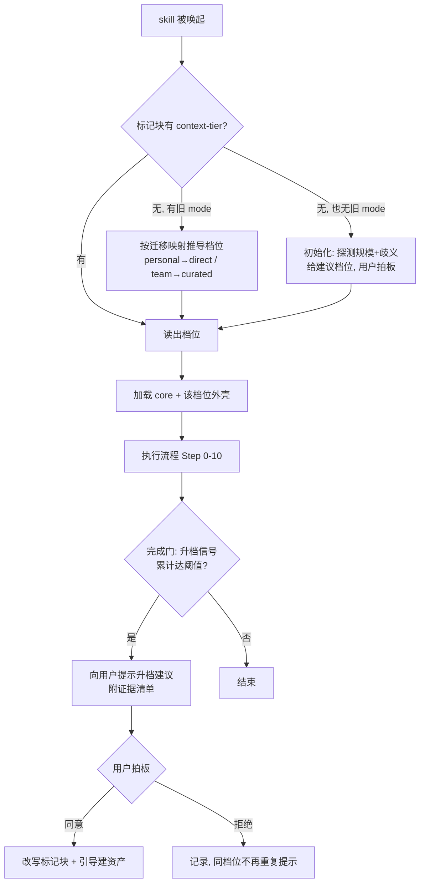

# ai-dev-system_技术 Spec — 项目真相源分层与 mode→context-tier 重构

> 本仓库是方法论分发包，"实现"即 skill markdown + `install.mjs`。本 spec 的接口契约指**标记块格式与安装器契约**，数据模型指**标记块字段模型**。
> 遵循 `references/core/spec写作纪律.md`：零上下文可动手、RFC2119、无占位符。
> **本轮范围只到 spec 定稿**，不含实现。§8.1 兼容取舍尚未经用户拍板，spec 不得据此进入编码。

## 0. 阅读导引

**一句话目的**：把项目分类维度从「几个人协作」换成「真相源需要什么形态承载」，让任何项目都能做到对**人和 AI 一律零上下文交接**，并让 agent 在项目长大时主动提示升档。

**端到端场景**：

1. 新人（或零上下文 agent）接手一个项目 → 从 `docs/index.md` 找到需求真相源、从架构文档建立心智模型、从实现真相源定位到权威代码 → 无需任何人口头介绍即可动手。
2. 一个人的项目从 3 千行长到 5 万行 → agent 在若干次任务中反复遭遇"找不到权威实现" → 攒够证据后主动提示"建议从 `direct` 升到 `graph`" → 用户拍板 → 标记块更新。
3. 项目出现 v1/v2 并存的支付实现 → agent 检出歧义信号 → 提示升到 `curated` 并只对该能力建 registry 条目，不要求全仓建卡。
4. **异常**：用户拒绝升档 → agent 记录拒绝，本档位内继续工作，且在同一档位内不再重复提示，直到出现新类别的信号。

**核心流程图**：



**决策表**：

| 输入 / 状态 | 条件 | 走向 / 处置 | 结果 |
|---|---|---|---|
| 标记块含 `context-tier` | 值在值域内 | 直接路由 | 加载对应档位外壳 |
| 标记块含 `context-tier` | 值非法 | 报错并要求用户修正 | 中止，不猜测 |
| 标记块只有旧 `mode` | `personal` / `team` | 按 §8.3 映射推导 + 一次性提示升级 | 行为与旧版等价 |
| 无标记块 | — | 走初始化，探测后建议 + 用户拍板 | 写入新字段 |
| 任务中检索失败信号累计 ≥ 阈值 | 当前非最高档 | 完成门处提示升档 | 用户拍板 |
| 用户拒绝升档 | — | 记录拒绝 + 同档位内静默 | 不重复打扰 |

## 1. 范围

**做什么**：

- 论证并废弃 `mode="personal|team"` 二分，代之以 `context-tier="direct|graph|curated"`。
- 定义**三层真相源 × 三档形态**矩阵，使任何档位的项目都具备完整真相源。
- 定义可判定的档位判据、初始化探测算法、升档提示机制。
- 给出跨 50+ 文件的受影响清单、兼容取舍待拍板项、迁移方案。

**不做什么**：

- 不实现。本轮产出仅本 spec，编码需另起 coding plan。
- 不改 `ctx` CLI 的命令语义（`probe` 的题型扩展在 §3.4 只作设计，实现另议）。
- 不规定使用者的架构选择（是否拆仓、是否微服务）——`00-流程总纲.md` 的技术栈无关原则不变。
- 不引入新的外部依赖。codegraph 与 `agentic-principle` 的外部工具边界维持现状。

**依赖**：本 spec 的结论依赖 `references/core/上下文卫生.md`（零上下文起步）、`references/company/context-engineering.md`（真相方向铁律与资产分层）两篇现行纪律，不与之冲突。

## 2. 问题：现有二分为何失效

### 2.1 三条证据

**证据 A — 体系自相矛盾。** `references/personal/mode-personal.md:10` 规定「无 Engineering Context 层 / 无 ctx CLI。**个人项目仓库你自己熟**，直接读代码即可」。但 `references/core/上下文卫生.md:14` 同时规定「**编码任务零上下文起步**」「任务间 MUST NOT 依赖上个任务的会话记忆」。前者的前提是"人熟悉"，后者的前提是"执行者不熟悉"。**人熟不等于 agent 熟**，两条纪律在同一 skill 内互斥。

**证据 B — card 的四个成因里三个与人数无关。** `references/company/context-engineering.md:9` 列出 AI 被误导的四个成因：相似命名、旧实现、重构中间产物、多仓副本。仅"多仓副本"由多仓/协作产生；其余三项是**代码量 × 存活时间**的函数。单人维护三年的 15 万行系统，前三项全部成立。

**证据 C — 加载条件把两个变量绑死。** `references/company/mode-team.md:3` 写明加载条件为「多人多项目（5~20 人、10~30 仓）」——人数与仓数写在同一括号内，但二者可独立变化。

### 2.2 纯 AI 开发下协作维度恒为真

协作方从人变为 agent 后，team 侧机制并未消失，而是换了协作对象：

| team 机制 | 单人 + 多 agent 下 | 判定 |
|---|---|---|
| owner 归属 | 从"哪个人拍板"变为"**人 vs agent 的决策权边界**"；`context-engineering.md:50` 已规定权威判定必须人确认 | 存活且更重要 |
| 评审会 | 变为"用户审 agent 产出的 Overview"，人类闸门实质不变 | 存活 |
| 小而可 review 的 PR | agent 单次可产出 2000 行，粒度限制是人类唯一审查窗口 | 加强 |
| 三轴子代理评审 | `mode-personal.md:14` 已自述"子代理就是你唯一的第二双眼睛" | 已承认 |
| 按边界拆 spec / 垂直切片 | 目的是让**零上下文 agent** 独立执行一个切片 | 存活 |
| `REQUIREMENTS.md` / index 分层 | agent 无跨会话记忆，**文档是 agent 间唯一通信信道** | 更必要 |

真正随人数消失的仅三项：约人类评审会、对齐他人仓 owner、多仓合并顺序协商。

**结论**：协作维度在纯 AI 开发下恒为真。**常量不应作为开关。**

### 2.3 personal 外壳实质为空

`mode-personal.md` 十条默认，逐条检验：

| 条目 | 内容 | 检验结果 |
|---|---|---|
| 1 | 默认走 Lean | Triage 四问已覆盖，不需要 mode 承载 |
| 2 | 可跳步（省 Step 2/3） | 理由是"没有协作方要对齐"，被 §2.2 否定 |
| 3 | 不需要评审会/owner | 被 §2.2 否定 |
| 4 | 无 Engineering Context / 无 ctx | 被 §2.1 证据 A 否定 |
| 5–10 | 目录/沟通/worktree/评审门/兼容/测试 | **原文即标注"不裁剪"** |

十条中六条明示不裁剪，一条被 Triage 覆盖，三条被证伪。独有内容仅剩「个人 memory 约定」一节，而该约定对团队同样成立。

### 2.4 两个错配象限

| 象限 | 现判定 | 实际后果 |
|---|---|---|
| **单人 / 大仓**（一人维护的十万行遗留系统） | personal | 被明令"直接读代码"，退化为裸 grep——正是体系最反对的行为 |
| **小团队 / 小仓**（4 人 / 3 个各 5 千行服务） | team | 被迫建 card + registry + scene + probe 全套，成本远超收益，结局烂尾。而 `context-engineering.md:11` 自述"一个看起来权威但已过期的来源，比没有来源更危险"——**烂尾的 card 层是负资产** |

## 3. 新模型

### 3.1 目标（本重构的验收标尺）

**项目对任何接手者——人或 agent——都做到零上下文交接**：需求、架构、实现三层真相源均能从项目自身清晰定位，无需任何人口头介绍。

档位不决定"是否具备真相源"，只决定"**真相源用什么形态承载**"。**任何档位都 MUST 三层齐全。**

### 3.2 三层真相源 × 三档形态

| 真相源层 | `direct`（直读档） | `graph`（图谱档） | `curated`（权威档） |
|---|---|---|---|
| **需求** | `docs/index.md` + PRD 按生命周期归档 | 同左 + `docs/REQUIREMENTS.md` | 同左 |
| **架构** | README 中一节"架构与边界" | `docs/ARCHITECTURE.md` | 同左 + `engineering-context/scenes/` 场景蓝图 |
| **实现** | 代码本身（关键路径读得完） | **codegraph**（`explore`/`impact`/`callers`，auto-sync，零维护） | 同左 + `engineering-context/` 的 registry / card + cite |
| 人工维护成本 | 仅文档 | 仅文档（实现层全自动） | 文档 + 权威判定 + 新鲜度门禁 |

> `direct` 档的架构一节 MUST 存在但可短至 10 行：模块划分、模块职责一句话、对外边界、不做什么。它是新人建立心智模型的最小载体。

### 3.3 档位判据（两个独立问题）

两个问题回答的是不同的事，MUST 分别判定：

- **Q1（检索）"找得到吗"** — 典型任务的**关键路径**源码，能否在一次会话的聪明区内读完？
- **Q2（消歧）"信哪个"** — 仓库中是否存在需要人判断才能定夺权威的并存实现？

| Q1 装不下 | Q2 有歧义 | 档位 | 理由 |
|---|---|---|---|
| 否 | 否 | `direct` | 全部读得完，无需索引也无需消歧 |
| 是 | 否 | `graph` | 只是检索问题，codegraph 自动解决，**不必付 card 的维护成本** |
| 否 | 是 | `curated` | 小仓亦可有 v1/v2 遗留；消歧只能靠人工登记 |
| 是 | 是 | `curated` | 二者兼具 |

**关键判据：从 `graph` 升 `curated` 的触发条件是「出现歧义」，不是「变得更大」。** 规模只提高歧义概率，不等价于歧义。索引由 codegraph 免费提供；card 的价值是**消歧**，不是索引。干净的大仓 MUST NOT 被要求维护 card。

**Q2 的歧义信号**（命中任一即为"有歧义"）：同一能力存在两处及以上实现且需判断哪个是线上权威；`v1`/`v2` 或 `_old`/`_legacy` 并存；`@deprecated` 标记存在但旧实现未删；重构中间产物尚未清理；多仓存在同一逻辑的副本。

### 3.4 curated 的最小可用形态（降低采纳门槛）

判定为 `curated` MUST NOT 等同于立即建全套资产。按需递进，顺序固定：

1. **registry-only**（必做起点）：只在 `capability-registry.md` 登记**存在歧义的那几个能力**，标明权威实体与陷阱项。三条歧义就写三行。
2. **+ card**：当单仓大到需要分区索引时补 `cards/<repo>.md`。
3. **+ scene 蓝图**：出现高频跨服务场景时补。
4. **+ probe set**：资产量大到需要防腐门禁时补。

依据 `context-engineering.md:52` §4「只人工维护第一类（耐用的人工判断）」——registry 正是消歧表，是第一类的最小载体。

### 3.5 零上下文交接的可验证性

§3.1 的目标 MUST 可验证，验证形式为一组**新人问题**（Onboarding Probe），复用 `ctx probe` 的 Frozen Probe Set 机制：

| 题型 | 示例问题 | 应答来源 |
|---|---|---|
| 项目目的 | 这个项目解决什么问题？不做什么？ | 需求真相源 |
| 架构心智 | 有哪几个模块？边界在哪？ | 架构真相源 |
| 定位能力 | 功能 X 在哪实现？哪个是权威实现？ | 实现真相源 |
| 设计理由 | 为什么选了方案 A 而不是 B？ | spec 的已定决策 / 理由链 |

**判定标准**：一个零上下文 agent 仅凭项目内文档能答出全部题目，即视为交接能力达标。答不出的题指向缺失的真相源层，MUST 补齐而非口头补充。本机制的 CLI 实现（`ctx probe` 扩展新题型）不在本轮范围，本节仅冻结设计。

## 4. 升档提示机制

### 4.1 三类信号

| 类别 | 采集方式 | 权重 |
|---|---|---|
| **检索失败信号**（最准） | agent 在任务中自记：为定位权威实现执行了 ≥3 次 grep/搜索；为拼出一条调用链读了 ≥5 个文件；遇到同名/近义实现无法判断权威 | 高 |
| **歧义信号** | 按 §3.3 的信号清单扫描 | 高（直接指向 `curated`） |
| **容量信号** | 版本控制内代码行数、文件数越过阈值 | 低，仅作兜底 |

检索失败信号是**体验驱动**而非指标驱动，与 `references/core/上下文卫生.md:16`「识别过载信号，立即交接」同构：那里是"忘记决策 / 重复提问 / 引用不存在的文件 → 交接"，这里是"反复找不到权威 → 升档"。

### 4.2 时机与阈值

- **检查点**：`worktree开发纪律.md` §完成与自动合并门。该门已要求盘点本次触碰的权威面，在此顺带判定，不新增独立扫描开销。MUST NOT 在每次 skill 唤起时扫描。
- **触发阈值**：同一档位内累计命中 **3 次**检索失败信号，或命中**任意 1 次**歧义信号，即触发一次提示。
- **提示内容**：MUST 附证据清单（哪次任务、什么信号、具体是哪个能力/文件），MUST NOT 只给结论。
- **拍板方**：**用户**。agent 只建议，MUST NOT 自行改写标记块——符合 `用户沟通纪律.md`「大架构由用户确认」。
- **拒绝后**：记录拒绝，同一档位内 MUST NOT 因**同类**信号重复提示；出现**新类别**信号时可再提示一次。

### 4.3 信号账本

信号计数落 `docs/report/上下文档位信号.md`，与 `bug修复历史.md` / `测试场景覆盖度.md` 同属报告类账本，收敛方式遵循 `文档归档与账本收敛.md`。升档完成后该账本清零并记录升档日期。

### 4.4 降档

档位 MAY 下调，仅一种情形：`curated` 的人工资产**已实质烂尾**（`capability-registry` 或 card 的 `freshness` 全面过期且无人维护）。此时 MUST 提示用户"降回 `graph` 或恢复维护"二选一，因为过期权威源比没有权威源更危险（`context-engineering.md:11`）。规模增长不产生降档。

## 5. 数据模型：标记块字段

```
<!-- ai-dev-workflow:start -->
> **本项目采用 ai-dev-workflow** (context-tier="direct|graph|curated")
> ...档位对应的约定正文...
<!-- ai-dev-workflow:end -->
```

| 字段 | 值域 | 必填 | 语义 |
|---|---|---|---|
| `context-tier` | `direct` \| `graph` \| `curated` | 是 | 真相源承载形态档位 |
| `mode`（旧） | `personal` \| `team` | 否，已废弃 | 仅用于向后兼容读取，见 §8.3 |

**协作维度不再设字段。** 依 §2.2，纯 AI 开发下协作恒为真；随人数消失的三项（人类评审会、他人仓 owner 对齐、多仓合并顺序）改写为**条件规则**——"存在其他人类协作方时才适用"，属任务级判断，MUST NOT 固化为项目级配置（同一项目的人数会变，配置会过期）。

## 6. 接口契约

### 6.1 安装器（`install.mjs`）

| 契约点 | 现状 | 目标 |
|---|---|---|
| 标记块校验正则（`install.mjs:383`） | `/mode="(personal\|team)"/` | 同时识别 `context-tier="(direct\|graph\|curated)"` 与旧 `mode`，旧值按 §8.3 映射 |
| 校验失败报错（`install.mjs:1033`） | 提示 mode 标记无效 | 措辞改为 context-tier；旧值不报错，走迁移分支 |
| 双入口幂等同步（`install.mjs:1216`） | 同步 mode 块 | 同步 context-tier 块，逻辑不变 |
| config-snippet 选择 | `personal.md` / `team.md` | `direct.md` / `graph.md` / `curated.md` |

### 6.2 skill 路由（两个 SKILL.md）

`ai-dev-workflow/SKILL.md` §路由逻辑与 `ai-prd/SKILL.md` 的 mode 分流，MUST 改为读 `context-tier` 并加载对应外壳；读到旧 `mode` 时按 §8.3 映射并提示用户升级一次。

### 6.3 目录约定

| 现状 | 目标 |
|---|---|
| `references/personal/mode-personal.md` | `references/tiers/tier-direct.md` |
| `references/company/mode-team.md` | `references/tiers/tier-graph.md` + `references/tiers/tier-curated.md` |
| `references/company/context-engineering.md` | `references/tiers/context-engineering.md`（内容不变，仅移位） |

`ai-prd` 侧同构：`references/mode-personal.md` / `mode-team.md` → `references/tiers/tier-*.md`。

## 7. 受影响文件清单

全仓命中 `个人版|团队版|mode="personal"|mode="team"` 的文件共 **36 个 skill 内文档 + 5 个仓库自身文档 + `install.mjs` + 1 个测试**。按改动性质分三类：

**A 类 — 结构性改写（新建/重写/移位），11 个**

| 文件 | 动作 |
|---|---|
| `ai-dev-workflow/references/personal/mode-personal.md` | 删除（内容按 §2.3 已实质为空，memory 约定并入 core） |
| `ai-dev-workflow/references/company/mode-team.md` | 拆为 `tiers/tier-graph.md` + `tiers/tier-curated.md` |
| `ai-dev-workflow/references/tiers/tier-direct.md` | 新建 |
| `ai-dev-workflow/references/company/context-engineering.md` | 移位至 `tiers/` |
| `ai-dev-workflow/assets/config-snippets/{personal,team}.md` | 删除，代之以 `{direct,graph,curated}.md` |
| `ai-prd/references/mode-{personal,team}.md` | 重写为 `tiers/tier-*.md` |
| `ai-dev-workflow/references/init-初始化.md` | 重写提问与注入逻辑（8 处命中，最密集） |
| `install.mjs` | 正则、校验、snippet 选择、迁移分支 |

**B 类 — 判据引用改写（把"团队版"改为"`graph` 及以上"之类的档位表述），13 个**

`00-流程总纲.md`(7) / `步骤-1-7-设计与实现.md`(8) / `代码评审纪律.md`(4) / `环境冲突扫描.md`(3) / `文档治理.md`(2) / `bug诊断纪律.md`(2) / `上下文卫生.md`(2) / `步骤-8-10-测试.md`(2) / `测试资产纪律.md`(1) / `spec写作纪律.md`(1) / `worktree开发纪律.md`(1) / `路径-lean.md`(1) / `ai-prd/references/00-prd生成流程.md`(7)

**C 类 — 模板与其它一句话提及，13 个**

`eng-spec.md`(2) / `coding-plan.md`(2) / `test-spec.md`(2) / `overview.md`(1) / `lean-change-spec.md`(1) / `capability-registry.md`(1) / `ai-prd` 的 `prd质量清单.md`(3) / `prd写作纪律.md`(2) / `change-prd.md`(2) / `业务语言纪律.md`(1) / `UI原型纪律.md`(1) / `lite-issue-prd.md`(1) / `question-bank.md`(1)

**D 类 — 仓库自身文档与测试**

`CLAUDE.md`、`README.md`、`README_zh.md`、`docs/index.md`、`docs/spec/2026-07-06-ai-dev-system-design.md`、`docs/spec/2026-07-06-ai-prd-design.md`、`test/install-and-doc-governance.test.mjs`。

> `docs/plan/` 下两份历史计划与 `ai-dev-system/migrations/*.md` 中的 mode 提及属**历史记录**，MUST NOT 改写（改写历史文档会破坏可追溯性），但需在 `docs/index-archive.md` 确认其已标注为归档。

## 8. 兼容性 / 迁移

### 8.1 兼容取舍决策（**待用户拍板，spec 定稿前 MUST 完成**）

| # | 被改变的既有行为 | 谁在依赖它 | 待定选项 | 建议 |
|---|---|---|---|---|
| 1 | `mode="personal\|team"` 字段废弃 | 所有已安装项目的 `CLAUDE.md`/`AGENTS.md`；`install.mjs` 校验 | (a) 只认新字段，安装器升级时自动改写；(b) 双字段并存一个大版本再删；(c) 保留 `mode` 字段名只换值域 | **(a)**：标记块本就由安装器幂等改写，skill 与标记块总是同批更新；配 §8.3 的路由侧兜底读旧值即可 |
| 2 | personal 档不再"无 Engineering Context" | 已选 personal 的项目 | (a) 映射到 `direct`（行为最接近，实现层仍为直读）；(b) 映射到 `graph` | **(a)**：保证升级后行为等价，升档交给 §4 机制自然发生 |
| 3 | team 档拆为 `graph` / `curated` | 已选 team 的项目 | (a) 一律映射 `curated`（保守，行为完全不变）；(b) 探测后建议降到 `graph` | **(a)**：已建的 card 资产不能因升级被判为多余；降档只走 §4.4 |
| 4 | `references/personal/`、`references/company/` 目录消失 | 任何硬编码该路径的外部引用 | (a) 直接移位；(b) 保留旧路径转发文件一个版本 | **(a)**：skill 内部路径由安装器整目录复制，无外部消费者 |
| 5 | 新增 `docs/report/上下文档位信号.md` 账本 | 目标项目文档目录 | (a) 有信号时才创建；(b) 初始化即创建 | **(a)**：避免给零信号项目留空文件 |
| 6 | 版本号 | 使用 `--ref=v<版本>` 锁版本的用户 | (a) `2.0.0`（行为契约破坏性变更）；(b) `1.11.0` | **(a)**：字段废弃 + 目录约定变更，符合 CLAUDE.md §版本管理的 bump 条件，且需要用户动作 |

### 8.2 替换清单

| 被取代物 | 类型 | 取代者 | 处置 | 保留理由 + 到期日 |
|---|---|---|---|---|
| `mode="personal\|team"` 字段 | 标记块字段 | `context-tier` | 删除（读取侧保留兼容分支） | — |
| `references/personal/mode-personal.md` | 文档 | `tiers/tier-direct.md` | 删除 | — |
| `references/company/mode-team.md` | 文档 | `tiers/tier-graph.md` + `tier-curated.md` | 删除 | — |
| `assets/config-snippets/personal.md` | 配置片段 | `direct.md` | 删除 | — |
| `assets/config-snippets/team.md` | 配置片段 | `graph.md` / `curated.md` | 删除 | — |
| `ai-prd/references/mode-personal.md`、`mode-team.md` | 文档 | `ai-prd/references/tiers/tier-*.md` | 删除 | — |
| `install.mjs` 的 `/mode="(personal\|team)"/` 正则 | 代码 | 新正则 + 迁移分支 | 保留至兼容窗口结束 | 需读旧标记块完成自动迁移；**到期日与 §8.1#1 一致，取决于该项拍板结果** |
| `references/company/` 目录 | 目录 | `references/tiers/` | 删除 | — |

> 保留例外仅一条（迁移分支），理由属"数据迁移未完成"类，成立。

### 8.3 迁移方案

**旧值映射（读取侧，MUST 实现）**：

| 读到 | 推导为 | 附带动作 |
|---|---|---|
| `context-tier="<合法值>"` | 该值 | 无 |
| 无 `context-tier`，有 `mode="personal"` | `direct` | 一次性提示用户"已按 direct 档运行，建议重跑安装器完成升级" |
| 无 `context-tier`，有 `mode="team"` | `curated` | 同上 |
| 两者皆无 | — | 走初始化 |
| `context-tier` 值非法 | — | **报错中止**，MUST NOT 猜测 |

**安装器升级路径**：升级安装时检出旧 `mode` 块，按上表映射并**幂等改写**为新字段块，改写前打印前后对照。因 skill 目录由安装器整体复制，skill 与标记块必然同批更新，不存在"新 skill 配旧标记块"的持久状态。

**迁移指南**：MUST 新增 `ai-dev-system/migrations/<新版本>.md`，一屏内说清：字段改名、旧值映射表、目录移位、无需用户手工改文件、升档提示是新行为。

**初始化探测算法**（新项目，给建议而非判决）：

| 探测项 | 采集命令 | 阈值 → 建议 |
|---|---|---|
| 代码规模 | 版本控制内文件行数总和（排除 lock 文件与生成物） | ≤ 15,000 行 → `direct`；> 15,000 行 → `graph` |
| 歧义信号 | 扫描 §3.3 信号清单 | 命中任一 → 建议 `curated` |
| 仓库年龄 | 首次提交距今 | > 2 年时提高歧义信号权重（仅影响措辞，不改建议档位） |

> 行数阈值是**关键路径可读性的代理指标**，不是判据本身。判据是 §3.3 的 Q1/Q2。探测结果 MUST 连同"这是建议，你可以改"一并抛给用户，与冲突扫描结论同一批提问（沿用 `init-初始化.md` 现行的批量提问约定）。

## 9. 错误处理

| 情形 | 处置 |
|---|---|
| `context-tier` 值非法 | 报错中止并列出合法值域，MUST NOT 猜测或回退默认档 |
| 两入口档位不一致 | 以 `CLAUDE.md` 为准并同步至 `AGENTS.md`（沿用 `init-初始化.md` 现行规则） |
| `curated` 档但 `engineering-context/` 不存在 | 警告并引导 `ctx init`，MUST NOT 静默降档 |
| `graph` 档但 codegraph 不可用 | 警告并提示重跑安装器或 `npm install -g @colbymchenry/codegraph`；MUST NOT 退回裸 grep（处置详见 §12 待澄清点 2） |
| 探测脚本失败 | 降级为"直接问用户选哪档"，不阻断初始化 |

## 10. 状态机

不适用。档位是配置值而非流转状态；升/降档是一次性配置改写，无中间态。

## 11. 完成定义

本轮（spec 阶段）：

- [x] §2 的失效论证给出可核对的文件行号证据
- [x] §3 档位判据可判定（Q1/Q2 + 信号清单），无模糊表述
- [x] §4 升档机制的信号、时机、阈值、拍板方、拒绝后行为均已定义
- [x] §7 受影响文件清单按改动性质分类且计数可核对
- [x] §8.2 替换清单逐条登记，保留项带理由
- [ ] **§8.1 兼容取舍 6 项经用户逐条拍板** ← 阻塞项，未完成不得进入编码
- [ ] 依 §8.1#6 结论确定版本号并起草 `migrations/<版本>.md`

实现阶段（本轮不做，列出供后续 coding plan 承接）：

- [ ] A 类 11 个文件结构性改写完成
- [ ] B 类 13 个文件判据引用改写完成
- [ ] C 类 13 个模板提及改写完成
- [ ] D 类仓库自身文档与测试同步
- [ ] `test/install-and-doc-governance.test.mjs` 覆盖新旧字段两条路径
- [ ] 新增测试覆盖 §8.3 旧值映射与安装器幂等改写
- [ ] `docs/spec/2026-07-16-skill写作自检清单.md` 过一遍（改 skill markdown 的规定动作）
- [ ] `docs/index.md` 同步

## 12. 待澄清点

1. **§8.1 六项兼容取舍**——阻塞项，需用户逐条拍板。
2. **`graph` 档是否强依赖 codegraph**：codegraph 是外部工具，安装可能失败（现行设计中失败只降级为警告）。若一个项目判为 `graph` 但 codegraph 装不上，实现层真相源即缺失。是接受"降级为 direct + 警告"，还是要求 `graph` 档必须补人工架构文档兜底？倾向后者，但需用户确认——这会给 `graph` 档增加一项文档义务。
3. **升档提示的跨会话计数**：§4.2 的"累计 3 次"需要跨会话持久化，落在 §4.3 的账本文件。但 agent 是否每次完成门都读该账本，会带来固定开销。是否接受？替代方案是只在单次会话内计数（更省，但会漏掉"每次任务各失败 1 次"的慢性信号）。
4. **`ai-prd` 是否需要三档**：PRD 产出对实现真相源的依赖弱于 workflow。`ai-prd` 可能只需 `direct` / `curated` 两档（是否有权威口径要引用），无需 `graph`。本 spec 暂按三档同构处理，需确认是否简化。
