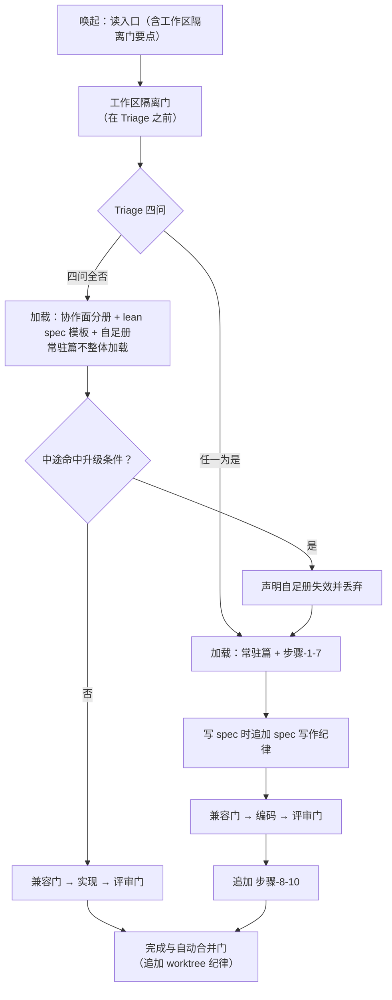

# ai-dev-workflow 精简与需求追溯 PRD

> 更新时间：2026-08-22
> 状态：PRD 评审版（已过双轴子代理复核并据此重修），用于本体系自身的后续技术设计对齐
> 语言要求：读者是本体系的维护者本人（协作面 = solo，按 `collab/solo.md` §3 不对用户隐藏技术细节），因此允许出现文件名与体积数值；但每条仍先说影响、后说依据，不描述实现方案
> 核心目标：让走 Lean 的小改动不再背完整流程的全部纪律，同时给需求装上能贯通到测试的编号

## 一句话结论

本次对 `ai-dev-workflow` 做且只做四件事：

1. **让 Lean 真正轻**——造一份自足册，四问全否后只读入口 + 协作面分册 + lean spec 模板 + 自足册，常驻篇不再整体加载。
2. **削常驻**——把只在特定时刻才用得上的三篇纪律移出常驻，并停止在多个文件里复写同一个数字。
3. **给需求编号**——spec 的需求与验收项编上永不复用的号，贯通到任务、评审与测试。
4. **让评审报告说清"怎么错的"**——在现有的"多急"之外，再标一列偏离类型。

**做完的标志**：常驻负担 ≤ 50,000 字节（一条 `wc -c` 直接量）、加载点清单交付且每一行满足三条判据、需求编号在四个落点贯通、评审报告每条带偏离类型、两条机器检查上线，需求编号在四个落点贯通，评审报告每条带偏离类型，两条机器检查上线，且用改完的体系真跑通一次 Lean 与一次完整流程。

既有的四道门、Triage 四问、两个可变维度（协作面 / 代码图谱）、`engineering-context` 代码事实层地基，本次一条也不动。

## 背景

触发是 2026-08-21 与 `github/spec-kit` 的一次全面比对。比对确认了本体系的护城河（代码事实层、Triage 自动分流、worktree 隔离、兼容取舍门都是对方没有的），也量出三处实测问题：

1. **小改动的代价和大需求一样高**。走 Lean 的一个三行改动，端到端要加载 **133,545** 字节：常驻九篇 108,003 + `路径-lean.md` 5,649 + `lean-change-spec.md` 模板 5,889 + `代码评审纪律.md` 主会话实读三节 14,004（写 spec 时 §替换清单 2,491，过评审门时 §四条轴 3,429 + §子代理 prompt 模板 8,084）。Triage 分流本是为"不给小改动套重流程"设计的，但它只减少了**步骤**，没有减少**上下文负担**。

2. **需求追溯断在 spec 与 test-spec 之间**。`assets/templates/test-spec.md` §6 的追溯矩阵示例已写着「FR-1」，但 `assets/templates/eng-spec.md` 的十二节里没有任何一节定义需求编号。结果是编码阶段没有锚点，测试阶段突然要追溯，只能事后倒推。评审门的忠实轴也因此只能做自然语言逐条比对。

3. **同一个数字散在十几个文件里，且现有防线只挡住了一部分**。仓库里已有两条同类机器闸——`test/cards-mandatory.test.mjs:267` 与 `:285`，注释写明"这不是本次变更特有的契约，而是同一类 bug 咬了两次之后加的机械闸"，其中第一条覆盖的正是 `七条"不裁剪"护栏`。但它们采用的是**"出现处的数字必须与权威值一致"**策略（允许出现、校验取值），而不是**"权威文件之外不许出现"**策略，因此挡不住数字继续扩散到新文件。实测散布度（量法：`grep -rl <词> .`，范围 = `ai-dev-workflow/` 全目录，含 `SKILL.md` 与 `scripts/`）：`cite` 23 个文件、`补卡` 20 个、`worktree` 17 个、`替换清单` 15 个、`四轴` 13 个、`兼容取舍` 13 个、`lifecycle` 12 个。仓库根 `CLAUDE.md` 自己已写明"数量以 `grep -rn` 的实际结果为准，MUST NOT 按记忆中的数字收工"——靠人工 grep 比对，正是这毛病当初长出来的原因。

## 目标与非目标

### 产品目标

1. **常驻负担 ≤ 50,000 字节**（口径：`SKILL.md` + `references/core/` 常驻篇 + `references/collab/` 一份）。现状 108,003，降幅 ≥ 53%。
2. **判据一律渐进披露，不再有"先全背下来"的加载**。可勾验形式：交付一张**加载点清单**（见 §加载点清单），其中每一行 MUST 同时满足三条——①**触发条件明确**（说得出"什么时候"，不是"可能会用到"）；②**加载单元最小**（能按小节取就 MUST NOT 整篇取）；③**说得出为什么此刻需要**（该判据在这一步真的要用，不是"备着"）。任一行缺一条即不达标。

   **为什么不定体积阈值**：前三版依次定过 30,000 / 45,000 / 50,000，每一版都被复核挖出漏算的必读项（协作面分册与 lean spec 模板 → 评审门 §四条轴 与 §子代理 prompt 模板、worktree §完成与自动合并门 → 评审门 §门禁 与 §处置）。根因是**体积阈值要求穷举"这条路径上会读到的全部文件"，而这份清单取决于本次改动命中哪几道门**：同样是 Lean，改错别字与修 bug 相差一份 `bug诊断纪律.md`（10,258），命中测试资产再差一份 `测试资产纪律.md`（10,749）。清单列不全，阈值就永远在"看着达标、实际破线"之间摇摆。渐进披露把判据从**全集**换成**逐点**：每个加载点独立成立即可，漏一行补一行，新增条件门只是多一行，MUST NOT 因此推翻整个目标。

   体积仍然量，但**降级为观测指标**：改完实测三种典型 Lean（最窄 / bug 类 / 命中测试资产）各报一个数写进报告，供下次判断趋势，**MUST NOT 当作验收门槛**。
3. **需求编号贯通四个落点**：spec 定义 → coding-plan 任务引用 → 评审门忠实轴产出覆盖矩阵 → test-spec 追溯矩阵复用同一套号，中间不需要任何人重新编。
4. **评审报告可分类**：忠实轴每条发现都带偏离类型（五类），与严重度两列并存。
5. **两条机器检查上线**：计数词防腐、Lean 自足册对细则 MUST 的覆盖率，各自能在 `node --test test/*.test.mjs` 里跑出红绿。

### 非目标（逐条具体）

1. **不引入预设 / 扩展 / 编排平台**。不抄 spec-kit 的 presets、extensions、workflows 三层机制。理由：它从"模板 + 命令"长成 19 万行平台，这个膨胀方向与本次目标正相反。
2. **不把 `ai-dev-workflow` 拆分成多个 skill**。`SKILL.md` 自己已声明"自动触发不总是稳定"，拆开只会把不稳定的触发面乘以三。
3. **不新增独立的项目级 constitution 文件**。项目特有硬约束若要做，只在标记块里加一节，不新增文件、不新增跨文件契约。本次不做。
4. **不合并 `collab/solo.md` 与 `collab/team.md`**。两份分册维持独立。
5. **不要求已装项目做任何手动动作**。升级后旧项目照常跑：已有的 spec / plan / PRD 不要求回头补编号，标记块不新增必填字段，不需要重跑安装器才能用。
6. **不改四道门的数量、顺序与过门口径**。工作区隔离 → 兼容取舍 → 代码评审 → 完成与自动合并，四道门与三道条件触发门原样保留（**工作区隔离门仍在 Triage 之前**）；P0/P1 全修完才过门的口径不动。
7. **不动 `ctx` CLI、安装器 `install.mjs`、姊妹 skill `ai-prd`**。除此之外，本次会改动：`ai-dev-workflow` 的 references 与 assets、`ai-dev-system/VERSION`、仓库根 `CLAUDE.md`（口径归并）、本仓库 `docs/`（沿革归位与本 PRD 结算）、以及**既有测试**（见 §改动范围 末两行）。
8. **不改 Triage 四问与默认倾向的判据**。什么时候升级到完整流程，判据一个字不动。
9. **本轮不做「通用工程常识一笔带过」的剔除**。实测这类内容在本体系里占比很小（`coding-plan.md:12` 的 "DRY / YAGNI / TDD / 勤 commit" 一行、`test-spec.md:81,89` 的等价类/边界值/pairwise/测试金字塔一段、各文件"与其他纪律的关系"表合计 439 字节），因为体系内容主体是**反 Claude 默认行为**的判据而非工程常识。留待下一轮，届时判据是「**Claude 不写会不会做错**」而不是「人类工程师是否知道」。
10. **本轮不做判据必要性的抽样实测**。249 处 MUST / MUST NOT 里可能有针对早期模型已知误读而加、如今未必还需要的防御，但这只能实测（去掉某条看 Claude 会不会真做错），不能靠推断。留待下一轮。
11. **本轮不做「需求写得好不好」的自检判据**（spec-kit 的 checklist 概念）。它与本次的编号改动落点重叠（都在 spec 模板与自检环节），同批做会让一次改动同时动两套判据、难以定位回归。留待下一轮，本轮不预留字段、不留半成品。

## 现状与当前逻辑

本次现读源码取证：`ai-dev-system/skills/ai-dev-workflow/`（SKILL.md、references/、assets/templates/、scripts/）、`ai-dev-system/skills/ai-prd/`、仓库根 `test/`；这些模块尚无 card，待 ai-dev-workflow 按代码事实纪律 §4 补卡。

> 本仓库是本体系的分发源，自身没有安装本体系，因此没有 `engineering-context/` 目录，`ctx` 零命中属正常起步状态（判据见 `00-prd生成流程.md` §批 B）。以下每条现状均为本次现读源码取证，带 `文件:行` 或实测数值，并经双轴子代理独立重量复核。

### 加载模型的现状

每次唤起本 skill，无论需求大小，都先付清一份固定的常驻成本。实测构成（字节）：

| 常驻文件 | 字节 | 占比 |
|---|---|---|
| `references/core/00-流程总纲.md` | 23,794 | 22.0% |
| `references/core/文档治理.md` | 23,150 | 21.4% |
| `SKILL.md` | 16,148 | 15.0% |
| `references/core/代码事实纪律.md` | 14,550 | 13.5% |
| `references/core/worktree开发纪律.md` | 9,406 | 8.7% |
| `references/collab/solo.md` | 5,874 | 5.4% |
| `references/core/用户沟通纪律.md` | 5,487 | 5.1% |
| `references/core/上下文卫生.md` | 5,081 | 4.7% |
| `references/core/spec写作纪律.md` | 4,513 | 4.2% |
| **合计** | **108,003** | 100% |

分流之后再追加：Lean 追加 `路径-lean.md` 5,649 与 `lean-change-spec.md` 模板 5,889（`路径-lean.md:15` 规定 Lean 第 3 步 MUST 按该模板写一页 spec）；两条路径都要读 `代码评审纪律.md` 的部分小节——`SKILL.md` 路由第 5 步规定"改产品代码的任务基本都要读，分两次"，即写 spec 时读 §替换清单（2,491），编码完成派评审子代理时读 §四条轴（3,429）与 §子代理 prompt 模板（8,084），主会话实读合计 14,004，不是全文 19,972。**因此 Lean 端到端 133,545 字节，与完整流程的差距只有分册那几 KB。**

三篇移出候选各自的真实使用面（复核后修正，原稿低估了 `文档治理.md`）：

| 文件 | 真实使用面 | 因此怎么移 |
|---|---|---|
| `spec写作纪律.md` 4,513 | 只在动笔写 spec 时需要——但 **Lean 也写 spec**（`路径-lean.md:15`），且 `上下文卫生.md:32` 要求交接文档遵循它 | 整篇移出；要点进自足册（Lean 侧）与写 spec 时追加（完整流程侧） |
| `worktree开发纪律.md` 9,406 | 承载**两道门**：§工作区隔离门 3,403（**在 Triage 之前**，此刻尚未分流）与 §完成与自动合并门 4,839（另有 §开发期间、§失败与阻塞 共 1,164 不属任一门）；另有 `SKILL.md:108-110` 路由第 2d 步在门前就要读 §完成与自动合并门 判 `merge-gate` 缺省 | §工作区隔离门要点进**入口**（分流前唯一在手的文件），其余移出、过门时加载 |
| `文档治理.md` 23,150 | **比原稿判断的宽**：`:161` 有一节明标 `### 5. 账本的读取纪律（常驻）`、`:54-66` §硬规则 每次落任何文档都适用；另有 `init-初始化.md:42,103,105`、`上下文卫生.md:15`、`环境冲突扫描.md:28` 四处引用；D 轴结论的落盘由主会话执行（`代码评审纪律.md:123`） | §硬规则 与 §5 账本读取纪律的要点（约 1,800）进总纲；其余移出、按时机加载 |

### 需求追溯的现状

- `assets/templates/eng-spec.md` 共 12 节（§0 … §12），**没有任何一节定义需求编号**；但 `:79` 已有另一套编号约定 `Invariant N:`（安全不变量）。
- `assets/templates/test-spec.md:74,78` §6「需求 → 用例可追溯矩阵」标为"★ 最重要产物"，示例行写着「FR-1」——它假设上游已有编号，而上游没有产出编号的地方。
- `assets/templates/coding-plan.md:28-37,58-64` 的任务结构有 `Slice` / `依赖` / `Files` / `Interfaces`，**没有"本任务满足哪条需求"**；核销表只核销替换清单，不核销需求覆盖。
- `references/core/代码评审纪律.md:27` 的 B 忠实轴职责写的是"逐条对照 spec / lean spec 的需求与验收项"，靠自然语言匹配。

### 评审报告格式的现状

- 报告表头 `| # | 严重度 | 位置 | 问题 | 建议修改 |` 在 `代码评审纪律.md:114-117`，位于 §子代理 prompt 模板的代码块内——**它是四条轴共用的一份 §返回格式，不存在"B 轴专属表"**。
- 严重度口径 P0 / P1 / P2 在 `:116`。**没有"这条是怎么错的"这一维度**——漏实现、擅自加戏、做反了，现在都可能被标成同一个 P1。
- 现行 B 轴（`:27`）与 P0 口径（`:116`）已点名**四种**偏离：漏实现验收项、镀金、做反、**越过 spec 的"不做什么"边界**。

### 既有测试对本次改动的约束

三处断言锁定的正是本次要改的契约：

- `test/cards-mandatory.test.mjs:92-110`：断言 `SKILL.md` 必须含字符串「常驻 core 七篇」，并把 `worktree开发纪律.md` / `spec写作纪律.md` / `文档治理.md` 列进常驻分册清单——三篇正是本次要移出的。
- `test/doc-axis.test.mjs:80`：断言 `worktree开发纪律.md` **必须**出现「四轴」，而新增的计数词防腐检查要求「四轴」**只许**出现在权威定义文件里——两条检查对同一文件的同一字符串给出相反结论。
- `test/install-and-doc-governance.test.mjs:486-488`：要求 `SKILL.md` 含「全程使用独立 worktree」「完成后自动合并主分支」，入口腰斩有打掉它们的风险。

## 改动范围

| 对象 | 改造目标 |
|---|---|
| Lean 自足册 | 新增一份自足的 Lean 执行册（在现有 `路径-lean.md` 基础上扩写）：四问全否后，只凭入口 + 协作面分册 + lean spec 模板 + 本册就能走完四道门并完成小改动。册内每条要点显式标注它出自哪份细则的哪一节。 |
| skill 入口 | 瘦身到 8,000 字节以内，**内含工作区隔离门要点**（该门在 Triage 之前，过门时尚未分流、自足册未加载，入口是此刻唯一在手的文件），并在路由中明确 Lean 与完整流程各自的加载清单。 |
| `文档治理.md` | §硬规则 与 §5 账本读取纪律的要点（约 1,800 字节）进总纲；其余移出常驻，按时机加载。 |
| `spec写作纪律.md` | 整篇移出常驻；要点进自足册（Lean 侧），完整流程侧在动笔写 spec 时追加。 |
| `worktree开发纪律.md` | §工作区隔离门要点进入口；其余移出常驻。**它承载两道门**——第一道与第四道，两处都 MUST 加载它，MUST NOT 只在第一道门加载就认为后面还在上下文里（中间隔着整个编码与评审阶段，多半已换会话）。 |
| 流程总纲 | 抽掉"为什么这么定"的历史沿革论证，保留全部结论与 MUST NOT；抽出的内容归入本仓库 `docs/spec/`，不随 skill 分发。同时补入三篇移出文件的结论行与 `文档治理.md` 两节要点。 |
| 跨文件引用写法 | 引用他处判据时不再复写数字，改为指名文件与小节；计数只在权威定义处出现一次。 |
| 全篇措辞 | 对本 skill 全部 references 与 assets 做一遍措辞精简：合并重复表述、把解释性散文收进判据表、删冗长论证从句。**保留每一条 MUST / MUST NOT 结论与每一个判据消歧例子**（见 §不可压的红线）。 |
| spec 模板 | `eng-spec.md` 与 `lean-change-spec.md` 增加需求与验收项的编号要求（MUST），写明编号维护规则，并说明它与既有 `Invariant N:` 的关系。 |
| coding-plan 模板 | 每个任务增加"满足哪几条需求"的引用项；完成清单增加需求覆盖的核销。 |
| 代码评审纪律 | §返回格式的表头**按轴条件增列**：忠实轴多一列偏离类型（五类取值），其余轴不增列；写明遇到无编号存量 spec 时如何降级；覆盖矩阵作为忠实轴产出的一部分。 |
| **既有测试（三个文件、三处改 + 一处保留）** | `cards-mandatory.test.mjs:92-110` 的常驻清单与「常驻 core 七篇」断言按新契约同改；**`cards-mandatory.test.mjs:267` 改写成新策略**（其守的护栏词在新受检词表内），**`:285` 原样保留**（其守的「N 个固定文件名」不在受检词表内，改了会失去防线）；`doc-axis.test.mjs:80` 对 `worktree开发纪律.md` 含「四轴」的断言按计数词新规则同改；`install-and-doc-governance.test.mjs:486-488` 的入口断言在瘦身后仍须成立（要点保留即可）。 |
| **新增测试（两条）** | 计数词防腐、Lean 自足册对细则 MUST 的覆盖率。 |
| 版本 | `ai-dev-system/VERSION` 按行为契约变更 bump；因不要求用户动作，不新增迁移指南文件。 |

### 常驻负担的账（目标 1 怎么凑到 50,000）

| 动作 | 增减 | 累计 |
|---|---|---|
| 现状 | —— | 108,003 |
| 移出 `文档治理.md` | −23,150 | 84,853 |
| 移出 `spec写作纪律.md` | −4,513 | 80,340 |
| 移出 `worktree开发纪律.md` | −9,406 | 70,934 |
| 入口瘦身 16,148 → 8,000（8,000 **已含**工作区隔离门要点） | −8,148 | 62,786 |
| 总纲抽掉历史沿革论证 | 预计 −8,000 | 54,786 |
| 总纲补 `文档治理.md` §硬规则 + §5 的要点 | +1,800 | 56,586 |
| 总纲补三篇移出文件的结论行 | +600 | 57,186 |
| 全篇措辞精简（保守按 15%） | −8,578 | **48,608** |

余量 1,392。**达标临界精简率 = 12.6%**（57,186 → 50,000）。

**这笔账 MUST 在实现时逐笔复核**：前四项是确定的减法，后两项是变量。任一变量未达预期导致总数超过 50,000 时，MUST 回头扩大范围（下一顺位是把 `代码事实纪律.md` 拆成常驻要点 + 延后细则，约 −6,550），**MUST NOT 通过下调目标值来"达标"**。

**15% 的适用基数**：对**全部**常驻文件取，**包含**已做过专项减法的入口与总纲（即入口的 8,000 与总纲抽沿革后的体量仍参与精简，两个动作可叠加）。因此 §验收标准 的「入口体积 ≤8,000」是专项减法后的中间验收点，精简后实际会更小。

**15% 这个预算有实测依据**：对九篇里冗余密度最低的 `用户沟通纪律.md`（0.8 处/KB）做过一次真实压缩，5,487 → 4,825，压掉 20%，且压缩后 MUST NOT 条数由 3 增至 6、判据例子由 11 增至 12——冗余集中在解释性散文而非规范条款，因此压缩不削弱判据。冗余密度更高的 `上下文卫生.md`（2.2 处/KB）与 `collab/solo.md`（2.4 处/KB）预期高于 20%。按 15% 立预算是留了安全边际。

### 加载点清单（目标 2 的可勾验形式）

本次 MUST 交付一张加载点清单，取代原先的体积预算表。清单内容与已知加载点见 §详细业务行为 §一、加载规则——那一节即清单本体，本处不重复。

### 不可压的红线

措辞精简 MUST NOT 触碰下列内容，删一条即判为改动失败：

1. 任何一条 MUST / MUST NOT / SHOULD / MAY 结论本身。
2. 判据消歧用的正反例（如"算 / 不算"表里的每一行）——它们是防语感误判的唯一装置。
3. `MUST NOT 被读成……` 这类防误读表述的**结论部分**（可压掉其后的论证展开，MUST NOT 压掉被禁止的那个误读本身）。
4. 交叉引用的目标文件名与小节名。

可压的是：重复表述（同一判据在同一文件里说两遍）、解释性散文（可改写成判据表）、冗长论证从句、历史沿革。

## 不改的现有业务（边界护栏）

| 不改的现有业务 | 本次边界 |
|---|---|
| 四道门与三道条件触发门 | 数量、顺序、触发时机、过门口径全部按线上原样执行；**工作区隔离门仍在 Triage 之前** |
| Triage 四问与默认倾向的四条判据 | 一个字不动，包括"判据 3/4 是回溯触发"的规定 |
| 协作面与代码图谱两个可变维度 | 探测方式、配置方式、**加载时机**（协作面分册"必加载一份"）全部不变 |
| `engineering-context` 代码事实层 | 仍是必备地基，不参与路由判断；先查卡片、查不到读源码并当场补卡的规则不动 |
| P0/P1 全修完才过门 | 评审门的过门口径不变，偏离类型只是新增的一列信息 |
| 已有 spec / plan / PRD 文件 | 不要求回头补编号；忠实轴遇到无编号 spec 时自动降级，不报缺陷 |
| `test-spec.md` §6 追溯矩阵 | 格式不动。上游补上编号后直接复用同一套号，该模板无需改动 |
| `eng-spec.md` 的 `Invariant N:` 编号 | 保持现状。新增的需求/验收编号与它**各自独立、互不复用**；本次不给 `Invariant N:` 追加"永不重排"约束 |
| `ctx` CLI 与 `engineering-context/` 的格式约定 | 完全不动 |
| 安装器 `install.mjs` 及其冲突插件、codegraph、ctx link 逻辑 | 完全不动 |
| 姊妹 skill `ai-prd` | 完全不动 |
| 文档三目录约定 | spec → `docs/spec/`、plan → `docs/plan/`、report → `docs/report/` 不变，只是判据的加载时机变了 |

## 详细业务行为与信息要求

### 一、加载规则（即目标 2 要交付的「加载点清单」）

本次 MUST 交付一张加载点清单，取代原先的体积预算表。清单的每一行是一个**加载点**，四列：`触发条件 | 加载对象（精确到小节）| 为什么此刻需要 | 适用路径`。

下表是**必须覆盖的已知加载点**——它们全部来自三轮复核实测，MUST NOT 遗漏；实现时可增行，MUST NOT 减行。

| 触发条件 | 加载对象 | 为什么此刻需要 | 适用路径 |
|---|---|---|---|
| 每次唤起 | 入口（含工作区隔离门要点、Triage 四问、路由） | 路由本身要用；工作区隔离门在 Triage 之前，此刻还没有别的文件在手 | 两条 |
| 路由第 2d 步 `merge-gate` 缺省 | `worktree开发纪律.md` §完成与自动合并门 | 该缺省判据只在那一节定义一次（`SKILL.md:109-110`） | 两条 |
| 要建 worktree、需执行细则 | `worktree开发纪律.md` §工作区隔离门 | 入口内的要点只够判断"要不要过"，建的动作要细则 | 两条 |
| Triage 四问全否 | Lean 自足册 + 协作面分册一份 + `lean-change-spec.md` 模板 | 自足册是 Lean 的判据载体；协作面分册含直管 Lean 的 MUST；模板是第 3 步的产出骨架 | Lean |
| Triage 任一为是 | 常驻篇 + `步骤-1-7-设计与实现.md` | 完整流程的步骤细节 | 完整 |
| 红回路门命中（bug / 回归 / 异常行为） | `bug诊断纪律.md` | 改代码前 MUST 先造复现回路，判据在该文件 | 两条 |
| 动笔写 spec | `spec写作纪律.md`（完整流程）／ 其要点已在自足册内（Lean） | 零上下文可动手、RFC2119、无占位符 | 两条 |
| 登记替换清单 | `代码评审纪律.md` §替换清单 | spec 要登记被取代物 | 两条 |
| 过代码评审门 | `代码评审纪律.md` §门禁 + §四条轴 + §子代理 prompt 模板 + §处置 | §门禁 定派几个子代理与 D 轴恒跑；§prompt 模板 要被派发方**逐个替换占位符**（`代码评审纪律.md:38`），不读就填不了；§处置 定 P0/P1 过门口径与**"D 轴结算 MUST 由主会话当场落盘"**——这几节全是主会话职责，MUST NOT 写成"主会话只需知道派几个子代理" | 两条 |
| 进入测试阶段 | `步骤-8-10-测试.md` | 测试阶段的步骤细节 | 完整 |
| 用户给了真实数据／凭证／要挂覆盖度台账 | `测试资产纪律.md` | 真实输入固化与台账判据 | 两条 |
| 要判文档去留、归档、索引分层 | `文档治理.md` | 生命周期与索引门控判据 | 两条（其 §硬规则 与 §5 账本读取的 Lean 适用要点在自足册内，日常落文档不必取全文）|
| 过完成与自动合并门 | `worktree开发纪律.md` §完成与自动合并门 | 该门判据在此；第一道门那次加载可能已随会话交接失效 | 两条 |
| 出现过载信号要交接 | `spec写作纪律.md`（交接文档遵循它，`上下文卫生.md:32`） | 交接文档的读者就是零上下文新会话 | 两条 |

**清单里没有"阶段"这个概念**——本 PRD 前一版曾按会话阶段切分并声称 `上下文卫生.md` 有位置性交接点，**那是失实的**：该文件的交接一律由可观察过载信号触发（规则 2 + 规则 5），规则 1 反而要求决策链保持连续，规则 4 里与评审门相关的是"MUST 交**子代理**"（派发，不是换会话）。本次 **MUST NOT 新增任何位置性交接点**，`上下文卫生.md` 不在改动范围内。

**自足册要装什么**：四道门要点（工作区隔离门除外，已在入口）、四条纪律要点（`代码事实纪律.md` / `用户沟通纪律.md` / `上下文卫生.md` / `spec写作纪律.md`）、`文档治理.md` 的 Lean 适用要点（§硬规则 + §5 账本读取——Lean 第 3 步必产新文档，这两节对 Lean 适用，**MUST NOT 只放进总纲，Lean 不读总纲**）、`代码评审纪律.md` §替换清单的登记与核销判据、Triage 与升级路径、从属规则、Lean 本体流程。实测 Lean 可达范围内 MUST / MUST NOT 令牌共 249 处，即便一半适用于 Lean 也是约 120 条要点。**篇幅不设硬上限**（同上：上限要求穷举），但 MUST 满足覆盖率检查——漏一条即红。

**Lean 中途升级的处置**：Lean 走到一半命中升级条件（默认倾向判据 3/4 回溯触发）时，MUST 显式声明"自足册已失效"并丢弃，改按常驻篇 + `步骤-1-7` 重新执行。升级路径本身 MUST 写在自足册里，不能指望此刻会去读总纲。

**要点与细则冲突时以细则为准**。自足册与入口内的要点是要点版，被引用的细则是权威版；两者分歧一律以细则为准，要点版相应条目视为待修。

### 二、需求编号

| 信息项 | 含义 | 谁产出 | 谁使用 |
|---|---|---|---|
| 需求编号 | spec 里一条功能需求的稳定标识 | 写 spec 的会话 | coding-plan 任务、评审门忠实轴、test-spec 追溯矩阵 |
| 验收项编号 | spec 里一条验收标准的稳定标识 | 写 spec 的会话 | 同上 |
| 任务的"满足"引用 | 这个编码任务实现了哪几条需求 | 写 coding-plan 的会话 | 评审门忠实轴（据此出覆盖矩阵） |
| 覆盖矩阵 | 每条需求有没有对应任务、每个任务有没有对应需求 | 评审门忠实轴 | 主会话判断漏做与镀金 |

**编号规则**：编号 MUST 永不复用、永不重排。新增需求取下一个从未用过的号；删除的需求保留编号并标注"已撤销 + 原因"，不腾位置。理由是下游的任务、评审报告与测试矩阵都指向这些号，重排一次全部指错地方。

**编号是 MUST，两条路径都不豁免**：完整流程的 `eng-spec` 与 Lean 的 `lean-change-spec` 都要编号。写成建议等于没写——覆盖矩阵只要有一份 spec 没编号就跑不出来。

**与既有 `Invariant N:` 的关系**：两套编号各自独立、互不复用，同一份 spec 里并存。本次不改 `Invariant N:` 的现有约定。

### 三、评审报告的两个维度

忠实轴每条发现同时标两列，各管一件事：

| 维度 | 取值 | 管什么 |
|---|---|---|
| 偏离类型 | 漏做 / 做一半 / 做反了 / **越界（动了声明不碰的部分）** / 没人要却做了（镀金） | 怎么错的 → 决定怎么修 |
| 严重度 | P0 / P1 / P2 | 多急 → 决定过不过门 |

"越界"单列为一类，因为现行 B 轴（`代码评审纪律.md:27`）与 P0 口径（`:116`）已把它与镀金分开点名，合并会丢掉现有区分度。

**落点是共用的 §返回格式，按轴条件增列**：`代码评审纪律.md:114-117` 的表头是四条轴共用的一份。改法是"忠实轴多一列偏离类型，其余轴不增列"，MUST NOT 给四轴统一加一列（会让另外三轴多出一列空格）。

过门口径仍只看严重度（P0 与 P1 全修完），偏离类型不参与过门判定。

### 四、两条机器检查

| 检查 | 判据 | 失败表现 |
|---|---|---|
| 计数词防腐 | **受检词表**（闭集，按实测重写，实现时以此为准）：`四轴`（现 13 个文件，权威定义在 `代码评审纪律.md`）、`四道门`（4 个，权威在 `00-流程总纲.md`）、`四问`（7 个，权威在 `00-流程总纲.md`）、`七条"不裁剪"护栏`（4 个，权威在 `00-流程总纲.md`）。**受检范围**：仅 `ai-dev-system/skills/ai-dev-workflow/` 下的文件。**匹配方式**：字面匹配。每个词在权威定义文件之外出现即失败 | 有人把「四轴」重新写回引用处时，测试变红 |
| 自足册覆盖率 | **来源清单**（被检查的判据出处，与"常驻篇"概念解耦）：`00-流程总纲.md`、`代码事实纪律.md`、`用户沟通纪律.md`、`上下文卫生.md`、`worktree开发纪律.md`、`代码评审纪律.md`、`文档治理.md`、`spec写作纪律.md`、`collab/solo.md` **与** `collab/team.md`（**取两份的并集**——两份的 MUST 集合不同，写"一份"会让检查结果随协作面随机）。**被检查方**＝Lean 自足册 + 入口。清单里每一条适用于 Lean 的 MUST 条目，都能在被检查方里找到对应要点（靠要点显式标注的来源匹配） | 自足册漏抄某条纪律时，测试变红，并指出缺的是哪一条 |

**自足册的文件路径 MUST 在实现时定死并写进检查**：它由 `路径-lean.md` 扩写而来，若沿用原路径，则该文件既是被检查方又出现在来源清单里（自指，恒真或随改名失效）。因此 `路径-lean.md`（或其接替者）**只作为被检查方，MUST NOT 进来源清单**。

**三条豁免规则**（不写清楚两条检查会互相判红）：

1. **Lean 自足册与入口豁免计数词检查**——覆盖率检查要求它们复述四道门与 Triage 四问，而它们按从属规则不可能是权威定义文件。
2. **小节名不受计数词检查约束**——`§四条轴` 是被 5 个文件按名引用的小节名，它不含字面子串 `四轴`，因此本不冲突；但这依赖字面匹配，实现 MUST NOT 改用分词或模糊匹配，否则与 §不可压的红线 第 4 条直接互斥。
3. **0 命中的词不入表**——原稿列过 `三轴` / `五轴` / `两轴` / `三道门`，实测在受检范围内各 0 命中，已删除；`七条护栏` 是错写，真实用词是 `七条"不裁剪"护栏`。

**与既有两条机器闸的关系**：`cards-mandatory.test.mjs:267` 与 `:285` 用的是"出现处取值必须与权威值一致"，新规则用的是"权威文件之外不许出现"。两条要**分别处理，MUST NOT 一刀切**：

- `:267` 守的是 `七条"不裁剪"护栏`，该词在新受检词表内 → 改写成新策略，两者不并存。
- `:285` 守的是「N **个固定文件名**」，该词**不在**新受检词表内（受检词表是闭集，只含四个词）→ **MUST 原样保留**。若照"两条都改写"执行，这个词会失去任何防线（实测它在 5 处出现：`测试资产纪律.md:96`、`bug诊断纪律.md:80`、`文档治理.md:62`、`assets/templates/test-coverage.md:2,11`，权威值当前为 2）。

**`assets/config-snippets/` 的特殊性 MUST 单独处理**：`base.md` 与 `collab-solo.md` 是**注入目标项目 `CLAUDE.md` 的片段**，读它们的 agent 在目标项目里、没有本 skill 的文件可跳转。因此这两份文件里的计数词 MUST NOT 简单改成"指名文件与小节"——要么保留数字并接受它们不受本检查约束（写进豁免），要么改写成不依赖计数的表述（如"按 `代码评审纪律.md` 定义的全部轴"）。实现时 MUST 二选一并写明。

### 五、改完之后的"常驻篇"清单

验收项 1 的口径依赖这个集合，因此 MUST 明确：改完后常驻的是 `SKILL.md` + `00-流程总纲.md` + `代码事实纪律.md` + `用户沟通纪律.md` + `上下文卫生.md` + `collab/` 一份，共 **6 个文件**（`文档治理.md`、`spec写作纪律.md`、`worktree开发纪律.md` 已移出）。量常驻负担即量这 6 个文件之和。

## 流程图

## UI 原型

| 项 | 内容 |
|---|---|
| 原型文件 | 不适用——交付物是 skill 的 references 与 assets（markdown）加测试改动，不存在任何用户可见界面 |
| 覆盖路径 / 样式依据 / 关键状态 / 不在用户界面内展示 | 不适用 |

## 核心规则

| 情况 | 处理 |
|---|---|
| 自足册或入口的要点与细则冲突 | 以细则为准，要点版对应条目视为待修 |
| Lean 中途命中升级条件 | 声明自足册失效并丢弃，改按常驻篇 + 步骤-1-7 重新执行 |
| 过工作区隔离门时尚未分流 | 用入口内的要点动手；MUST NOT 假定自足册或常驻篇已加载 |
| 新写的 spec 缺需求编号 | 不允许——编号是 MUST，spec 自检不过 |
| 存量 spec 没有编号 | 忠实轴自动退回逐条自然语言对照，并在报告顶部写明"本次未跑覆盖矩阵：spec 无编号" |
| spec 改稿新增或删除需求 | 新增取下一个未用过的号；删除保留号并标"已撤销 + 原因" |
| 引用他处判据需要提到数量 | 不写数字，指名文件与小节；数字只在权威定义处出现 |
| 既有测试断言与新契约冲突 | 按新契约改测试（非目标 7 已放宽）；MUST NOT 为迁就旧断言放弃改动 |
| 需要知道某条判据"当初为什么这么定" | 去本仓库 `docs/spec/`，不在 skill 内查 |

## 特殊场景与冲突

| 场景 | 处理 |
|---|---|
| **多人或多次同时操作**：同一项目里协作者装的 skill 版本不同（配置入库、skill 不入库） | 本次不新增标记块必填字段，旧版 skill 读到的块与现在一致；新版行为不依赖任何新配置，因此版本参差不影响任一方跑通 |
| **信息迟到**：先写了 coding-plan，spec 后来又加了一条需求 | 新需求取新号，coding-plan 补一个任务引用它；覆盖矩阵会把"有需求无任务"报成漏做，不需要人工发现 |
| **前置条件不满足**：自足册尚未写完就有人走 Lean | 自足册是本次交付的一部分，未交付前 Lean 仍按现状加载；不存在半成品状态上线 |
| **处理失败**：两条机器检查因误报变红 | 检查失败即视为改动未完成，MUST 修检查或修内容，MUST NOT 关掉检查放行 |
| **业务过期**：存量 spec 无编号 | 忠实轴降级为逐条对照并在报告注明，不报缺陷、不阻断（对应非目标 5） |
| **跨阶段继续**：Lean 中途升级到完整流程 | 见 §核心规则 第 2 行；升级路径 MUST 写在自足册内 |
| **两条新检查互相判红** | 见 §四 的三条豁免规则；实现时 MUST 先让两条检查在同一份内容上同时为绿，再提交 |
| 智能能力相关场景 | 不适用——交付物是方法论文档与测试，不含运行期智能能力，无自主程度 / 兜底 / 数据边界可定 |

## 验收标准

### 业务信息验收

| 验收项 | 标准 |
|---|---|
| 常驻负担 | 改完后的 6 个常驻文件合计 ≤ 50,000 字节 |
| 加载点清单 | 清单已交付，且 §加载点清单 表中列出的**每一个已知加载点都在**（MUST NOT 减行）；逐行核验三条判据——触发条件明确、加载单元最小（能按小节取的没整篇取）、说得出为什么此刻需要。任一行缺一条即不达标 |
| 无"先全背下来"的加载 | 走查改后的入口与自足册：不存在"为了以后可能用到而提前加载"的条目。判定方式是拿 §加载点清单 逐条问"这一步真的要用吗"，答不上即为违规 |
| 入口体积 | `SKILL.md` ≤ 8,000 字节（专项减法后的中间验收点，措辞精简后会更小），且仍含工作区隔离门要点 |
| 编号定义 | `eng-spec.md` 与 `lean-change-spec.md` 各有一处明确要求需求与验收项编号，写明永不复用、永不重排，并说明与 `Invariant N:` 各自独立 |
| 任务引用 | `coding-plan.md` 的任务结构含"满足哪几条需求"项 |
| 报告格式 | `代码评审纪律.md` §返回格式按轴条件增列，忠实轴的偏离类型五类取值齐、其余三轴未增列 |
| 沿革归位 | 从总纲抽出的历史沿革已落在本仓库 `docs/spec/`，且总纲内不再保留论证段 |
| 红线未破 | **比对范围 = 本次被措辞精简改动过的每一个文件**（不限常驻 6 篇）。逐文件比对精简前后：MUST / MUST NOT / SHOULD / MAY 条数不减少，判据正反例条数不减少。任一文件不满足即整批判为失败 |

### 流程与规则验收

| 验收项 | 标准 |
|---|---|
| Lean 自足性 | 四问全否后**不加载常驻篇**；Lean 所需判据一律来自自足册，或来自 §加载点清单 中按门追加的小节。自足册含升级路径、从属规则与文档治理的 Lean 适用要点 |
| 加载时机 | 三篇均已移出常驻；总纲保留了各自的结论行（`文档治理.md` → §硬规则 + §5 账本读取要点 + 三个输出目录 + `lifecycle`/`authority_refs`；`spec写作纪律.md` → 零上下文可动手 + RFC2119 + 无占位符；`worktree开发纪律.md` → 两道门各一条何时过、过不了怎么办）；工作区隔离门要点在入口内 |
| 计数词 | 除权威定义文件外，§四 受检词表内的四个词不再出现在受检范围的其余文件；三条豁免规则已落实 |
| 机器检查 | `node --test test/*.test.mjs` 全绿（含按新契约改过的三个既有测试），且两条新增检查各自能被人为破坏后变红 |
| 过门口径 | 评审门仍以 P0/P1 全修完为过门条件，偏离类型不参与过门判定 |
| 零手动动作 | 用一个未改动过的旧项目验证：升级 skill 后直接跑通一次任务，全程不需要改任何已有文件或配置 |

### 场景验收

| 场景 | 预期 |
|---|---|
| 用改完的体系走一次 Lean（一个三行级小改动） | 四道门全过、产出一页 lean-change-spec（含编号）、评审门派 1 个子代理跑完、自动合并成功；全程**未加载任何常驻篇**，每次追加加载都能在 §加载点清单 里找到对应行 |
| 用改完的体系走一次 bug 类 Lean | 红回路门命中时按清单追加 `bug诊断纪律.md`，此前不加载它——验证"条件门只在命中时才付成本" |
| 用改完的体系走一次完整流程（一个带多条需求的改动） | 需求编号在 spec 产出、coding-plan 引用、评审门产出覆盖矩阵、test-spec 复用同一套号；四个落点无需任何一次人工重编 |
| 走 Lean 到第 3 步命中升级条件 | 显式声明自足册失效并丢弃，改按完整流程重新执行，不出现两套口径同时生效 |
| 过工作区隔离门时（尚未分流） | 仅凭入口内的要点即可判断必须建 worktree、目录取自哪个字段、主工作树不干净时中止 |
| 忠实轴遇到一份无编号的存量 spec | 退回逐条自然语言对照，报告顶部写明"本次未跑覆盖矩阵：spec 无编号"，不报缺陷、不阻断 |
| 有人在引用处重新写回计数词 | 计数词防腐检查变红 |
| 自足册漏抄一条适用于 Lean 的 MUST | 覆盖率检查变红，指出缺的是哪一条 |

## 非功能与上线

| 项 | 结论 |
|---|---|
| 性能与可度量目标 | 分两种：**常驻负担**是封闭集合（就那 6 个文件），因此定字节阈值 ≤50,000，一条 `wc -c` 可验；**Lean 的加载量**不是封闭集合（取决于命中哪几道门），因此不定阈值，改由 §加载点清单 的三条判据把关，体积仅作观测量报告 |
| 数据 / 隐私 / 安全 / 合规 | **不适用**——交付物是 markdown 文档与仓库内测试，不采集、不存储、不传输任何用户数据，不涉及鉴权边界与留存期 |
| 灰度与回滚 | 不做灰度：分发形态是"安装器按 tag 取版本"，使用方各自决定何时升级，天然分批。**回滚条件**：真跑验收（§场景验收 前两条）任一条走不通，或两条机器检查在非人为破坏下变红 → 回滚整批，不做部分保留（自足册与常驻篇的加载规则互相咬合，半套上线即两套口径并存）。**回滚动作**：改动全部在一个分支内，回滚即不合入；已合入则整批 revert 并把 `VERSION` 退回 2.4.0 |
| 上线后看什么 | 见 §运营度量与看板；此外每次改动本 skill 时 `node --test test/*.test.mjs` 必须全绿 |
| 事故 owner | 维护者本人（协作面 = solo） |

## 运营度量与看板

协作面 = solo，按 `collab/solo.md` 精简为一条自查：

| 指标 | 公式 | 粒度 |
|---|---|---|
| 常驻负担达标 | 改完后跑 `wc -c`：常驻 6 篇合计对照 50,000 | 每次改动本 skill 后 |
| Lean 实际加载量（观测，非门槛）| 实测三种典型 Lean（最窄 / bug 类 / 命中测试资产）各读了多少，记进报告供下次判断趋势 | 每次改动本 skill 后 |

## 风险与兜底

| 风险 | 说明 | 兜底 |
|---|---|---|
| 自足册漏抄纪律 | 要点版最大的失败模式：某条纪律没被抄进去，走 Lean 时静默失效，要等出事才发现 | 覆盖率检查按**显式文件清单**扫描（不依赖"常驻"这个会变的概念），缺一条即红 |
| 渐进披露被读成"可以少读" | 它只改变**何时读**，不改变任何一项该读的东西；误读成"某些判据可以不读"会让门失去依据 | §加载点清单 每一行都是 MUST 读的，只是触发点不同；清单第三列"为什么此刻需要"正是防这条误读——写不出理由的行说明它压根不该加载，而不是可以不读 |
| 加载点清单漏行 | 清单少一行，某个触发点就没有判据可依（三轮复核已实证这类漏项容易发生） | 与体积阈值不同，**漏一行只影响那一行**：补上即可，MUST NOT 因此推翻整个目标。已知的十四个加载点已写死在 §加载点清单，MUST NOT 减行 |
| 自足册 26,000 装不下 | 约 120 条要点挤进 26,000 是本次最紧的预算 | 优先砍要点的展开篇幅；仍装不下 MUST 上调目标 2 阈值并说明，MUST NOT 靠删纪律达标 |
| 两套口径并存造成误判 | 要点版与细则同时存在，agent 可能拿要点版当权威 | 写死"冲突以细则为准"；Lean 升级时 MUST 丢弃自足册 |
| 措辞精简伤到防误读表述 | 那些"MUST NOT 被读成……"是体系用返工代价换来的，压缩时最容易被当成啰嗦删掉 | 立 §不可压的红线（四条）；验收时对**每个被改文件**比对 MUST 类条数与判据例子条数 |
| 工作区隔离门失去判据 | 它在 Triage 之前，此刻自足册未加载；细则若整篇移出，过门时无据可依 | 要点驻留**入口**（不是总纲——Lean 不读总纲）；`install-and-doc-governance.test.mjs:486-488` 的入口断言正好守住这条 |
| 总纲抽掉论证后被误改 | 沿革移走后，后来的人看不到"当初为什么这么定"，容易把已推翻的方案重新提一遍 | 沿革整篇归入本仓库 `docs/spec/` 并进 `docs/index.md`，总纲在相应结论处留指向它的引用 |
| 编号 MUST 增加写 spec 的负担 | 强制编号可能让小改动的 Lean spec 变啰嗦 | 可调的是编号写法的简繁（如允许短号），**MUST NOT 调整编号本身的强制性** |
| 削常驻削过头 | 移出的三篇里若有必须每次都在的条款，会造成静默失效 | 三篇各自的要点分别进总纲或入口（见 §改动范围）；完整流程侧由真跑验收暴露 |

## 本 PRD 的收尾动作

实现验收通过后按 `00-prd生成流程.md` §PRD 生命周期 结算。**本仓库没有整品 PRD**（`docs/REQUIREMENTS.md` 不存在，真相源是根 `CLAUDE.md` 与 `docs/index.md`），因此"归并回整品 PRD"落到：把本次改变的口径归并进根 `CLAUDE.md` 的相应章节（§架构、§改动时注意 的跨文件契约条目）。随后本 PRD 原地转归档——frontmatter 标 `lifecycle: merged` + `archived: <日期>`、正文首行加"已归并"头注、从 `docs/index.md` 移入 `docs/index-archive.md`，三个动作同一次提交做完。

## 改动说明（changelog）

- 2026-08-21：首版起草。基于与 `github/spec-kit` 的比对结论成稿；四批提问全部按推荐选项确认；范围定为"四条精简 + 需求编号 + 偏离类型"，checklist 判据与项目级硬约束留待下一轮。复核门（降级为主会话分轮）查出 8 条并处置完毕。
- 2026-08-22（上午）：常驻目标由 70,000 收紧到 50,000；新增两个达成手段——`worktree开发纪律.md` 一并移出常驻、全篇措辞精简；新增 §不可压的红线 与逐文件比对验收。落盘确认门通过并落盘。
- 2026-08-22（复核后重修）：派两个并行子代理跑真正的双轴复核，查出 **28 条**（自洽轴 16、冲突轴 12），其中 4 条 P0。据此重修全文：①**目标 2 由 30,000 上调到 45,000**——原值漏算了协作面分册（5,874）与 `lean-change-spec.md` 模板（5,889），自足册只剩约 10,000 却要装约 120 条要点，不成立；②**工作区隔离门要点改为驻留入口**——该门在 Triage 之前，把 `worktree开发纪律.md` 整篇移出会让第一道门在最需要判据时无据可依；③**非目标 7 放宽，既有测试同改**——`cards-mandatory.test.mjs` 与 `doc-axis.test.mjs` 的两处断言与新契约直接互斥，不改则"测试全绿"不可能达成；④**修正 `文档治理.md` 的现状失实**——它有一节明标"（常驻）"、§硬规则 每次落文档都适用，另有四处引用，原稿"只有文档轴与准出门会用到"是错的，改为拆分保留要点；⑤偏离类型由四类增为五类（补"越界"，现行 B 轴已单独点名）；⑥计数词表按实测重写（删 4 个 0 命中词、修正 `七条"不裁剪"护栏`）并补三条豁免规则；⑦覆盖率检查扫描面改为显式文件清单；⑧修正三节字节数（各多算一行下一节标题）与散布度量法口径；⑨补齐路由 2d、Lean 写 spec、步骤-8-10、交接文档四处加载落点；⑩其余措辞与算术一致性修正十余处。
- 2026-08-22（验证轮后二次修订）：对重修稿再派一个子代理做验证轮，结论"原 28 条全部闭合，新引入 8 条"（1 条 P0）。据此二次修订：①**目标 2 由"全程累计 ≤45,000"改为"任一阶段上下文峰值 ≤50,000"**——累计口径连续两轮各挖出一批漏算的必读项（第一轮协作面分册与 lean spec 模板，第二轮评审门的 §四条轴 与 §子代理 prompt 模板、worktree 的 §完成与自动合并门），补齐后累计达 60,352，说明这份清单很难一次列全；峰值口径按阶段计量，每阶段的加载集封闭可核，且顺带把"该交接就交接"变成可验收的约束；②补 `代码评审纪律.md` 两节与 `worktree开发纪律.md` §完成与自动合并门 到阶段 C 加载集，删去与 `代码评审纪律.md:38` 冲突的"主会话只需知道派几个子代理"；③`文档治理.md` 的 Lean 适用要点改为写进自足册（原方案只进总纲，而 Lean 不读总纲，会让覆盖率检查上线即红）；④**修正现状失实**：仓库里已有两条同类计数词机器闸（`cards-mandatory.test.mjs:267,285`），采用的是"取值须一致"而非"权威外不许出现"策略，原稿"靠人工 grep"是错的，两条一并列入待改测试；⑤`七条"不裁剪"护栏` 实测 4 个文件（原写 3）；⑥worktree 两节字节数修正为 3,403 / 4,839（原 3,419 / 5,146，同型多算复发）；⑦协作面分册与 lean spec 模板预算放到 ≤5,100，避免与 15% 保守精简率在边界互斥；⑧覆盖率检查的来源清单取 solo 与 team 两份并集，并把自足册自身排除出来源清单（原方案自指）；⑨补 `assets/config-snippets/` 的特殊处理——它注入目标项目，读者无法跳转，计数词 MUST NOT 简单改成指名引用。

- 2026-08-23（收敛验证后三次修订，方向调整）：第三轮子代理判 **NO**，阻断项是——峰值口径成立的前提"`上下文卫生.md` 有位置性交接点"**不存在**（该文件的交接一律由可观察过载信号触发，规则 1 反而要求决策链保持连续，规则 4 里与评审门相关的是"MUST 交子代理"即派发而非换会话），这句是起草时**编造**的；同轮还查出加载集第三次漏项（评审门 §门禁 2,008 + §处置 2,201，全是主会话职责）与 bug 类 / 测试资产命中时必然破线。

  据此**放弃给 Lean 定体积阈值**，目标 2 改为**渐进式披露**：交付一张加载点清单，每行满足三条判据（触发条件明确 / 加载单元最小 / 说得出为什么此刻需要）。根因是体积阈值要求穷举"这条路径会读到的全部文件"，而该清单取决于本次命中哪几道门——三版阈值（30,000 / 45,000 / 50,000）被三轮复核各挖出一批漏项，正是这个结构性原因，不是疏忽。渐进披露把判据从**全集**换成**逐点**：漏一行补一行，新增条件门只是多一行，不会推翻整个目标。三轮挖出的全部"漏项"已作为已知加载点沉淀进清单（十四行，MUST NOT 减行），体积降级为观测量。

  同批：①删除全部峰值 / 阶段 / 交接点表述，`上下文卫生.md` 不进改动范围；②`cards-mandatory.test.mjs` 两条既有闸改为**分别处理**——`:267` 改写成新策略（其词在受检表内），`:285` **原样保留**（其守的「N 个固定文件名」不在受检表内，一刀切会让它失去防线）；③§加载点清单 与 §一、加载规则 合并，清单本体归 §一；④新增非目标第 9、10 条，把"通用工程常识一笔带过"与"判据必要性抽样实测"明确记为下一轮的事——前者实测在本体系里占比很小（体系内容主体是反 Claude 默认行为的判据而非工程常识），后者只能实测不能推断。
