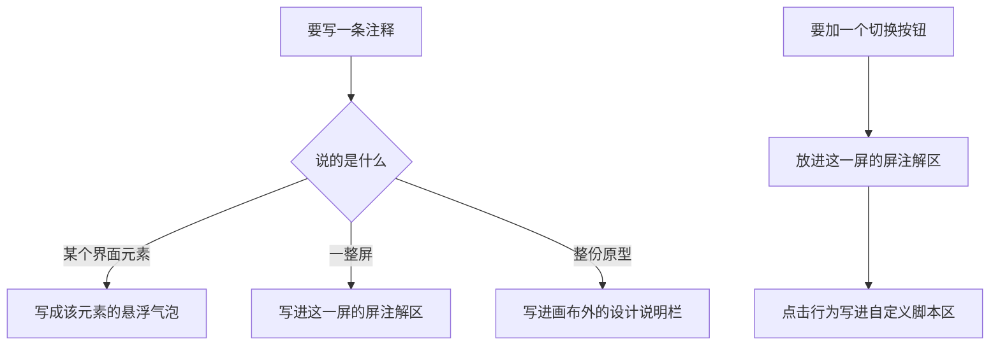

# 原型注解分层与文档日期前缀 PRD

> **已归档（2026-08-27）｜lifecycle: merged**：本期口径已归并进 `docs/REQUIREMENTS.md`；本文保留需求形成过程与取舍记录，现行实施口径以需求真相源和代码为准。

> 更新时间：2026-08-26
> 状态：PRD 评审版，用于本体系自身的下一版交付对齐
> 语言要求：全文只使用业务语言，不描述程序实现和技术选型
> 核心目标：让原型上的"状态切换"与"注释"各有固定归属，并把丢失的文档日期前缀规则补回来

## 一句话结论

本期做且只做九件事，`ai-prd` 的提问批次与三道门的顺序、以及取批注的入口全部不变：

1. 原型每一屏在设备壳之外多一块**屏注解区**，承载这一屏的状态切换按钮与这一屏的整体注释；状态切换**只在这里**，画布上不再有切全部屏的总闸。为承载这些按钮的点击行为，产出方可写的位置由六处增到七处，新增的那处叫"自定义脚本"。
2. 原型上的注释确定为**三层**，每层只有一个载体：单个元素 → 该元素的悬浮气泡；一整屏 → 这一屏的注解区；整份原型 → 设计说明。
3. 设计说明从常驻的右侧一列改为**顶部工具栏里的一个入口**，默认收起，点开在下方展开面板。
4. 堵住一个静默覆盖：预览服务开着时，页面里的旧版本**不再**把产出方刚改好的稿子盖掉。
5. 用户可以对**任何一条 AI 写的说明**直接追加回复，取回批注时看得出这是回复、回的是哪条说明、挂在哪个元素上。
6. 改稿要动到带**用户批注**的元素时，从"一律拦住"改成"**先和用户把每条批注的处理方案定下来**，定了就能改能删"。
7. 批注工具栏只摆用得上的按钮：「复制 JSON」与「重试写回」条件显示，批注计数并入左段。
8. 立一条改稿规矩：**未定稿前的多轮改稿只写最新设计**，不写稿与稿之间的对比，且不得丢掉此前已写好的特性与注释。
9. 补回丢失的文档命名规则：`docs/spec/`、`docs/plan/`、`docs/report/` 下**按次产出**的文档一律以 `YYYY-MM-DD-` 开头。

## 背景

- **状态切换只有一个总闸**。今天的原型只在画布右侧有一处状态切换，一点全部屏一起切。多屏原型里要单独看"第二屏的空态"做不到，而这正是评审时最常做的动作。
- **注释没有"一整屏"这一层**。今天只有两层：指向单个元素的悬浮气泡、以及整份原型唯一的设计说明栏。想说"这一屏的信息优先级是这样安排的"时无处可放，只能挤进那一栏，读的人分不清说的是哪一屏；更常见的结果是被顺手写进屏幕里，变成用户界面上根本不该出现的说明文字——这条禁令从 1.x 就在，仍反复被违反，因为缺的是位置，不是严厉程度。
- **说明栏一直占着一整列**。设计说明常驻画布右侧一列、随页面滚动跟着走，且永远是展开的。它是给产品经理读的辅助信息，却长期占着约五分之一的横向版面，屏一多就把界面挤窄。它该待在工具栏里、要看时才展开。
- **改稿在攒流水账**。原型和 PRD 在定稿前通常一天改好几轮，产出方习惯写上"相比上一轮把筛选挪到了顶部"。这类对比对评审者没有价值——他直接看得到改了什么——却让文档越来越难读，还会在定稿那一刻留下一份写着历史的成稿。
- **改稿会被开着的预览页面悄悄盖掉**。用户读稿期间预览服务一直开着，产出方此时改稿写进文件，用户浏览器里那份**旧页面**只要发生一次写回，就把改动整份覆盖回去。本次产 PRD 的过程中真实发生了一次：改动写进文件、命令报成功、交付自检全过，用户刷新却"没变化"——从头到尾没有任何一处报错。
- **AI 写的说明是单向的**。产出方在元素上写的说明（尤其是标成待拍板的那些）读者只能看，不能就地表态。想说"这条我同意 / 这条按 B 来"，只能另起一条独立批注——它挂在元素上，却与那条说明没有任何关联，产出方拿到手也分不清是在回应哪一句；或者干脆去对话里说，那就更难对上号。**待拍板项本来就是等用户答复的**，却偏偏没有答复的地方。
- **文档日期前缀规则丢了**。本仓库 29 份 spec/plan/report 里 28 份都带 `YYYY-MM-DD-` 前缀，规则本身却不在文档治理里，靠的是习惯。新装本体系的项目拿不到这条规则，同一个目录很快就会混进两种命名。

## 目标与非目标

### 产品目标

1. 五类诉求（切某屏状态、切某个组件形态、注释某个元素、注释一整屏、注释整份原型）各有**唯一**归属位置，产出方不需要临场决定写在哪。
2. 单屏状态可独立切换：多屏原型里看任意一屏的任意状态，不再牵动其它屏。
3. 屏注解区的位置与外观由容器给定，产出方加一屏就有，无需自己排版。
4. 说明栏默认不占版面：平时只是工具栏上的一个入口，需要时一点即展开，界面区因此拿回整幅宽度。
5. 改稿不再被静默覆盖：预览服务开着时改稿，用户下次刷新看到的一定是最新那一版。
6. 交付自检能查出三类新问题：某屏没写注解、稿子里出现稿间对比措辞、注解区里的按钮没有对应的点击行为；改稿丢了之前写好的元素说明则在**改稿时**当场提示。
7. 每条 AI 说明都能被就地回复，回复与说明一一对应，产出方零猜测。
8. 改稿不再被批注卡死：带**用户**批注的元素照样能改能删，代价只是先和用户把这几条批注的处理方案说清楚。
9. `docs/spec|plan|report` 下按次产出的新文档 100% 带日期前缀，且本仓库存量不留反例。

### 非目标

1. **不改取批注的入口与既有三类内容**：仍是页面上写意见、一条命令取回，用户逐元素批注 / 全局反馈 / AI 侧说明三类的含义与取法一律不动——本次只在结果里**增加**"用户对某条说明的回复"这一类。
2. **不改 `ai-prd` 的提问批次与三道门的顺序**：4 批提问、用户过稿门 → 复核门 → 落盘确认门的先后与各自的触发条件不动。唯一的例外写在 §五：落盘确认门摆待拍板项时，已被用户回复的连回复一起摆出、不重新提问。
3. **容器不定义任何点击语义**：注解区里的按钮点下去做什么，一律由产出方自己写；容器只提供这块区域与按钮的外观。
4. **不为原型引入主题切换、暗色模式或多语言**。
5. **不改 `ai-dev-workflow` 的任何一道门、步骤或准出项的语义**：本期在它那侧动的全是命名规则与口径的投影——文档治理补一条命名规则、各处写死的文件名范式、五个模板 frontmatter 的示例文件名、Lean 自足册里对应的那条要点、总纲里那篇的结论行、加载点清单里让这条规则读得到的那一行、以及"三类批注"这句口径。这些改的都是**同一句话在各处的写法与它的可达性**，MUST NOT 借它们改动任何判据。
6. **不批量重命名存量文档**：除本仓库那一份反例外，已有文档不因新规则改名。

## 现状与当前逻辑

本次现读源码取证：原型容器 `ui-prototype.html`、原型工具 `preview.mjs`、`ai-prd` 的 `SKILL.md` 与 `references/`（`UI原型纪律.md`、`00-prd生成流程.md`、`prd写作纪律.md`、`prd质量清单.md`、`prd复核纪律.md`）、三类 PRD 模板、`ai-dev-workflow` 的 `references/core/`（`文档治理.md`、`00-流程总纲.md`、`路径-lean.md`、`上下文卫生.md`、`代码评审纪律.md`、`步骤-1-7-设计与实现.md`、`步骤-8-10-测试.md`）与它的五个 spec/plan 模板、`test/` 下的机器闸（`prototype-annotations` / `prototype-preview` / `lean-selfcontained` / `counter-word` / `doc-index` / `requirements-layering` / `installer-migration`）、`CLAUDE.md`、`docs/index.md`、`docs/REQUIREMENTS.md`、`ai-dev-system/migrations/1.6.0.md`；这些模块尚无 card，待 ai-dev-workflow 按代码事实纪律 §4 补卡。

| 现状 | 事实来源 |
|---|---|
| 状态切换只有画布右侧一处，一点作用于全部屏；每屏内部没有任何切换入口 | `ai-dev-system/skills/ai-prd/assets/templates/ui-prototype.html:851-865`（切换卡片）、`:884-894`（切换动作遍历全部屏） |
| 注释只有两层：元素上的悬浮气泡、整份原型唯一的设计说明栏 | `ai-dev-system/skills/ai-prd/references/UI原型纪律.md:125`（§7.2 元素级气泡）、`ui-prototype.html:867-873`（设计说明栏） |
| 设计说明栏常驻画布右侧一列（约占五分之一横向版面），随页面滚动跟着走，且始终展开 | `ai-dev-system/skills/ai-prd/assets/templates/ui-prototype.html:548-556`（画布分两列）、`:598`（右列随滚动） |
| 主行动按钮的"提交 → 处理中 → 成功"演示，切的是全部屏的状态 | `ai-dev-system/skills/ai-prd/assets/templates/ui-prototype.html:900-906` |
| 加一屏得到的是屏名 + 设备壳 + 状态层，设备壳之外没有任何可写内容的位置 | `ai-dev-system/skills/ai-prd/scripts/preview.mjs:198-213` |
| 产出方可写的位置共六处：标题、副标题、界面、设计说明、项目样式、自定义样式；**没有写脚本的位置** | `ai-dev-system/skills/ai-prd/scripts/preview.mjs:41-77` |
| 交付自检查的是外链、占位符、结构与图标等十二类，不查"有没有写注释""是不是在写稿间对比" | `ai-dev-system/skills/ai-prd/scripts/preview.mjs:452-600` |
| 改稿保护只覆盖**用户**批注的锚点：丢了直接拒绝写入；产出方自己写的元素说明丢了，没有任何提示 | `ai-dev-system/skills/ai-prd/scripts/preview.mjs:279-303` |
| 交付自检另有一道：批注数据里有、界面上却找不到锚点的条目，逐条报硬错误 | `ai-dev-system/skills/ai-prd/scripts/preview.mjs:487-497` |
| 文档治理的默认命名只规定目录与文件名后缀，没有日期前缀这条；同节末尾另有一条逃生口「项目已有更严格的文件名约定时可以沿用，但目录不可改变」 | `ai-dev-system/skills/ai-dev-workflow/references/core/文档治理.md:235-245`（逃生口在 `:245`） |
| 本仓库 spec/plan/report 共 29 份（spec 21 / plan 6 / report 2），28 份带日期前缀，`docs/report/agentic-principle-gap-report.md` 是唯一反例 | 本仓库 `docs/spec`、`docs/plan`、`docs/report` 目录清单 |
| 原型文件名的日期在后：`<name>-prototype-YYYYMMDD.html`；PRD 文件名同样日期在后：`<name>-PRD-YYYYMMDD.md` | `ai-dev-system/skills/ai-prd/references/UI原型纪律.md:29`、`00-prd生成流程.md:228`（落盘命名）、`prd质量清单.md:78`（落位）、三类 PRD 模板的「UI 原型」表 |
| PRD 模板末尾有「改动说明（changelog）」节，用于记录修订 | `ai-dev-system/skills/ai-prd/assets/templates/change-prd.md` 末节 |

## 改动范围

| 对象 | 改造目标 |
|---|---|
| 原型容器 · 注解区 | 新增屏注解区的外观（区域、标题、按钮排布两种形态）；新增"自定义脚本"这个可写位置——它与现有的"自定义样式"一样是**同一份 HTML 里的一块区域**，原型仍是单文件、零外链，MUST NOT 引出任何外部脚本文件 |
| 原型容器 · 状态切换 | 删除画布右侧那处切全部屏的状态切换；主行动按钮的"提交 → 处理中 → 成功"演示改为只作用于它所在那一屏 |
| 原型容器 · 说明栏 | 画布右侧那一列取消，界面区拿回整幅宽度；设计说明改为顶部批注工具栏里的一个入口，名字就叫「设计说明」（去掉「（不属于用户界面）」——那句话产出方改不了，读者也不需要它来判断这是什么）；它排在写回按钮左侧，与工具栏其它按钮同高同形、图标在前，描边与文字用主色以便一眼认出；默认收起，点它在下方展开面板、再点收起 |
| 原型容器 · 工具栏排布 | 批注计数从右侧移到「隐藏批注」右边，与左侧那组动作按钮同区；工具栏因此分成两段——左边是原型批注标题、加注释、全局反馈、隐藏批注、批注计数，右边是设计说明、写回按钮、状态灯 |
| 原型容器 · 批注工具栏 | 「复制 JSON」改为条件显示：预览服务正常写回时不出现，只在写不进文件、又只能靠人工把批注交回来时才出现；「重试写回」维持现有的条件显示，并改用次要按钮样式——它是辅助功能，不该比「加注释」还抢眼 |
| 原型工具 · 加屏 | 加一屏时连注解区外壳一起给出，可在加屏时指定注解区挂在屏下方（默认）还是屏右侧 |
| 原型工具 · 可写位置 | 六处变七处，新增"自定义脚本" |
| 原型工具 · 交付自检 | 新增三类检查：某屏没写注解、稿子出现稿间对比措辞、注解区里的按钮没有对应的点击行为 |
| 原型工具 · 改稿 | 改稿丢掉此前写好的元素说明时，逐条列出丢了哪些（提示，不拦）。改稿丢掉**用户批注**的锚点时，从"一律拒绝写入"改成"列出受影响的每一条，产出方与用户逐条约定处理方案（已落实 / 作废 / 挪到新元素），约定后放行"——放行 MUST 是一次显式动作，MUST NOT 默认放行。工具另担两件事：约定为**已落实 / 作废**的，放行时由它把这几条从批注数据里清掉并记进放行清单；约定为**挪到新元素**的，锚点不在改后的界面上时 MUST 拒绝放行。两条连带改动：①现行那条"写入前后批注块内容必须相等（按解析后的结构比对），否则报'这是 bug'"的不变式要开一个口子——**仅限已约定清掉的条目、且仅在显式放行这条路径上**，其余路径不变；②现有的显式开关（今天叫 `--drop-anchors`）**复用为放行动作**，语义从"我要丢弃这些批注"改成"我已与用户逐条约定过"，`CLAUDE.md` 里那条「MUST NOT 用 `--drop-anchors` 绕过去」随之改写成「MUST NOT 未经约定就放行」 |
| UI 原型纪律 · 改稿（批注约定） | 补一条：改稿要动到带用户批注的元素时，MUST 先拿着这份清单与用户逐条确认，确认后才写入；MUST NOT 自行判断某条批注"已经不重要了"；AI 说明与其回复不走这道约定。同时改写六处已失准的承诺：`UI原型纪律.md:92`（自检清单"失联一条报一条"）、`:118-119`（§7.1"`slot` 保证批注块原样不动 / 丢锚点就拒绝写入"）、`:144`（"唯一写入方是页面工具栏"）、`:194`（§8.1 命令表同一句）、`ui-prototype.html:934`（批注数据区注释里的同一句），以及 `preview.mjs` 的 HELP 文案（`:731`）。改写方向：写入方由"仅页面工具栏"改成"页面工具栏 + 显式放行路径上的工具"，**AI 手工编辑批注块仍然禁止**（`ui-prototype.html:936` 那条不变） |
| UI 原型纪律 | 新增「注释三层归属」与「屏注解区」两节；可写位置表由六处改七处；§8.2 屏结构补注解区；三处因删掉总闸而失准的表述同步改写（`UI原型纪律.md:49` 说明栏位置、`:175` 容器自带能力、`:232` 状态切换作用于全部屏），`§6` 自检清单里「每个声明覆盖的状态都有对应切换入口」改由屏注解区承担；原型文件名改为日期开头 |
| PRD 写作纪律 | 新增一条"只写最新现状"：区分"产品相对现有系统的变化"（必须写）与"稿子相对上一稿的变化"（不写） |
| 三类 PRD 模板 | 「不在用户界面内展示」一项补上屏级说明的去处；原型文件名示例改为日期开头 |
| 原型容器 · 说明气泡 | 每条 AI 说明气泡上增加回复入口：用户点它写一段话，回复挂在这条说明上；同一条说明可以追加多条回复，回复可改可删 |
| 原型工具 · 取批注 | 取回结果里增加"用户对说明的回复"这一类，每条带：这是回复、被回复的说明原文、说明是不是待拍板项、所在屏与元素、回复正文 |
| "三类批注"这句口径 | 散在 9 个文件里，全部同改成"三类 + 回复"。**其中只有 3 处字面写着"三类"**（`00-流程总纲.md:111`、`路径-lean.md:273`、`步骤-1-7-设计与实现.md:23`），另外 6 处是**别的字面或逐项枚举**（`UI原型纪律.md:139` 写的是"三样东西"、`步骤-8-10-测试.md:10`、`00-prd生成流程.md:210`、`ai-prd/SKILL.md:141`、`CLAUDE.md:192`、`docs/index.md:24`）——**MUST NOT 靠字面搜"三类"找齐**，那样会漏掉这 6 处（其中 `UI原型纪律.md:139` 正是这句口径的权威定义处），还会命中一堆"三类 PRD 模板"的假阳性 |
| 批注数据的存放形态 | 回复挂在被回复的那条说明上；是否需要给批注数据升一个版本号由实现判断，改了就同步 `test/prototype-annotations.test.mjs`、`test/prototype-preview.test.mjs` 里逐字断言版本号的那几处，以及 `docs/spec/2026-08-25-原型批注框架-lean-change-spec.md` 的 `authority_refs` |
| 落盘确认门（`00-prd生成流程.md`） | 摆待拍板项时，已有用户回复的连回复一起摆出供确认，不重新提问；`prd质量清单.md` 里对应那条勾验项同改 |
| 原型工具 · 预览服务 | 页面写回时带上它当初读到的那一版的标识；文件已被改过就拒绝这次写回，并让页面重新载入最新内容后再写。产出方改稿因此不必先停服务 |
| UI 原型纪律 · 改稿（预览刷新） | 补一条：预览服务开着时改完稿 MUST 让用户刷新页面再继续读，MUST NOT 默认"用户看到的就是最新那版" |
| 文档治理 | §默认命名 补回日期前缀规则，写清适用范围、常青档例外、拆成目录时目录名同样带前缀，并写明它与同节末尾那条「项目已有更严格的文件名约定时可以沿用」的优先关系（前缀不受豁免） |
| `ai-prd` 的落盘命名 | PRD 文件名改为 `docs/spec/YYYY-MM-DD-<name>-PRD.md`、原型改为 `docs/spec/YYYY-MM-DD-<name>-prototype.html`，同改 `00-prd生成流程.md` §组稿 第 7 步、`prd质量清单.md` §落位、`UI原型纪律.md` §2（`:29`）与 §5 五项表（`:69`），以及三类 PRD 模板的示例 |
| `ai-dev-workflow` 的文件名范式 | 该 skill 里每一处写死的无前缀按次产出文件名同步改成日期开头，**枚举以实测为准、MUST NOT 照抄某个数字**：`00-流程总纲.md`、`路径-lean.md`、`上下文卫生.md`、`代码评审纪律.md`、`步骤-1-7-设计与实现.md`（含 `:69` 参考 prompt 里那处 `docs/spec/ProjectName-overview.md`）、`步骤-8-10-测试.md` 六份 references 共 18 处；`文档归档与账本收敛.md:12/26/27/28` 的四条示例 spec 文件名；`eng-spec` / `overview` / `coding-plan` / `test-spec` / `lean-change-spec` 五个模板的 frontmatter 示例各 1 处。`文档治理.md` 自身的落点表示例（`:13-15`）与 §默认命名 的 7 条范式（`:237-243`）归上一行「文档治理」射程，不重复计 |
| Lean 自足册 | 日期前缀写成 MUST 后，`路径-lean.md` 补一条带 `来源：文档治理.md §默认命名` 锚点的要点，否则自足册覆盖率闸判红 |
| 规则的可达性（完整路径） | `文档治理.md` 已移出常驻，它现有的两个加载触发点（判文档去留归档 / 往真相源与 TODO 写东西）**都不覆盖"给一份新文档起名落盘"那一刻**，规则写了也读不到。因此两处要改：①`ai-dev-workflow/SKILL.md` 的〈加载点清单〉要让"给新建文档起名落盘"这个时刻取得到它——**MUST 并进已有行**，因为入口现在 7,947 字节、硬上限 8,000，只剩 53 字节，新增整行必然判红；确实要新增行时 MUST 同步从别处腾出字节。②`00-流程总纲.md` §移出常驻的三篇 里 `文档治理.md` 的结论行 MUST 从"输出目录只有三个"扩到带上命名地板（日期前缀）——这一侧有余量（当前值以 `node --test test/resident-budget.test.mjs` 的输出为准，它无论绿红都打印逐文件明细）。**漏了这一步，这条规则在完整路径上等于不存在** |
| 本仓库存量 | `docs/report/agentic-principle-gap-report.md` 按其提交日期补前缀，并同步两处引用：`docs/index.md:40`（受 `test/doc-index.test.mjs` 管辖）与 `ai-dev-system/migrations/1.6.0.md:21`（已发布的迁移指南，改动 MUST 保持它 ≤45 行且「需要的动作」节仍在） |
| 机器闸 · 索引 | `test/doc-index.test.mjs` 现在只扫三个目录的第一层、不递归子目录（它把这条写成明确假设）。日期前缀认可"拆成目录"这种形态后，目录里的文档会整体逃出 lifecycle 字段、索引收录与断链三项检查，因此该闸 MUST 改成递归 |
| 机器闸 | 逐条同改因本次改动而失准的断言：`test/prototype-annotations.test.mjs`（硬编码的六个插槽名与插槽数、notes 插槽的逐字探针）、`test/prototype-preview.test.mjs`（插槽相关断言，以及「丢掉用户批注锚点时拒绝写入」那条——它验的行为本次从"一律拒绝"改成"未约定则不写入、约定后放行"，断言 MUST 跟着改写而不是删掉），并为新规矩补断言（屏注解区、回复类型、放行动作、已落实/作废项被清掉、挪走项锚点校验、日期前缀）。判据不变的断言 MUST NOT 因为"跑红了"就放宽 |
| 跨文件契约的落点 | 按 `CLAUDE.md:192`「原型批注框架是跨文件的契约」那份落点清单逐处同改，并更新 `CLAUDE.md` 自身与 `docs/index.md` 里写死的口径（"六个具名插槽"、"三类批注"、原型命名"三处同改"）；`ai-prd/SKILL.md:141` 的同一批表述一并改 |

## 不改的现有业务（边界护栏）

| 不改的现有业务 | 本次边界 |
|---|---|
| 用户点选元素写意见、写全局反馈的**交互方式** | 仍按线上原样：点「＋ 加注释」选元素、点「全局反馈」写整体意见，状态灯的三种颜色与含义不动。工具栏上有哪些按钮、怎么排，按〈改动范围〉调整 |
| 取回批注的唯一入口与既有三类内容 | 入口不变；用户逐元素批注 / 全局反馈 / AI 侧说明三类的含义与取法不变，本次只在结果里**新增**回复这一类。屏注解区的内容不进这个出口 |
| 元素级悬浮气泡里**已有**说明的写法与待拍板标记 | 不动；本次只在气泡上**新增**回复入口。落盘确认门仍逐条摆出待拍板项，只是已被回复的连回复一起摆（见 §五） |
| 设计说明栏里写什么（样式依据 / 覆盖范围 / 开放问题 / 全局注释） | 只改它的位置与展开方式，内容分工不动 |
| 状态层本身的显隐机制与"某屏缺这个状态就回落到默认态" | 完全不动 |
| `ai-prd` 的 4 批提问、用户过稿门 → 复核门 → 落盘确认门三门顺序 | 完全不动 |
| 原型的零外链、单文件、可离线打开 | 新增区域与脚本位置一律不得引入任何外部资源 |
| 交付自检对"批注指不到元素"报硬错误 | 不动——它抓的是没约定就丢；约定后由工具清掉的那些不会触发它 |
| 原型交付前必须跑自检、自检报硬错误必须改完再交付 | 不动；新增的三类检查都是提示级。自定义脚本区沿用现有的脚本可解析检查，仍是硬错误级——那不是新增检查，是既有检查覆盖到了新位置 |
| PRD 定稿落盘之后的修订记录（changelog） | 保留：新规矩只管**未定稿前**的改稿，不影响定稿后的修订留痕 |
| `docs/` 下的目录归属（spec/plan/report 三处） | 不动，本次只加文件名前缀规则 |
| 需求真相源、架构真相源、TODO、索引、两个固定账本的文件名 | 不加日期前缀，保持现名 |

## 详细业务行为与信息要求

### 一、屏注解区

- **它是什么**：每一屏在设备壳**之外**的一块区域，用虚线框与浅底色与界面区分开，读者一眼能看出它不属于用户界面。
- **它在哪**：默认挂在这一屏下方、水平居中（多屏横排时读起来最顺）；加屏时可显式指定挂在这一屏右侧、垂直居中（多屏纵排时用）。位置由产出方在加屏时决定，容器不猜。
- **它装什么**：一行固定小标题（如「这一屏的注解 · 不属于用户界面」）、这一屏的整体注释、以及这一屏需要的切换按钮（切本屏状态、切某个组件的形态，或产出方自定的任何切换）。**屏名仍在设备壳上方，不搬进来**。
- **它是状态切换的唯一入口**：画布上没有别处能切状态。要看全部屏的同一状态，逐屏点。
- **按钮的点击行为由产出方写**：容器只给按钮的外观与排布，点下去做什么一律写在"自定义脚本"这个新的可写位置里——它就在这份原型文件内部，与"自定义样式"并列；原型仍是**单文件、零外链**，MUST NOT 把脚本拆成外部文件。
- **改状态 MUST 用容器认得的三种表达方式之一**：给 `.screen` 加 `state-*` 类、改 `[data-state]` 元素的按下态、或让被改的元素自报"我这个属性是运行时改的"。理由是容器写回文件时要把**运行时点出来的状态还原掉**，它只认这三种；用别的方式改 DOM，下一次写回就把当时的状态**烘进文件**，此后每次打开这份原型都停在那个错误状态上，而且没有任何报错。这条是硬约束，不是建议。
- **屏注解区不进批注出口**：它是产出方写的说明，不是用户写的意见；取回批注的命令给出的仍是用户逐元素批注、全局反馈、AI 侧说明，外加本期新增的回复。

### 二、注释的三层归属

| 说的是什么 | 唯一去处 | 呈现方式 |
|---|---|---|
| 某一个界面元素 | 该元素的悬浮气泡 | 元素右上角小标，悬浮才展开；需用户拍板的转琥珀色并在落盘确认门逐条摆出 |
| 一整屏 | 这一屏的屏注解区 | 常驻显示在屏外，与该屏并排或在其下方 |
| 整份原型（样式依据、覆盖范围、开放问题、全局注释） | 设计说明 | 全篇唯一一处，入口在顶部工具栏右段，默认收起、点开在下方展开面板 |

- 三层是**闭集**：任何注释都能归到其中一层，产出方不需要临场发明第四个位置。
- 三层都在用户界面**之外**：把说明写进屏幕内容里仍然一律违规。

### 三、设计说明

- **它住在顶部工具栏里**：入口叫「设计说明」，带一枚图标，是右侧区的第一枚按钮、排在写回按钮左侧，与工具栏其它按钮同高同形；描边与文字用主色，在一排按钮里认得出来。
- **名字不带括号补语**：它是产出方改不了的固定文字，越短越好。
- **默认收起**：打开原型时只是工具栏上的一枚按钮，界面区拿回整幅宽度；点它在下方展开面板，再点收起。
- **画布右侧不再留列**：那一列取消。
- **内容分工不变**：样式依据、覆盖范围、开放问题、整份原型层面的注释仍写在这里，全篇仍只有这一处。

### 四、改稿不被开着的页面覆盖

- **谁赢**：磁盘上的最新版本永远赢。页面里的旧版本 MUST NOT 覆盖它。
- **怎么做到**：页面写回时带上它当初读到的那一版的标识；服务发现文件已经变过，就拒绝这次写回，让页面先取回最新内容，用户的批注再写上去。
- **用户看到什么**：页面自己重新载入最新的稿子，批注不丢。用户**手动**刷新时同理：页面先把还没写回的批注写回去，再载入最新稿——MUST NOT 直接丢弃未写回的那部分。
- **产出方看到什么**：改稿正常写入，不必先停预览服务。

### 五、用户可以回复 AI 写的说明

- **在哪回**：悬浮任意一条说明气泡即可看到回复入口，点它写一段话。**待拍板的那种气泡尤其如此**——它本来就是在等用户答复。
- **回复挂在说明上**：不是另起一条独立批注。同一条说明可以追加多条回复，用户随时改、随时删。
- **产出方看到什么**：取回批注时多出一类条目，每条能回答四个问题——这是不是回复、回的是哪条说明（说明原文照录）、那条说明是不是待拍板项、挂在哪一屏的哪个元素上，外加回复正文。
- **回复与批注同等对待**：逐条落稿，或明确回"不改 + 一句话理由"，不允许默默忽略。
- **待拍板项已被回复的，不再重问**：落盘确认门逐条摆待拍板项时，已有用户回复的那些 MUST 带着回复一起摆出来供确认，MUST NOT 当成没答过重新问一遍。
- **AI 不在页面上回话**：产出方的回应体现在改稿里，页面上的回复框只属于用户。
- **说明没了，回复跟着没**：改稿删掉某条说明时，挂在它上面的回复一并删除——说明不在了，回复也就无处可依。为免误删，改稿时 MUST 列出被一并丢弃的回复（哪条说明、几条回复、正文），**出声但不阻断**。
- 与**用户独立批注**的差别只在要不要先问一句：那类批注不依附任何说明，动到它所在的元素时 MUST 先与用户逐条约定处理方案（见 §六），约定后照样能改能删。

### 六、改稿动到带用户批注的元素时，先约定再动手

- **本节只管用户自己写的独立批注**。AI 说明与挂在其上的回复不走这道约定：它们按 §五 处理——说明被删，回复跟着删，出声但不阻断。
- **不再一律拦住**：产出方改界面时本来就可能要改掉、删掉带批注的元素，这是正常改稿，不该被工具堵死。
- **但 MUST 先约定**：写入前列出受影响的每一条用户批注（哪一屏、哪个元素、原文），与用户逐条定处理方案——**已落实** / **作废** / **挪到改后的哪个元素**上。
- **约定之后放行**：放行 MUST 是一次显式动作，MUST NOT 因为"列过了"就默认放行；也 MUST NOT 由产出方自行判断某条批注"已经不重要了"。
- **为什么要这一步**：批注失联的表现是"数据还在文件里，页面上却再也指不到任何元素"，交付时看不出任何症状——不问一句，用户写下的意见就这么消失了。
- **约定为「已落实」或「作废」的那几条，由工具在放行时一并清掉**：产出方 MUST NOT 自己去编辑批注数据。两者的差别只记在放行清单里（已落实 = 意见已经改进稿子；作废 = 用户说这条不要了），便于事后回看。
- 清掉之后交付自检不会再报"有批注指不到元素"，那条自检因此仍然成立——它抓的是**没约定就丢**，不是"约定后清掉"。
- **约定为「挪到新元素」的**：产出方 MUST 把该批注的锚点写到改后的那个元素上，工具确认锚点在位才放行。

### 七、批注工具栏只摆用得上的按钮

- **「复制 JSON」**：预览服务正常写回时不出现。只有在批注写不进文件、只能靠人工把内容交回来时才出现。
- **「重试写回」**：维持现有行为——写回失败或有未写回的改动时才出现；框架自身的自动重试不变。它改用次要按钮样式，不再是主色实心——辅助功能不该比「加注释」更抢眼。**它与本文里说的「写回按钮」是同一枚**：预览服务模式下它的文案就是「重试写回」，不是两枚按钮。
- 工具栏分两段：左边是原型批注标题、加注释、全局反馈、隐藏批注、批注计数；右边是设计说明、写回按钮、状态灯。其中**写回按钮平时不出现**（正常写回、且没有待写回改动时隐藏），所以右段常驻可见的只有设计说明与状态灯。

### 八、改稿只写最新现状

- **适用面**：PRD 正文与原型（含屏级注释、元素说明、设计说明栏）都适用，从起草到用户定稿为止的每一轮改稿。
- **写什么**：只写这份设计此刻的样子。
- **不写什么**：稿与稿之间的对比——"相比上一轮"、"原方案是……现在改为"、"本轮把 X 挪到了 Y"。评审者手上有上一版，改了什么他看得见；这类文字只在文档里沉淀成历史。
- **必须写的那种"变化"**：本次产品**相对现有线上系统**的变化照写不误，那正是「改动范围」与「不改的现有业务」两节的内容。两者的区别是参照物：参照现有系统 = 必须写；参照上一版稿子 = 不写。
- **不得丢东西**：改稿是"把这份稿子更新到最新状态"，不是"重写一份"。此前已写好的特性、元素说明、屏级注释，除非本次明确要删，一条都不能少。
- **定稿之后不受此约束**：文档落盘后的修订记录（changelog）照常写。

### 九、文档日期前缀

- `docs/spec/`、`docs/plan/`、`docs/report/` 下**按次产出**的文档，文件名一律以 `YYYY-MM-DD-` 开头，日期取该文档的创建日期。
- **常青档不加**：需求真相源、架构真相源、TODO、两份索引、bug 修复历史、测试场景覆盖度——它们是固定名字的长期文档，不属于某一天。
- **它是地板，不受既有逃生口豁免**：`文档治理.md` §默认命名 末尾那条「项目已有更严格的文件名约定时可以沿用」MUST NOT 用来整条绕开日期前缀——项目可以在前缀之上更严格（比如再规定主题词的写法），但 MUST NOT 把前缀本身豁免掉。
- **目录形态同样适用**：某次产出大到要拆成一个目录时，目录名同样以 `YYYY-MM-DD-` 开头，规则不因形态改变。
- **UI 原型随 spec 一起**：文件名改为日期开头，与同一次需求的 PRD 在目录里排在一起。
- 存量文档不因新规则批量改名；本仓库那一份反例本次一并补上前缀。

## 流程图

## UI 原型（如适用）

| 项 | 内容 |
|---|---|
| 原型文件 | [`2026-08-26-原型注解分层-prototype.html`](./2026-08-26-原型注解分层-prototype.html) |
| 覆盖路径 | 产品经理打开原型 → 只切第二屏的状态 → 读某一屏的整体注释 → 读某个元素的悬浮说明 → 读整份原型的设计说明；同时覆盖注解区挂下方与挂右侧两种排布 |
| 样式依据 | 原型容器自带的中性亮色基线与组件样式（`ui-prototype.html` 的默认视觉基线与设计系统两区），未引入任何新的品牌色 |
| 关键状态 | 默认 / 加载 / 空态 / 错误 / 成功，各屏按需声明；另演示同一屏内某个组件的两种形态 |
| 不在用户界面内展示 | 面向产品经理的解释、设计理由、开放问题一律不画进屏幕：指向单个元素的写成该元素的悬浮气泡，指向一整屏的写进屏注解区，整份原型层面的留在设计说明栏 |

## 核心规则

| 情况 | 处理 |
|---|---|
| 加一屏 | 连注解区外壳一起给出，位置默认屏下方，可在加屏时改为屏右侧 |
| 注解区里放按钮 | 外观由容器给，点击行为由产出方写进自定义脚本区；两者缺一，按钮就是个摆设 |
| 想让某一屏单独切状态 | 在该屏注解区放状态按钮，行为自己写；画布上没有别处能切状态 |
| 想看全部屏的同一状态 | 逐屏点各自注解区里的按钮 |
| 用户想对某条说明表态 | 在那条说明气泡上直接回复，不必另起一条独立批注 |
| 待拍板项已被用户回复 | 落盘确认门带着回复一起摆出来确认，不重新问一遍 |
| 读整份原型的说明 | 点顶部工具栏上的「设计说明」展开，读完再点收起 |
| 想对比同一屏里某个组件的两种形态 | 同样放在该屏注解区，形态与切换行为都由产出方定义 |
| 某一屏没写注释 | 自检提示，不拦交付——有的屏确实没什么可说 |
| 稿子里出现稿间对比措辞 | 自检提示，不拦交付——业务文案里可能正好有这些词 |
| 注解区里的按钮找不到对应的点击行为 | 自检提示：点了没反应属于静默失败，交付时看不出症状 |
| 改稿丢了此前写好的元素说明 | 逐条列出丢了哪几条，提示，不拦 |
| 改稿动到带用户批注的元素 | 列出受影响的每一条，与用户逐条约定处理方案后放行（见 §六） |
| 新建 spec/plan/report 文档 | 文件名以创建日期开头；拆成目录时目录名同样以日期开头 |
| 项目自己有更严格的命名约定 | 可以更严格，但 MUST NOT 豁免掉日期前缀 |
| 新建常青档 | 保持固定名字，不加日期 |

## 特殊场景与冲突

| 场景 | 处理 |
|---|---|
| 说明收起后怎么知道里面有内容 | 入口常驻在工具栏右段第一枚（写回按钮左侧），一眼能看到 |
| 展开的面板挡住界面 | 面板挂在入口下方、宽度固定；挡住时点入口收起即可 |
| 批注写不进文件 | 「重试写回」与「复制 JSON」此时出现，人工把批注交回来的路仍然在 |
| 被回复的说明在改稿中被删掉 | 回复一并删除；改稿写入时列出被丢弃的是哪条说明、几条回复、正文分别是什么，出声但不阻断 |
| 用户独立批注所在的元素被改掉或删掉 | 列出受影响的每一条，与用户约定处理方案后放行；未约定 MUST NOT 写入 |
| 同一条说明被回复多次 | 全部保留、按时间先后列出，不覆盖前一条 |
| 用户回复了一条普通说明（不是待拍板项） | 同样取得到、同样逐条处理，只是不进落盘确认门的待拍板清单 |
| 产出方改稿时用户的页面还开着 | 磁盘上的新版本不被覆盖；用户那一页取回最新内容后继续用，他已写的批注不丢 |
| 用户正写着批注，产出方同时改了稿 | 这一次写回被拒，页面取回最新稿后把批注补上；两边的改动都不丢 |
| 主行动按钮的提交演示 | 只改它所在那一屏，其余屏不动 |
| 某一屏没有当前状态对应的内容 | 沿用现行做法回落到默认态，不空白 |
| 注解区挂右侧但屏很宽 | 屏与注解区并排放不下时自动换行到屏下方，不挤压屏本身 |
| 屏数很多 | 注解区随屏走，一屏一块；设计说明栏仍全篇唯一 |
| 产出方在自定义脚本区写错了 | 自检报硬错误（沿用现有的脚本可解析检查），必须改完再交付 |
| 自定义脚本区想引入外部库 | 一律禁止，零外链检查照旧判红 |
| 用户在屏注解区上写批注 | 允许，按现行方式记录；它仍是画布内的一个元素 |
| 改稿把某一屏整个删掉 | 该屏的注解区随之消失属正常；该屏上若有用户批注，先列出来与用户约定这几条怎么处理，约定后再删 |
| 同一天产出两份 spec | 日期相同、主题不同，文件名不冲突；同一天同主题的第二份属改稿，改原文件而不是新建 |
| 存量文档被本次改动触碰 | 不因触碰而改名，除非它就是那一份反例 |
| 信息迟到 / 业务过期 / 跨阶段继续 | 不适用：本次改的是本地文档与本地工具，没有异步消息、没有时效性业务对象，也没有跨阶段流转的单据 |

## 验收标准

### 业务信息验收

| 验收项 | 标准 |
|---|---|
| 三层归属写清 | UI 原型纪律里能查到一张三层表，每层写明"说的是什么 → 去哪 → 怎么呈现"，三层互不重叠 |
| 屏注解区的定义完整 | 纪律里写清它在设备壳之外、默认位置、可选位置、装什么、按钮行为归谁写 |
| 可写位置清单同步 | 纪律里的可写位置表与工具实际接受的位置一一对应，新增的自定义脚本位置在两处都在 |
| 只写现状条款可核对 | PRD 写作纪律里能查到该条款，且明确区分"相对现有系统的变化必须写"与"相对上一稿的变化不写" |
| 日期前缀规则可核对 | 文档治理的默认命名节写清适用的三个目录、按次产出与常青档的分界、与既有逃生口的优先关系（前缀不受豁免）、目录形态同样适用，以及 PRD 与原型文件名同样适用 |
| 全仓范式一致 | `ai-dev-workflow` 与 `ai-prd` 里每一处写死的文件名范式都带日期前缀，与文档治理的规则一致 |
| 规则在完整路径上读得到 | 走完整流程要给一份新 spec 起名落盘时，按加载点清单能取到这条命名规则；总纲的结论行里也能读到日期前缀这条地板 |
| 目录形态被机器闸覆盖 | 索引检查会递归到子目录，拆成目录的产出同样受 lifecycle 字段、索引收录与断链三项检查。**MUST 用构造用例验证递归真的生效**——本仓库当前一个子目录实例都没有，不构造的话改完照样全绿而实际没覆盖 |

### 流程与规则验收

| 验收项 | 标准 |
|---|---|
| 加屏带注解区 | 加一屏后，这一屏在设备壳之外有注解区，含一行固定小标题与注释位；屏名仍在设备壳上方；指定挂右侧时注解区在屏右侧 |
| 单屏状态独立 | 在某一屏注解区放状态按钮并写好行为后，点它只改这一屏，其余屏保持原状；画布上找不到第二处能切状态的地方 |
| 说明入口在工具栏里 | 打开原型时画布右侧没有说明栏；工具栏右侧区第一枚就是带图标的「设计说明」（写回按钮左侧），与相邻按钮同高同形、上下对齐；点它在下方展开面板，再点收起 |
| 工具栏分两段 | 批注计数排在「隐藏批注」右边，与左侧动作按钮同区；右段常驻可见的只有设计说明与状态灯，写回按钮仅在需要时出现在两者之间 |
| 说明栏标题 | 入口文字只有「设计说明」四个字，不带括号补语 |
| 界面区拿回整幅宽度 | 画布上不再有常驻的右侧一列 |
| 工具栏按钮 | 预览服务正常、**且没有待写回改动**时，工具栏上没有「复制 JSON」，也没有「重试写回」；「重试写回」出现时是次要按钮样式，不是主色实心 |
| 自检三类新提示 | 某屏没写注释、稿中出现稿间对比措辞、注解区按钮没有对应行为——各能被自检报出，且都是提示级不拦交付 |
| 改稿提示丢失说明 | 改稿丢掉此前写好的元素说明时逐条列出 |
| 带批注的元素可改可删 | 改稿动到带用户批注的元素时，工具列出受影响的每一条；未做显式放行动作时不写入，做了就正常写入 |
| 已落实 / 作废项被清掉 | 放行之后，批注数据里不再有这几条，交付自检也不再报它们指不到元素；放行清单里记着每条的处理方案 |
| 挪走项校验锚点 | 约定为「挪到新元素」的，锚点没写到改后的界面上时拒绝放行 |
| 说明可被回复 | 每条 AI 说明气泡上都有回复入口，包括待拍板的那些；同一条说明能追加多条回复 |
| 回复取得回来且认得出 | 取回结果里这条是回复、被回复的说明原文、是否待拍板、所在屏与元素、回复正文，五项齐全 |
| 待拍板项带着回复进确认门 | 已被回复的待拍板项在落盘确认门里连回复一起摆出，不重新提问 |
| 删说明连带删回复且出声 | 改稿删掉一条带回复的说明时写入照常进行，并列出被一并丢弃的回复 |
| 改稿不被覆盖 | 预览服务开着时改稿，磁盘上是新版本；用户刷新后看到的是新版本，他此前**已写回文件**的批注仍在 |
| 零外链不破 | 加了注解区与自定义脚本位置之后，原型仍是零外链单文件，自检通过 |
| 存量反例清零 | 本仓库 spec/plan/report 下每一份按次产出的文档都以日期开头，索引与引用同步修正 |

### 场景验收

| 场景 | 预期 |
|---|---|
| 产品经理打开两屏原型，想看第一屏的空态 | 点第一屏注解区的"空态"，只有第一屏变化，第二屏保持原状 |
| 产品经理打开原型想先看界面 | 说明是收起的，界面区占满整幅宽度 |
| 产品经理想知道第二屏为什么这样排 | 第二屏注解区里就写着这一屏的整体说明，不必去展开设计说明找 |
| 产品经理想知道某个按钮为什么禁用 | 悬浮该按钮右上角小标即可看到说明，屏幕上没有多余文字 |
| 产品经理提了意见，产出方改稿后再交 | 新稿只写现在的设计，没有"相比上一轮"字样，上一轮已写好的其它注释一条不少 |
| 产出方在注解区放了按钮但忘了写行为 | 自检报出这个按钮点了没反应 |
| 产出方新建一份技术 spec | 文件名以创建日期开头，与同期 PRD、原型排在一起 |

## 运营度量与看板

只有自己使用，精简为一条：下一次真跑一遍完整的产 PRD 流程时，产出的原型里"写进屏幕内容的说明文字"为零，且每屏该说的话都在它自己的注解区里。

## 风险与兜底

| 风险 | 说明 | 兜底 |
|---|---|---|
| 自写脚本改状态被烘进文件 | 产出方不按容器认得的方式改 DOM，写回时状态被当成内容存下来，原型此后每次打开都停在错误态且零报错 | §一 把三种表达方式写成硬约束；这与本期第 4 件事要堵的是同一类失败（写进去了、没报错、看到的却不对） |
| 按钮点了没反应 | 容器只给外观，产出方忘了写行为时页面不报错 | 自检把"有按钮没行为"报出来；纪律里把"外观与行为成对"写成硬条款 |
| 产出方仍把说明写进屏幕 | 多一个位置未必改掉旧习惯 | 三层归属写成闭集表；屏幕内出现说明字样仍属违规，纪律与自检两处都留着 |
| 自定义脚本位置被用来重写容器行为 | 有了写脚本的位置，可能有人去覆盖容器自带的交互 | 纪律写明它只用于注解区按钮与本次原型自有的交互，固定实现区照旧不许改写 |
| 回复被当成独立批注处理 | 回复与批注混在一起，产出方分不清在回应哪句 | 取回结果里回复自带被回复的说明原文与元素，两类条目形状不同 |
| 删说明把用户的回复一起抹掉 | 回复随说明删除，用户可能没意识到 | 改稿时列出被一并丢弃的每一条回复，产出方看得见才敢删 |
| 放行变成走过场 | 产出方每次都直接放行，等于回到静默丢弃 | 放行 MUST 是显式动作且要先列清单；纪律写明 MUST NOT 由产出方自行判断某条批注不重要 |
| 拒绝写回让用户以为批注丢了 | 用户点了保存却被拒 | 页面自动取回最新稿并把批注补写上去，不需要用户重写；状态灯照常显示写回结果 |
| 稿间对比措辞的检查误伤业务文案 | 业务文案里可能正好有"原方案"这类词 | 只报提示、不拦交付，由产出方自己判断 |
| 去掉总闸后，看"整条链路都在加载"要逐屏点 | 屏多时点的次数变多 | 接受：这个动作远不如"只想看某一屏的空态却牵动全部屏"常见；真要看全链路时逐屏点两三下即可 |
| 说明默认收起导致没人去读 | 收起后只是工具栏上的一枚按钮，容易被忽略 | 入口常驻在工具栏右段第一枚、位置固定；样式依据与开放问题这类必须被读到的内容，仍会在落盘确认门由产出方逐条摆给用户 |
| 三层归属与既有的"整体性说明留在设计说明栏"表述打架 | 旧表述只分两层 | 本次同步改写所有旧表述，三类 PRD 模板的对应项一并更新 |
| 日期前缀规则与既有的原型命名冲突 | 原型今天是日期在后 | 本次统一改为日期在前，纪律、模板、下游读原型的各处同步 |
| 新规则让存量文档看起来不合规 | 存量不改名 | 规则显式声明只对新建文档生效，并把本仓库唯一那份反例改掉 |

## 非功能、数据与上线

| 项 | 结论 |
|---|---|
| 性能与可靠性 | 不适用：产物是本地文档与随技能分发的本地工具，无线上服务、无并发与吞吐指标。唯一的量是原型仍为单文件、能离线打开 |
| 数据与隐私 | 不适用：不采集、不传输任何数据；原型的预览服务只绑本机回环地址，**这一点本次不变**（本次只改它的写回冲突处理，见 §四） |
| 无障碍 | 沿用容器现有做法（切换按钮带选中态标记），本次不新增无障碍要求 |
| 智能能力 | 不适用：本次不引入任何生成、总结、分类或识别能力 |
| 发布与回滚 | 随本体系版本号发布；使用者重装即升级。新规矩只影响此后新产出的原型与文档，存量原型照常打开、存量文档不改名，因此无需回滚动作 |
| 上线后怎么确认 | 见〈运营度量与看板〉那一条 |

## 收尾动作

本 PRD 是变更 PRD：实现并验收之后 MUST 把其中已落地的口径归并回需求真相源 `docs/REQUIREMENTS.md`（按现行的归并落点映射表分派），本文件随即标 `lifecycle: merged`、加归档头注，并从 `docs/index.md` 移入 `docs/index-archive.md`。

## 改动说明（changelog）

- 2026-08-26：首版；用户过稿门收到两条全局反馈（取消全局状态切换总闸、设计说明改为固定并默认折叠），逐条落稿。
- 2026-08-27：过完两轮双轴复核与一轮收敛验证（32 + 18 + 7 条），逐条处置后落盘。
