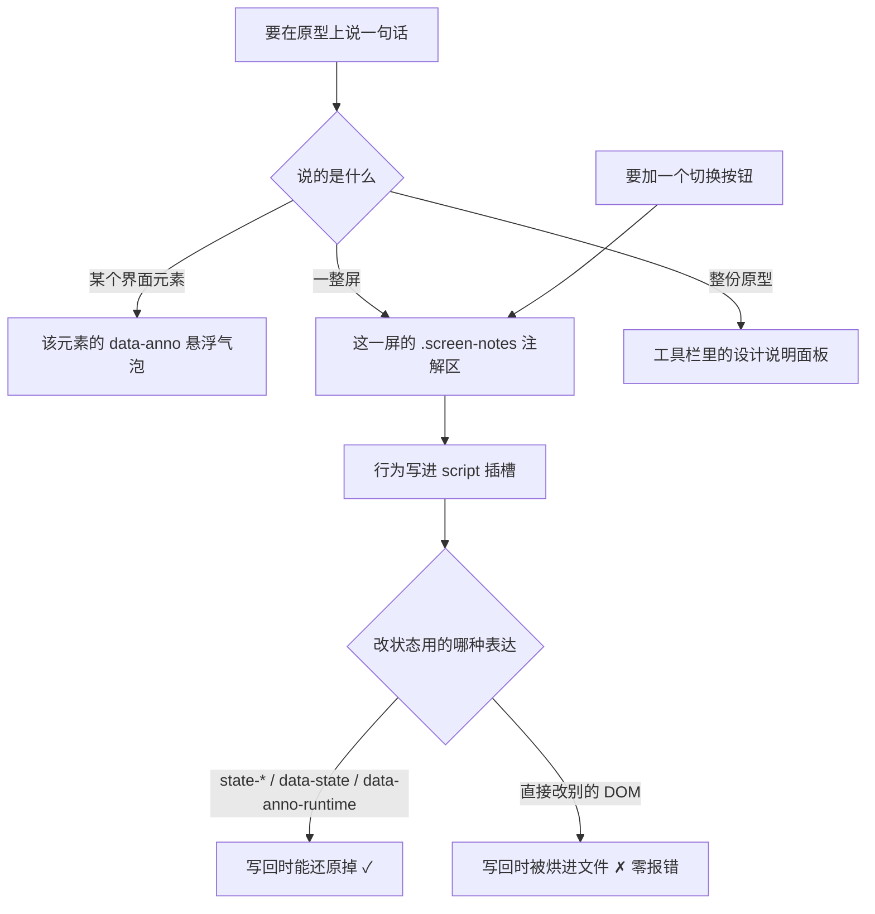

# ai-dev-system_技术 Spec — 原型注解分层与文档日期前缀

> 单仓库详细技术规范。上游：`2026-08-26-原型注解分层与文档日期前缀-PRD.md`、`2026-08-27-原型注解分层与文档日期前缀-overview.md`、UI 原型 `2026-08-26-原型注解分层-prototype.html`。
> **本文按 RFC 2119 解释** MUST / MUST NOT / SHOULD / SHOULD NOT / MAY / Implementation-defined。
> 本文里的文件路径与行号是**现状事实的锚点**（本次现读源码取得，出处见 §1 既有系统清单），不是实现指令；实现落点归 coding plan。

## 0. 阅读导引

**一句话目的**：这份 spec 让原型上的每一句话都有唯一归属位置、让用户能就地答话、让改稿不再被静默覆盖或被批注堵死，并把丢失的文档日期前缀规则补回全仓。

**端到端场景**

1. 产出方跑 `screen` 加一屏 → 这一屏在设备壳外自带一块注解区 → 产出方把该屏的整体注释与状态切换按钮写进注解区、把按钮的点击行为写进 `script` 插槽 → 用户打开原型，点第二屏注解区的「空态」，**只有第二屏变化**。
2. 用户悬浮某个控件右上角的琥珀色小标，读到「按团队筛选要不要保留？」→ 点气泡里的回复入口写「保留，但只给组长看」→ 产出方跑 `annotations`，看到这是一条**回复**、回的是哪条说明、说明是待拍板项、挂在哪一屏哪个元素。
3. 用户读稿期间预览服务开着，产出方跑 `slot --set screens` 改稿 → 用户浏览器里那份旧页面随后写回 → **服务拒绝这次写回**并回最新内容 → 页面自动载入新稿并把用户批注补写上去，两边改动都不丢。
4. 产出方要改掉一个带用户批注的按钮 → `slot` **拒绝写入**并列出受影响的每条批注 → 产出方与用户逐条约定（已落实 / 作废 / 挪到新元素）→ 带 `--agreed` 重跑 → 工具清掉已落实与作废的条目、校验挪走项的锚点在位、写入并打印放行清单。
5. 产出方新建一份技术 spec → 文件名以创建日期开头 → 索引检查递归扫到它（哪怕它被拆进一个同样以日期开头的子目录）。

**核心流程图**



**决策表**

| 输入 / 状态 | 条件 | 走向 / 处置 | 结果 |
|---|---|---|---|
| `slot --set screens` 写入 | 新片段丢了 `data-anno-user` 锚点，未带 `--agreed` | 拒绝写入，列出受影响每条 | 退出码 1，文件未变 |
| 同上 | 丢了锚点，带 `--agreed`，且批注块里已无对应条目（已被清掉）| 放行 | 写入 + 打印放行清单 |
| 同上 | 丢了锚点，带 `--agreed`，但该条目仍在批注块里 | 按 `--agreed-plan` 逐条处置 | 已落实/作废→清掉；挪走→锚点不在即拒绝 |
| 同上 | 新片段丢了 `data-anno-id`（AI 说明锚点）| 提示，不拦 | 写入 + 逐条列出丢掉的说明与其回复 |
| `POST /save` | 请求 `If-Match` 与磁盘当前版本一致 | 写入 | 200 `{"ok":true,"version":"<新版本>"}` |
| `POST /save` | 不一致 | 拒绝 | 409 `{"ok":false,"error":"stale","html":"<最新全文>"}` |
| `check` | 某屏 `.screen-notes` 内无正文 | 提示 | P2，退出码不受影响 |
| `check` | `.screen-notes` 里的 `[data-act]` 按钮在 `script` 区找不到同名引用 | 提示 | P2 |
| `check` | 稿中出现稿间对比措辞 | 提示 | P2 |
| `check` | `script` 插槽内容语法错误 | 硬错误 | P0（既有检查覆盖到新位置，非新增）|

## 1. 范围

- **本仓库做什么**：改造原型容器与原型工具，同步 `ai-prd` 与 `ai-dev-workflow` 两侧的纪律、模板、口径与机器闸；补回文档日期前缀规则并清掉本仓库唯一那份反例。
- **不做什么**：不改 `ai-prd` 的 4 批提问与三道门顺序（唯一例外见 FR-011）；不改 `ai-dev-workflow` 的任何一道门、步骤或准出项的**语义**；不引入主题切换/暗色/多语言；不批量重命名存量文档；不迁移存量原型；不引入任何外部资源。
- **依赖的上游 / 被依赖的下游**：无跨仓依赖，单仓交付。下游是使用本体系的目标项目（通过重装升级）。

### 既有系统清单（穷举不判断）

见 Overview §5.5 —— 该表逐行带 `文件:行` 出处，本节 MUST NOT 复制一份（两份必然漂移）。本次读了源码才搞清楚的四个域已落成卡片：`engineering-context/cards/ai-dev-system.md#原型容器（ui-prototype.html）` / `#原型工具（preview.mjs）` / `#文档治理与命名（ai-dev-workflow）` / `#UI 原型纪律（ai-prd）`，并在 `engineering-context/capability-registry.md` 登记四行（`ctx discover "原型"` 可命中，确认时间 2026-08-27）。

### 1.2 配套原型里那三条 AI 说明是演示数据，不是本次的行为契约

跑 `preview.mjs annotations docs/spec/2026-08-26-原型注解分层-prototype.html` 会得到三条 AI 侧说明（`:996` 新建工单入口、`:1011` 按团队筛选〔待拍板〕、`:1109` 填处理结论）。它们属于那份原型**用来演示屏注解区长什么样**的虚构工单场景，**MUST NOT 被当成本次需求的行为契约**——本次改的是原型框架本身，不是任何工单系统。其中 `:1011` 那条在 §2.1 被引作回复结构的示例，同样只是示例数据。

两条用户全局反馈则**是**真需求，已分别落成 FR-003（g1 去掉全局状态切换总闸）与 FR-007（g2 设计说明固定不随滚动、默认折叠）。

### 1.1 功能需求

| 编号 | 需求 |
|---|---|
| FR-001 | 每一屏在设备壳之外有一块屏注解区，含一行固定小标题、该屏整体注释位、该屏切换按钮位；屏名仍在设备壳上方 |
| FR-002 | 屏注解区默认挂在该屏下方水平居中；加屏时可显式指定挂该屏右侧垂直居中；并排放不下时自动换行到屏下方，不挤压屏本身 |
| FR-003 | 屏注解区是画布上**唯一**的状态切换入口：画布右侧那处切全部屏的状态切换删除；主行动按钮的"提交→处理中→成功"演示只作用于它所在那一屏 |
| FR-004 | 产出方可写位置由六处增到七处，新增的一处承载自定义脚本，位于同一份 HTML 内部，MUST NOT 引出任何外部脚本文件 |
| FR-005 | 注解区里按钮的点击行为由产出方写；改状态 MUST 用容器认得的三种表达方式之一，用别的方式改 DOM 会在写回时被烘进文件 |
| FR-006 | 注释三层归属成闭集并写进纪律：某元素→该元素悬浮气泡；一整屏→该屏注解区；整份原型→设计说明。三层都在用户界面之外 |
| FR-007 | 设计说明改为顶部工具栏右段第一枚按钮（写回按钮左侧），带图标、与相邻按钮同高同形、描边与文字用主色；入口文字只有「设计说明」四字；默认收起，点开在下方展开面板、再点收起；**入口与展开的面板都固定在画布顶端、不随页面滚动而滚动**（用户批注 g2 的原话）；画布右侧那一列取消，界面区拿回整幅宽度 |
| FR-008 | 工具栏分两段：左段为原型批注标题、加注释、全局反馈、隐藏批注、批注计数；右段为设计说明、写回按钮、状态灯 |
| FR-009 | 「复制 JSON」条件显示：预览服务正常写回时不出现，只在写不进文件时出现；「重试写回」维持既有的条件显示并改用次要按钮样式 |
| FR-010 | 预览服务开着时，页面里的旧版本 MUST NOT 覆盖磁盘上的新版本：页面写回时带上它当初读到的那一版的标识，服务发现文件已变即拒绝本次写回并回最新内容 |
| FR-011 | 被拒绝写回时页面自动载入最新稿并把未写回的批注补上，用户批注不丢；用户手动刷新时同样先把未写回的批注写回再载入 |
| FR-012 | 用户可在任何一条 AI 说明气泡上追加回复（含待拍板的那种），同一条说明可追加多条回复，可改可删 |
| FR-013 | 取回批注时新增"用户对说明的回复"这一类，每条带五项：这是回复、被回复的说明原文、该说明是否待拍板、所在屏与元素、回复正文 |
| FR-014 | 落盘确认门逐条摆待拍板项时，已有用户回复的连回复一起摆出供确认，MUST NOT 当成没答过重新问一遍 |
| FR-015 | 改稿删掉某条 AI 说明时，挂在它上面的回复一并删除；写入时逐条列出被一并丢弃的回复（哪条说明、几条回复、正文），出声但不阻断 |
| FR-016 | 改稿丢掉此前写好的 AI 侧元素说明时，逐条列出丢了哪些，提示不拦 |
| FR-017 | 改稿动到带用户批注的元素时，MUST 先列出受影响的每一条（哪一屏、哪个元素、原文），与用户逐条约定处理方案（已落实 / 作废 / 挪到改后的哪个元素），约定后才写入 |
| FR-018 | 放行 MUST 是一次显式动作，MUST NOT 默认放行；约定为已落实或作废的条目由工具在放行时从批注数据里清掉并记进放行清单；约定为挪到新元素的，锚点不在改后界面上时 MUST 拒绝放行 |
| FR-019 | 交付自检新增三类提示级检查：某屏没写注解、稿中出现稿间对比措辞、注解区里的按钮没有对应的点击行为 |
| FR-020 | 自定义脚本区沿用既有的内联脚本可解析检查（硬错误级）与零外链检查 |
| FR-021 | PRD 写作纪律新增「只写最新现状」条款，明确区分"相对现有系统的变化必须写"与"相对上一稿的变化不写"，并写明"不得丢掉此前已写好的特性与注释"、"定稿后的 changelog 不受此约束" |
| FR-022 | 文档治理 §默认命名 补回日期前缀规则：适用 `docs/spec|plan|report` 三个目录下按次产出的文档，日期取创建日期；常青档不加；它是地板，MUST NOT 被"项目已有更严格约定"那条逃生口整条豁免；拆成目录时目录名同样以日期开头；**同一天同主题的第二份属改稿，MUST 改原文件而不是新建**（同一天不同主题的两份文件名天然不冲突）|
| FR-023 | `ai-prd` 的落盘命名改为日期开头：PRD 为 `docs/spec/YYYY-MM-DD-<name>-PRD.md`、原型为 `docs/spec/YYYY-MM-DD-<name>-prototype.html` |
| FR-024 | `ai-dev-workflow` 与 `ai-prd` 里每一处写死的按次产出文件名范式同步改成日期开头（枚举以实测为准，MUST NOT 照抄任何数字）|
| FR-025 | 这条命名规则在完整路径上读得到：`SKILL.md`〈加载点清单〉让"给新建文档起名落盘"那一刻取得到 `文档治理.md`，且 `00-流程总纲.md` §移出常驻的三篇 里 `文档治理.md` 的结论行带上命名地板 |
| FR-026 | `路径-lean.md` 补一条带 `来源：文档治理.md §默认命名` 锚点的要点，使 Lean 自足册覆盖率闸不判红 |
| FR-027 | 本仓库存量反例 `docs/report/agentic-principle-gap-report.md` 按其提交日期补前缀，并同步 `docs/index.md` 与 `ai-dev-system/migrations/1.6.0.md` 两处引用（后者 MUST 保持 ≤45 行且「需要的动作」节仍在）|
| FR-028 | `test/doc-index.test.mjs` 由只扫三个目录第一层改为递归扫子目录，使拆成目录的产出同样受 lifecycle 字段、索引收录与断链三项检查 |
| FR-029 | 「三类批注」这句口径在全部落点改成"三类 + 回复"（枚举以实测为准，MUST NOT 靠字面搜"三类"找齐）|
| FR-030 | 因本次改动而失准的机器闸断言逐条改写，并为新规矩补断言；判据不变的断言 MUST NOT 因为跑红就放宽 |
| FR-031 | 准出时承接 PRD〈收尾动作〉：把本次已落地的口径按 `文档治理.md` §6 的落点映射表归并回需求真相源 `docs/REQUIREMENTS.md`，随后把变更 PRD 标 `lifecycle: merged`、加归档头注，并从 `docs/index.md` 移入 `docs/index-archive.md` |

**编号规则（MUST）**：格式为 `FR-###` / `AC-###`（前缀 + 三位零填充十进制，超过 999 位数自然扩展）；编号**永不复用、永不重排**，新增一律接着当前最大号往后取；删除的需求 MUST 原地保留编号并改写成"**已撤销** —— 原因"，MUST NOT 整行删掉腾位置。`FR-###`/`AC-###` 与 §6 的 `Invariant N:` 是两套独立编号，互不换算。

## 2. 数据模型 / 数据结构

### 2.1 批注数据块（schema 不升版本）

`prd-annotations@1` **保持不变**。回复以新增的可选顶层数组承载：

```json
{
  "schema": "prd-annotations@1",
  "updatedAt": "2026-08-27T10:00:00.000Z",
  "global": [ { "id": "g1", "text": "…", "at": "…" } ],
  "items":  [ { "id": "u1", "screen": "…", "tag": "button", "label": "…", "path": "…", "text": "…", "at": "…" } ],
  "replies": [
    {
      "id": "r1",
      "noteId": "a3",
      "noteText": "按团队筛选要不要保留？现在只有组长用得上",
      "noteKind": "question",
      "screen": "工单列表",
      "label": "本组全部",
      "tag": "button",
      "text": "保留，但只给组长看",
      "at": "2026-08-27T10:00:00.000Z"
    }
  ]
}
```

**为什么不升版本**（决策 D9）：升版本会让两个测试里逐字断言 `prd-annotations@1` 的那几处、以及 `docs/spec/2026-08-25-原型批注框架-lean-change-spec.md` 的 `authority_refs` 一起动，而收益为零——`replies` 是**可选字段**，旧原型的批注块里没有它，解析时缺失即视为空数组，新旧双向可读。升版本号只在"旧数据用新代码读会读错"时才有意义，这里不会。

**字段约束（MUST）**：

- `replies[].id` 前缀为 `r`，取号规则复用既有的 `nextId(list, prefix)`（`ui-prototype.html:1004-1010`）。
- `replies[].noteId` MUST 指向某个 AI 说明元素上的 `data-anno-id` 值（见 §2.2）。
- `noteText` / `noteKind` / `screen` / `label` / `tag` 是**写入时的快照**：说明被改写或删除后，这些快照仍让产出方看得懂这条回复原本在回什么。**MUST NOT 在读取时按当前 DOM 重算**——说明已经不在时重算只会得到空值。
- 顺序即时间序：`replies` MUST 追加，MUST NOT 因编辑某条而重排。

### 2.2 AI 说明的稳定锚点 `data-anno-id`

回复要挂在"某一条说明"上，而今天的 AI 说明**没有 id**——`collectAiNotes()` 靠正则扫 `data-anno` 属性、按出现顺序列出（`preview.mjs:329-356`）。顺序不是稳定标识：改稿插一条说明，其后每条的序号全漂，回复就全部错位。

因此新增一个属性：

```html
<button class="btn" data-anno="按团队筛选要不要保留？" data-anno-kind="question" data-anno-id="a3">本组全部</button>
```

- `data-anno-id` 由**页面框架在用户第一次回复这条说明时**自动补写（取号 `a` + 序，同 `nextId`），并随下一次写回落进文件。产出方写说明时 MAY 不写它。
- 已有 `data-anno-id` 的元素，框架 MUST NOT 改写它。
- 改稿时新片段 MUST 把现有的 `data-anno-id` 原样带过去——丢了它，挂在其上的回复失联（处置见 FR-015/FR-016：出声不阻断）。
- **为什么让框架补而不是要求产出方写全**：产出方写说明时并不知道用户会回复哪一条；要求每条都手写 id 是给一件八成用不上的事加恒定成本，且漏写没有任何东西会报错。

### 2.3 屏注解区的 DOM 契约

```html
<section class="device-wrap">            <!-- 挂右侧时： class="device-wrap is-anno-right" -->
  <p class="device-name">工单列表</p>
  <div class="device">…</div>
  <div class="screen-notes">
    <p class="screen-notes__title">这一屏的注解 · 不属于用户界面</p>
    <div class="screen-notes__body">这一屏按处理紧急度排序，未读在最上。</div>
    <div class="screen-notes__acts">
      <button type="button" class="btn btn-outline btn-sm" data-act="s1-empty">空态</button>
    </div>
  </div>
</section>
```

| 元素 | 谁写 | 约束 |
|---|---|---|
| `.screen-notes` | `screen` 命令生成外壳 | MUST 是 `.device-wrap` 的直接子元素，且 MUST 在 `.device` **之后**（它在设备壳之外） |
| `.screen-notes__title` | 容器固定文案 | 内容固定为「这一屏的注解 · 不属于用户界面」，产出方 MUST NOT 改 |
| `.screen-notes__body` | 产出方 | 该屏的整体注释；可为空（`check` 提示级） |
| `.screen-notes__acts` | 产出方 | 该屏的切换按钮；按钮 MUST 带 `data-act="<唯一名>"`，行为写进 `script` 插槽 |
| `.device-wrap.is-anno-right` | `screen --anno-right` 生成 | 挂右侧时加此类；未加即默认挂下方 |

**屏名 MUST 留在 `.device-name`，MUST NOT 搬进注解区**——`screenOf()`（`ui-prototype.html:1531-1535`）与 `screenSpans()`（`preview.mjs:310-326`）都靠 `.device-name` 判断"这是哪一屏"，搬走会让所有批注失去屏归属。

## 3. 接口契约

### 3.1 容器分区标记（新增两个可写区，固定实现区集合不变）

| 标记 | 类别 | 谁写 | 备注 |
|---|---|---|---|
| `CUSTOM-JS` | **新增·插槽** | 产出方（`slot --set script`）| 自定义脚本区，承载注解区按钮的点击行为 |
| `SCREEN-SCRIPT` | **新增·固定实现** | 谁都不写 | 原型级交互脚本（原 `ui-prototype.html:877-932` 那段裸脚本）纳入保护，见 D10 |

- `CUSTOM-JS` MUST NOT 加进 `preview.mjs` 的 `FIXED_REGIONS`（`preview.mjs:402`）——它是插槽不是固定区。
- `SCREEN-SCRIPT` MUST 加进 `FIXED_REGIONS`。
- 两个新区的位置：`CUSTOM-JS` 紧接 `CUSTOM-CSS` 之后（脚本与样式并列，且 MUST 在 `SCREEN-SCRIPT` **之后**加载，产出方才覆盖得掉容器的默认行为）；`SCREEN-SCRIPT` 即原裸脚本所在位置。

### 3.2 `preview.mjs` 命令契约

| 命令 | 变化 | 契约 |
|---|---|---|
| `slot --set <名>` | 插槽名由 6 个增到 7 个 | 新值 `script`，写入 `CUSTOM-JS` 区。完整取值：`title｜subtitle｜screens｜notes｜theme｜custom｜script`。**写入前 MUST 把内容里的 `</script` 转义成 `<\/script`**——脚本正文或注释里出现完整的结束标签会让 HTML 解析在那里提前闭合，浏览器执行一段残缺脚本，而 `check` 只会对被截断的片段报语法错。批注块早已做同样的转义（`persist()`），这里 MUST 一致 |
| `slot`（放行）| `--drop-anchors` **删除**，改为 `--agreed` | `--agreed` 表示"已与用户逐条约定过"。单独给 `--agreed` 而不给 `--agreed-plan` 时 MUST 拒绝并提示缺处置方案 |
| `slot --agreed-plan <文件或内联>` | **新增** | 逐条处置方案，格式见 §3.3 |
| `screen --anno-right` | **新增** | 该屏的注解区挂右侧；不给即默认挂下方 |
| `annotations` | 输出增第四类 | 人类可读输出增「用户对说明的回复」段；`--json` 输出增 `user.replies[]` |
| `check` | 增三类 P2 | 见 FR-019；`script` 区参与既有的内联脚本语法检查与零外链检查 |
| `serve` | 写回增版本校验 | 见 §3.4 |

**`--drop-anchors` 直接删除，不保留兼容**（用户在兼容取舍确认门拍板，2026-08-27）：它只由 AI 敲，无外部使用者；旧名字面说的是"丢弃用户意见"，与新语义相反，留着会被下一个零上下文 agent 当成绕过约定的后门。传入 `--drop-anchors` 时 MUST 报错并指向 `--agreed`，MUST NOT 静默当作未知参数吞掉。

### 3.3 放行方案 `--agreed-plan` 的格式

```
u1=done
u2=void
u3=move
```

| 取值 | 含义 | 工具动作 |
|---|---|---|
| `done` | 已落实（意见已改进稿子）| 从 `items[]` 清掉，记进放行清单 |
| `void` | 作废（用户说这条不要了）| 从 `items[]` 清掉，记进放行清单 |
| `move` | 挪到改后的某个元素 | **校验新片段里存在 `data-anno-user="<id>"`**；存在即放行并记进放行清单，不存在即拒绝 |

- 取值是**闭集**，MUST NOT 自造第四个值；未知取值 MUST 报错列出合法值域。
- **"受影响的条目"MUST 按两个来源取并集，MUST NOT 只取"锚点丢了的那些"**：① 新片段里**没有**该锚点的（旧锚点消失 = 这条要么已落实、要么作废、要么产出方忘了带过去）；② 新片段里**仍有**该锚点、但产出方在方案里显式声明为 `move` 的（锚点还在、只是挪到了别的元素上）。
  **只取 ① 会让 `move` 成为死值**：锚点带过去了就不在 ① 里、压根触发不了放行；不带过去就必然被 `move` 的校验拒绝——两条路都走不通，`move` 永远无法成功。这条是设计缺陷，`--agreed-plan` 的三个取值 MUST 都有可达的成功路径。
- 受影响的每条 MUST 在方案里出现；有遗漏 MUST 拒绝并列出漏了哪几条，MUST NOT 对遗漏项默认放行。
- `--agreed-plan` 接受两种形式：`--agreed-plan=u1=done,u2=void`（内联，逗号分隔）或 `--agreed-plan <文件>`（每行一条）。Implementation-defined：文件里以 `#` 开头的行按注释忽略。
- **放行清单 MUST 打印到 stdout**，每条含 id、所在屏、元素文字、原文、处置。它是"约定过"这件事唯一的留痕。

### 3.4 预览服务写回契约

| 交互 | 契约 |
|---|---|
| `GET /` | 响应头 MUST 带 `X-Proto-Version: <版本串>`，页面 MUST 记住它 |
| `POST /save` | 请求头 MUST 带 `If-Match: <页面记住的版本串>` |
| `POST /save` 版本一致 | 原子写入，200，响应体 `{"ok":true,"version":"<写入后的新版本串>"}`，页面 MUST 用它更新记住的版本 |
| `POST /save` 版本不一致 | **不写入**，409，响应体 `{"ok":false,"error":"stale","html":"<磁盘上的最新全文>"}` |
| `POST /save` 缺 `If-Match` | 409 同上（**MUST NOT 当作强制覆盖放行**）|

- **版本串 MUST 是文件内容的哈希**（`node:crypto` 的 SHA-256 取前 16 位十六进制即可，零依赖）。**MUST NOT 用 `mtime` + 字节数**：同一毫秒内两次写入且字节数相同时它不变，旧页面就能覆盖新稿——那正是本条要堵的失败。
- **写入 MUST 串行化**：`POST /save` 里"读当前版本 → 比对 → 写入"之间存在 TOCTOU 窗口，另一个写者可以挤进来、而它的改动会被这次写入吞掉。服务 MUST 用一条 Promise 队列把每次 `/save` 的比对与写入串成临界区（同进程内够用；本服务只服务一个文件、只绑回环，不存在跨进程写者）。
- 收到 409 时页面 MUST：① 用响应里的 `html` 重建当前文档的批注块基线；② 把本机尚未写回的批注合并上去；③ 重新写回一次（带新版本串）。合并规则：以本机 `store` 为准追加，**MUST NOT** 丢弃磁盘那版里已有而本机没有的条目。
- 手动刷新（`beforeunload`）时页面 MUST 先把未写回的批注写回再卸载，MUST NOT 直接丢弃那部分。卸载期发不出自定义请求头，因此服务 MUST 另认一条**同义的携带方式**：`POST /save` 在没有 `If-Match` 头时 MUST 读取查询参数 `?v=<版本串>`，两者语义完全相同（都表示"我基于哪一版改的"）。这样 `navigator.sendBeacon("save?v=" + docVersion, blob)` 就能走通，且**不削弱版本校验**——两者都不给才判冲突。
- 兜底仍在：beacon 被浏览器丢弃或撞版本冲突时，批注仍留在 `localStorage`（既有 `load()` 按 `updatedAt` 择新，`ui-prototype.html:991-1000`），下次打开这份原型时取回。**MUST NOT 把兜底当成主路径**——不发 beacon 就等于让用户这一次刷新丢掉一次写回机会。

## 4. 核心逻辑 / 流程

### 4.1 状态切换由总闸改为逐屏

**删**：`ui-prototype.html:851-865` 的状态切换卡片、`:877-895` 的 `setState` 全局遍历与 `stateButtons` 绑定。

**留并改**：`[data-submit]` 演示改为只作用于自身所在的 `.screen`：

```js
document.querySelectorAll("[data-submit]").forEach(function (submit) {
  submit.addEventListener("click", function () {
    var screen = submit.closest(".screen");
    if (!screen) return;
    setScreenState(screen, "state-loading");
    window.setTimeout(function () { setScreenState(screen, "state-success"); }, 650);
  });
});
```

**新增**容器导出的**状态表达函数**（住在 `SCREEN-SCRIPT` 固定区，供 `CUSTOM-JS` 区调用）：

```js
// 给某一屏换状态。它是"三种合法状态表达"里第一种的现成写法，不含任何按钮语义：
// 绑哪个按钮、点了切到哪个状态、要不要设按下态，全部由产出方在 CUSTOM-JS 区自己写。
window.setScreenState = function (screenEl, nextState) {
  if (!screenEl) return;
  Array.prototype.slice.call(screenEl.classList)
    .filter(function (c) { return c.indexOf("state-") === 0; })
    .forEach(function (c) { screenEl.classList.remove(c); });
  if (nextState) screenEl.classList.add(nextState);
};
```

产出方在 `CUSTOM-JS` 区自己接线，容器不参与：

```js
document.querySelector('[data-act="s1-empty"]').addEventListener("click", function (e) {
  var wrap = e.currentTarget.closest(".device-wrap");
  window.setScreenState(wrap.querySelector(".screen"), "state-empty");
  // 要不要给按钮设 aria-pressed、要不要联动别的按钮，也由产出方自己决定
});
```

**边界 MUST 就划在这里**：容器只导出"怎么表达一个状态"（`serialize()` 认得的三种表达之一，`ui-prototype.html:1051-1071`），**MUST NOT 导出任何认识按钮的函数**。早前的设计里有一个 `protoSetState(actName, nextState)`——它按 `data-act` 找按钮、由按钮找屏、再批量设 `aria-pressed`，那已经把"按钮点下去做什么"整套内置进容器了，**违反 PRD 非目标 3「容器不定义任何点击语义」，本次已删除**（codex 忠实度复核 2026-08-27 判为越界，采纳）。

**为什么仍要导出 `setScreenState` 而不是让产出方自己写 `classList.add`**：产出方自己写 `classList.add("state-empty")` 恰好落在第一种合法表达里、是安全的；但让他自己想，写成 `el.style.display = "none"` 的概率不低，而那一种写回时还原不掉、会把状态烘进文件且零报错。导出一个纯粹的状态表达函数是**给出合法表达**，不是**定义点击语义**——两者的分界是"这个函数认不认识按钮"。

### 4.2 设计说明移入工具栏

- **删** `ui-prototype.html:850-874` 的 `<aside class="aside-stack">` 整段；`.stage` 由两列改单列（`:548-556`）；`.aside-stack` 及其 sticky 规则、`@media(max-width:1080px)` 里那两行随之删除（`:598`、`:619-622`）。
- **`NOTES` 插槽标记与 `#proto-notes` 元素 MUST 保留**，整体移进工具栏下方的折叠面板里。`slot --set notes` 的写入路径因此完全不变。
- 面板默认 `hidden`；入口按钮 `data-act="notes"` 切换它。
- 入口按钮 MUST 是右段第一枚（写回按钮左侧），样式 `btn btn-outline btn-sm`，图标在前，描边与文字用主色（新增 `.anno-bar__notes-btn` 规则，写进 `ANNO-FRAMEWORK:CSS` 固定区）。
- **`check` 里那条"设计说明栏为空"的 P1 检查（`preview.mjs:478-479`）判据不变**——它查的是 `#proto-notes` 内容，与它挂在哪儿无关。

### 4.3 工具栏两段重排

`bar.innerHTML`（`ui-prototype.html:1187-1196`）改为：

```
[左段] 原型批注(标题) · 加注释 · 全局反馈 · 隐藏批注 · 批注计数
[spacer]
[右段] 设计说明 · 写回按钮 · 状态灯
```

`paint()`（`:1212-1258`）增两条显隐判定：

| 按钮 | 显示条件 |
|---|---|
| 写回（`data-act="save"`）| 既有判据不变：`SERVED && servedOk && !dirty` 时隐藏 |
| 复制 JSON（`data-act="copy"`）| **新**：`SERVED && servedOk` 时隐藏（写得进文件就没有人工搬运的必要）|

「重试写回」的样式由 `btn btn-sm`（主色实心）改为 `btn btn-outline btn-sm`。**只有 `SERVED` 分支改样式**——`file://` 降级路径下那枚按钮是用户唯一的存盘入口，MUST 保持主色实心。

### 4.4 说明气泡的回复

- `render()`（`:1325-1347`）给 note/ask 气泡加 `data-anno-note-id`（从元素的 `data-anno-id` 取，没有则由框架当场补写）。
- 点击 note/ask 气泡（今天只是显示 tip，`:1379-1385`）改为打开**说明面板**：上半展示说明原文（只读）+ 是否待拍板，下半是回复列表与输入框。
- 回复列表每条可改可删；追加走 `store.replies.push(...)` 后 `persist()`。
- **AI MUST NOT 在页面上回话**：面板里没有任何"以产出方身份回复"的入口。
- 删除某条 AI 说明（改稿时片段里不再有该 `data-anno-id`）→ `slot` 在写入前收集 `replies` 里 `noteId` 指向它的每一条，逐条打印后**从 `replies` 中移除**，写入照常进行（FR-015）。

## 5. 错误处理 / 降级 / 失败模型

| 失败 | 处置 | 谁保证 |
|---|---|---|
| 预览服务写不进文件 | 状态灯转灰，「重试写回」与「复制 JSON」出现，既有退避重试不变（`:1262-1273`）| 容器 `paint()` / `retry()` |
| 写回撞版本冲突 | 409 + 最新全文，页面合并后重写；用户无感 | `serve` + 容器 `write()` |
| 卸载期写回不可用 | 降级为 `localStorage` 缓存，下次打开按 `updatedAt` 择新（既有逻辑）| 容器 `load()` |
| `--agreed` 未带 `--agreed-plan` | 拒绝，提示缺处置方案 | `cmdSlot` |
| `--agreed-plan` 有遗漏或未知取值 | 拒绝，列出漏了哪几条 / 合法值域 | `cmdSlot` |
| `move` 项锚点不在新片段里 | 拒绝放行 | `cmdSlot` |
| 丢了 `data-anno-id` | 提示 + 逐条列出被丢弃的说明与其回复，写入照常 | `cmdSlot` |
| `script` 插槽内容语法错误 | P0 硬错误 | `cmdCheck` 既有的 `new Function(body)` 检查（`preview.mjs:575-583`）|
| `script` 插槽引入外部资源 | P0 硬错误 | `cmdCheck` 既有零外链检查（`:454-460`）|
| 注解区按钮无对应行为 | P2 提示 | `cmdCheck` 新增 |

## 6. 安全 / 不变量

`Invariant 1`：原型任何时候都是单文件、零外链、可离线打开。新增的注解区与 `CUSTOM-JS` 区 MUST NOT 引入任何外部资源。
`Invariant 2`：画布上有且只有各屏自己的 `.screen-notes__acts` 能切状态；设计说明全篇有且只有一处。
`Invariant 3`：用户写下的意见，未经与用户逐条约定，不会在任何路径上被静默丢弃。
`Invariant 4`：磁盘上的原型永远是最新那一版；页面里的旧版本不能覆盖它。
`Invariant 5`：批注数据块的写入方只有两个——页面工具栏，以及**显式放行路径上的 `cmdSlot`**。AI 手工编辑批注块仍然禁止。
`Invariant 6`：`docs/spec|plan|report` 下此后新建的按次产出文档，文件名都以 `YYYY-MM-DD-` 开头。
`Invariant 7`：预览服务只绑 `127.0.0.1`，只认这一个文件，拒绝跨站写入（**本次不变**，新增的版本校验 MUST NOT 削弱任何一条）。

### 6.1 运营度量（上线后观察，不构成本次验收）

PRD〈运营度量与看板〉那条——"下一次真跑一遍完整的产 PRD 流程时，产出的原型里『写进屏幕内容的说明文字』为零，且每屏该说的话都在它自己的注解区里"——**发生在本次交付之后**，MUST NOT 落成本次的 `AC-###`（那会用一件本次做不到的事阻塞交付）。它也**MUST NOT 被读成 §6 的 Invariant 2**：那条管的是"状态切换入口唯一、设计说明唯一"，与"屏幕里有没有混进说明文字"是两件事。

本次能为它做的只有埋好条件，且都已各自成条：三层归属写成闭集（FR-006）、屏注解区就位（FR-001）、`check` 仍对屏幕内出现说明字样报违规（既有检查，未改）。**观察本身挂进 `docs/TODO.md` 的待观察项**，下次产 PRD 时回看。

## 7. 可观测性

产物是本地工具，无线上指标。可观察的只有三处，MUST 保持：`serve` 每次写回打印一行（第 N 次、字节数）；`slot` 放行时打印放行清单；`check` 按 P0/P1/P2 分级打印并以退出码区分（P0 存在即 1）。

## 8. 兼容性 / 迁移

### 8.1 兼容取舍决策（用户已拍板，2026-08-27）

| 被改变的既有行为 | 谁在依赖它 | 用户决定 | 到期日 | 到期动作 | 确认时间 |
|---|---|---|---|---|---|
| `slot` 的 `--drop-anchors` 开关（丢弃锚点）| 只有 AI 敲；纪律与 `CLAUDE.md` 各一处表述 | **不兼容**——直接删除，传入时报错并指向 `--agreed` | — | — | 2026-08-27 |
| 画布右侧的状态切换总闸消失 | 此后新产出的原型；**存量原型自带旧容器，不受影响** | 不兼容（PRD §改动范围 已定）| — | — | 2026-08-27 |
| 设计说明由常驻右列改为工具栏折叠 | 同上 | 不兼容（PRD §改动范围 已定）| — | — | 2026-08-27 |
| 可写插槽集合六→七 | `test/prototype-annotations.test.mjs` 的硬编码断言 | 不兼容——断言同步改写（FR-030）| — | — | 2026-08-27 |
| `cmdSlot` 的"批注块前后必须逐字相等"不变式 | 该不变式自身的报错路径 | **仅在 `--agreed` 放行路径上、仅对已约定清掉的条目开口子**，其余路径不变（PRD §改动范围 已定）| — | — | 2026-08-27 |
| PRD 与原型文件名由日期在后改为日期在前 | 下游读原型的各处；存量文件**不改名** | 不兼容——新建文档才适用（PRD §九 已定）| — | — | 2026-08-27 |
| 文档命名新增日期前缀 | 所有装了本体系的项目 | 不兼容——只对新建文档生效，存量不批量改名（PRD §九 已定）| — | — | 2026-08-27 |
| 存量反例改名后旧路径失效 | `docs/index.md`、`migrations/1.6.0.md`（本次同步修正）；**仓库外的链接无法追溯** | 不兼容——用户已在大架构确认门逐条确认（Overview §0）| — | — | 2026-08-27 |
| 批注数据 schema | 存量原型的批注块 | **永久兼容**——schema 不升版本，`replies` 为可选字段，缺失即视为空数组（D9）| — | — | 2026-08-27 |
| 存量原型的打开与使用 | 已交付的原型文件 | **永久兼容**——不迁移、不改写；它们是"这个界面当初长什么样"的唯一证据 | — | — | 2026-08-27 |

### 8.2 替换清单（Replacement Ledger）

| 被取代物 | 类型 | 取代者 | 处置 | 保留理由 + 到期日 |
|---|---|---|---|---|
| `--drop-anchors` 命令行开关（`preview.mjs:750`）| 开关 | `--agreed` + `--agreed-plan` | **删除**（保留一条指向新名的报错分支）| — |
| `opts['drop-anchors']` 判定分支（`preview.mjs:287`）| 代码分支 | `--agreed` 放行流程 | 删除 | — |
| `slot` 放行后那两行 `⚠ 按 --drop-anchors 丢弃了 N 个批注锚点`（`preview.mjs:302-304`）| 输出文案 | 放行清单 | 删除 | — |
| 状态切换卡片 `<section class="card card-compact" aria-label="原型状态切换">`（`ui-prototype.html:851-865`）| DOM 片段 | 各屏的 `.screen-notes__acts` | 删除 | — |
| `setState()` 全局遍历与 `stateButtons` 绑定（`ui-prototype.html:884-899`）| 函数 | `window.setScreenState()` | 删除 | — |
| `<aside class="aside-stack">` 外壳（`ui-prototype.html:850-874` 中除 `NOTES` 插槽外的部分）| DOM 片段 | 工具栏里的设计说明面板 | 删除 | — |
| `.aside-stack` 与 `.state-buttons` 样式规则（`ui-prototype.html:598`）| CSS 规则 | `.anno-notes-panel` / `.screen-notes__acts` | 删除 | — |
| `.stage` 的两列 `grid-template-columns`（`ui-prototype.html:548-556`）与 `@media` 里那两行（`:619-622`）| CSS 规则 | 单列布局 | 删除 | — |
| 说明栏标题文案「设计说明（不属于用户界面）」（`ui-prototype.html:869`）| 文案 | 「设计说明」四字 | 删除 | — |
| `UI原型纪律.md:92` 「失联一条报一条 P0」的绝对表述 | 文档句 | 「未经约定丢失时报 P0；约定后清掉的不触发」 | 改写 | — |
| `UI原型纪律.md:118-119` 「`slot` 保证批注块原样不动 / 丢锚点就拒绝写入」 | 文档句 | 新的放行契约表述 | 改写 | — |
| `UI原型纪律.md:144` / `:194`、`ui-prototype.html:937`、`preview.mjs:734` 的「唯一写入方是页面工具栏」 | 文档句 ×4 | 「页面工具栏 + 显式放行路径上的工具」 | 改写 | — |
| `UI原型纪律.md:49` 「右侧『设计说明』栏全篇只保留一个」 | 文档句 | 「设计说明全篇只保留一个」（去掉方位）| 改写 | — |
| `UI原型纪律.md:175` 容器自带能力表里的「状态切换」 | 文档句 | 屏注解区 | 改写 | — |
| `UI原型纪律.md:232` 「状态切换作用于全部屏」 | 文档句 | 逐屏切换 | 改写 | — |
| `UI原型纪律.md:88` 自检项「每个声明覆盖的状态都有对应切换入口」 | 文档句 | 改由屏注解区承担 | 改写 | — |
| `文档治理.md:245` 逃生口「项目已有更严格的文件名约定时可以沿用」 | 文档句 | 同句 + 「但 MUST NOT 豁免日期前缀」 | 改写（**不删**，它对目录之外的约定仍成立）| — |
| `CLAUDE.md` 那条「MUST NOT 用 `--drop-anchors` 绕过去」 | 文档句 | 「MUST NOT 未经约定就放行」 | 改写 | — |
| `docs/report/agentic-principle-gap-report.md` | 文件名 | `docs/report/2026-08-02-agentic-principle-gap-report.md` | 改名（`git mv`）+ 同步两处引用 | — |

> 本表**不含**"同一逻辑的多处副本"——本次没有产生副本。改写类条目的核销标准是"旧表述在全仓检索不到"，删除类是"引用数为 0"。

### 8.3 数据迁移 / 灰度

无数据迁移。唯一的存量改动是一次 `git mv`（FR-027），随本次分支提交，可用 `git mv` 反向还原。

## 9. AI 契约补充

不适用：本次不引入任何生成、总结、分类或识别能力，无模型调用、无 prompt、无置信度路由。**Triage 第 1 问已判定为否**，不叠加 `AI-LLM-overlay.md`。

## 10. 状态机

不适用：本次无持久状态流转。页面的写回状态（`dirty` / `servedOk`）是既有的瞬时 UI 状态，本次只增加一次 409 后的重试路径，不构成新状态机。

## 11. 完成定义（Definition of Done）

| 编号 | 验收项 | 满足 |
|---|---|---|
| AC-001 | §0 阅读导引齐全（一句话目的 + 端到端场景 + 流程图 + 决策表）| — |
| AC-002 | 加一屏后，该屏在设备壳外有 `.screen-notes`，含固定小标题与注释位；屏名仍在 `.device-name`；`--anno-right` 时注解区挂右侧 | FR-001 FR-002 |
| AC-003 | 屏与注解区并排放不下时自动换行到屏下方，不挤压屏本身 | FR-002 |
| AC-004 | 在某屏注解区放状态按钮并写好行为后，点它只改这一屏，其余屏保持原状；画布上找不到第二处能切状态的地方 | FR-003 |
| AC-005 | 主行动按钮的提交演示只改它所在那一屏 | FR-003 |
| AC-006 | `slot --set script` 可写入 `CUSTOM-JS` 区；写入的脚本参与既有的语法与零外链检查；原型仍是单文件、零外链 | FR-004 FR-020 |
| AC-007 | `window.setScreenState` 改的状态能被 `serialize()` 还原掉——运行时点过状态后写回，文件里不残留任何 `state-*` 类；且容器**没有**导出任何认识按钮的函数（`protoSetState` 一类） | FR-005 |
| AC-008 | `UI原型纪律.md` 里能查到一张三层归属表，每层写明"说的是什么 → 去哪 → 怎么呈现"，三层互不重叠且都在用户界面之外 | FR-006 |
| AC-009 | 打开原型时画布右侧没有说明栏、界面区占满整幅宽度；工具栏右段第一枚是带图标的「设计说明」（写回按钮左侧），与相邻按钮同高同形；点它在下方展开面板、再点收起；入口文字只有四个字；**页面向下滚动时入口与展开的面板都停在原位不跟着走** | FR-007 |
| AC-010 | 批注计数排在「隐藏批注」右边与左段动作按钮同区；右段常驻可见的只有设计说明与状态灯 | FR-008 |
| AC-011 | 预览服务正常且无待写回改动时，工具栏上没有「复制 JSON」也没有「重试写回」；「重试写回」出现时是次要按钮样式；`file://` 降级路径下那枚存盘按钮仍是主色实心 | FR-009 |
| AC-012 | 预览服务开着时改稿：磁盘上是新版本；用户那一页的写回被拒后自动取回最新稿并把批注补上，两边改动都不丢 | FR-010 FR-011 |
| AC-013 | 每条 AI 说明气泡上都有回复入口（含待拍板的那些）；同一条说明能追加多条回复；每条回复**既有改的入口也有删的入口**，改完即时写回 | FR-012 |
| AC-014 | `annotations` 输出里回复自成一类，五项齐全（是回复 / 被回复的说明原文 / 是否待拍板 / 所在屏与元素 / 回复正文）；`--json` 里为 `user.replies[]` | FR-013 |
| AC-015 | `00-prd生成流程.md` 落盘确认门那一步写明：已被回复的待拍板项连回复一起摆出，不重新提问；`prd质量清单.md` 对应勾验项同改 | FR-014 |
| AC-016 | 改稿删掉一条带回复的说明时写入照常进行，并逐条列出被一并丢弃的回复（哪条说明、几条回复、正文）| FR-015 |
| AC-017 | 改稿丢掉此前写好的 AI 侧元素说明时逐条列出，提示不拦 | FR-016 |
| AC-018 | 改稿动到带用户批注的元素时，工具列出受影响的每一条；未带 `--agreed` 时不写入 | FR-017 |
| AC-019 | `--agreed` 单独给出而无 `--agreed-plan` 时拒绝；方案有遗漏或未知取值时拒绝并列出漏项/合法值域 | FR-018 |
| AC-020 | 放行后 `done`/`void` 两类条目已从批注数据里清掉、放行清单打印了每条的处置；交付自检不再报它们指不到元素 | FR-018 |
| AC-021 | `move` 类条目的锚点没写到改后界面上时拒绝放行 | FR-018 |
| AC-022 | `check` 能报出三类新提示（某屏没写注解 / 稿中出现稿间对比措辞 / 注解区按钮没有对应行为），且都是提示级、不拦交付 | FR-019 |
| AC-023 | `prd写作纪律.md` 里能查到「只写最新现状」条款，明确区分两类"变化"，并写明不得丢东西与定稿后不受此约束 | FR-021 |
| AC-024 | `文档治理.md` §默认命名 写清：适用的三个目录、按次产出与常青档的分界、与既有逃生口的优先关系（前缀不受豁免）、目录形态同样适用、**同一天同主题的第二份改原文件而不是新建**，以及 PRD 与原型文件名同样适用 | FR-022 FR-023 |
| AC-025 | `ai-dev-workflow` 与 `ai-prd` 里每一处写死的按次产出文件名范式都带日期前缀，与 §默认命名 一致（**核销方式：按 §11.1 的检索式逐条过，MUST NOT 照数字收工**）| FR-024 |
| AC-026 | 走完整流程要给一份新 spec 起名落盘时，按〈加载点清单〉能取到这条命名规则；总纲 §移出常驻的三篇 的结论行里也能读到日期前缀这条地板；入口 `SKILL.md` 仍 ≤8,000 字节 | FR-025 |
| AC-027 | `路径-lean.md` 里有一条带 `来源：文档治理.md §默认命名` 锚点的要点，`node --test test/lean-selfcontained.test.mjs` 绿 | FR-026 |
| AC-028 | 本仓库 `docs/spec|plan|report` 下每一份按次产出的文档都以日期开头；`docs/index.md` 与 `migrations/1.6.0.md` 两处引用同步修正，后者仍 ≤45 行且「需要的动作」节仍在 | FR-027 |
| AC-029 | `test/doc-index.test.mjs` 递归扫子目录，且**有一个构造用例**证明递归真的生效（本仓库当前无子目录实例，不构造则改完照样全绿而实际没覆盖）| FR-028 |
| AC-030 | 「三类批注」这句口径在全部落点都改成"三类 + 回复"（核销方式见 §11.1）| FR-029 |
| AC-031 | 因本次改动失准的机器闸断言逐条改写、新规矩有断言；判据不变的断言未被放宽 | FR-030 |
| AC-032 | `node --test test/*.test.mjs` 全绿 | — |
| AC-033 | §8.1 兼容取舍每条都有用户确认结论 | — |
| AC-034 | §8.2 替换清单逐条核销：删除类引用数为 0，改写类旧表述全仓检索不到 | — |
| AC-035 | 代码评审门逐轴通过（轴的定义见 `references/core/代码评审纪律.md` §四条轴），P0/P1 已清零 | — |
| AC-036 | 文档生命周期已结算；本次新建文档 `lifecycle` 与 `authority_refs` 字段齐 | — |
| AC-037 | 卡片已更新（本次触碰的四个域，确认时间刷新）| — |
| AC-038 | `ai-dev-system/VERSION` 已 bump，`docs/index.md` 收录本次三份文档 | — |
| AC-039 | 用户在屏注解区上写批注与在界面元素上写批注**走同一条路、记同一份数据**——`.screen-notes` 在拾取模式下可被点选，产生的条目与普通元素批注同形（PRD〈特殊场景〉那条"允许，按现行方式记录"）| FR-001 |
| AC-040 | 准出时已把本次落地口径归并进 `docs/REQUIREMENTS.md`（按 `文档治理.md` §6 的落点映射表分派，**「功能清单没变化」MUST NOT 读成「无需归并」**）；变更 PRD 已标 `lifecycle: merged` + 归档头注，并已从 `docs/index.md` 移入 `docs/index-archive.md` | FR-031 |
| AC-041 | 往 `script` 插槽写入含完整脚本结束标签的内容后，页面仍能正常打开、脚本完整执行（写入时已转义），`check` 不报语法错 | FR-004 FR-020 |
| AC-042 | 版本串是内容哈希：同一毫秒内两次写入且字节数相同时版本仍变；`/save` 的比对与写入串行执行，并发两个写请求时后到的那个基于前一个的结果判定 | FR-010 |
| AC-043 | 用户手动刷新页面时未写回的批注被写回文件（beacon 带版本参数），不依赖"下次打开再取回"；beacon 被丢弃或撞冲突时批注仍在本机缓存里、下次打开取得回来 | FR-011 |
| AC-044 | `--agreed-plan` 的三个取值**都有可达的成功路径**：`done`/`void` 走清掉，`move` 在新片段带回同一锚点时放行并记进放行清单（**MUST 有一个真的走通 `move` 的用例**——只按"锚点丢了"取受影响集会让 `move` 永远走不到成功路径）| FR-018 |

**覆盖自查**：FR-001→AC-002/003；FR-002→AC-002/003；FR-003→AC-004/005；FR-004→AC-006；FR-005→AC-007；FR-006→AC-008；FR-007→AC-009；FR-008→AC-010；FR-009→AC-011；FR-010→AC-012；FR-011→AC-012；FR-012→AC-013；FR-013→AC-014；FR-014→AC-015；FR-015→AC-016；FR-016→AC-017；FR-017→AC-018；FR-018→AC-019/020/021；FR-019→AC-022；FR-020→AC-006；FR-021→AC-023；FR-022→AC-024；FR-023→AC-024；FR-024→AC-025；FR-025→AC-026；FR-026→AC-027；FR-027→AC-028；FR-028→AC-029；FR-029→AC-030；FR-030→AC-031；FR-031→AC-040。另有五条 AC 是复核后补的加严项，挂在既有 FR 上：AC-039→FR-001；AC-041→FR-004/FR-020；AC-042→FR-010；AC-043→FR-011；AC-044→FR-018。**每条 FR 都至少被一条 AC 覆盖，无缺口。**

### 11.1 两条"枚举以实测为准"的核销检索式

AC-025 与 AC-030 的核销 MUST 跑下面这两组命令并逐条过，**MUST NOT 照抄本文或 PRD 里的任何数字**（数字会随文档增删而漂）：

```bash
# AC-025：写死的按次产出文件名范式（本次改造前实测 37 处 / 18 个文件）
grep -rn --include='*.md' -E 'docs/(spec|plan|report)/<|docs/spec/ProjectName|<name>-prototype|<name>-PRD' ai-dev-system/skills/
# 归档篇的示例是具体文件名，上式抓不到，另跑：
grep -rn --include='*.md' -E 'docs/(spec|plan|report)/[^<【][^ )）`]*\.(md|html)' ai-dev-system/skills/

# AC-030：「三类批注」口径的全部落点 —— MUST NOT 只搜"三类"（只有 3 处是那个字面，
# 且会命中一堆"三类 PRD 模板"的假阳性）；按内容枚举搜：
grep -rn --include='*.md' -E '逐元素批注|全局反馈.*AI 侧|三样东西|用户批注 / 全局反馈' ai-dev-system/skills/ CLAUDE.md docs/index.md
```

## 12. 待澄清点

无。Overview §15 的三个开放问题已在本文定案：OQ1 → D10（纳入 `SCREEN-SCRIPT` 固定区）；OQ2 → **不做**（PRD 只定了三类自检，新增第四类属超范围）。兜底有三层：§4.1 导出的 `setScreenState` 给出合法表达、`check` 的「按钮无行为」提示、以及 AC-007 直接验证"点过状态后写回，文件里不残留 `state-*`"；OQ3 → 交给评审门忠实轴的「越界」偏离类型逐条核对 + §8.2 替换清单核销。

## 13. 决策表（locked-in）

| # | 决策 | 方向 | 影响组件 |
|---|---|---|---|
| D1–D8 | 见 Overview §8 | — | — |
| D9 | 批注 schema 不升版本 | `replies` 作可选字段，缺失即空数组 | 批注块、两个测试的逐字断言、2026-08-25 那份 spec 的 `authority_refs` 均**不动** |
| D10 | 原裸交互脚本纳入固定实现区 | 新增 `SCREEN-SCRIPT` 标记并进 `FIXED_REGIONS`。**PRD 没要求扩大固定实现区，这是本次新增的范围**（codex 复核判为镀金），但它已在**大架构确认门由用户逐条看过并拍板**（2026-08-27）：那段脚本本次必须改，而它今天不在任何保护区内、改坏了没有任何检查拦得住 | 容器、`preview.mjs:402`、`UI原型纪律.md` §7 三区表 |
| D11 | AI 说明的稳定锚点由框架按需补写 | `data-anno-id`，用户第一次回复该说明时补 | 容器 `render()`、`collectAiNotes()`、改稿提示 |
| D12 | 容器只导出 `window.setScreenState(screenEl, nextState)` | 纯状态表达函数，**不认识按钮**；绑定、按下态、联动全由产出方写。含按钮语义的 `protoSetState` 已删除——它违反 PRD 非目标 3 | `SCREEN-SCRIPT` 区、纪律的硬条款、`check` 的「按钮无行为」提示 |
| D13 | 放行开关改名不保留旧名 | `--drop-anchors` 删除，传入即报错指向 `--agreed` | `preview.mjs` argv、纪律六处、`CLAUDE.md` |
