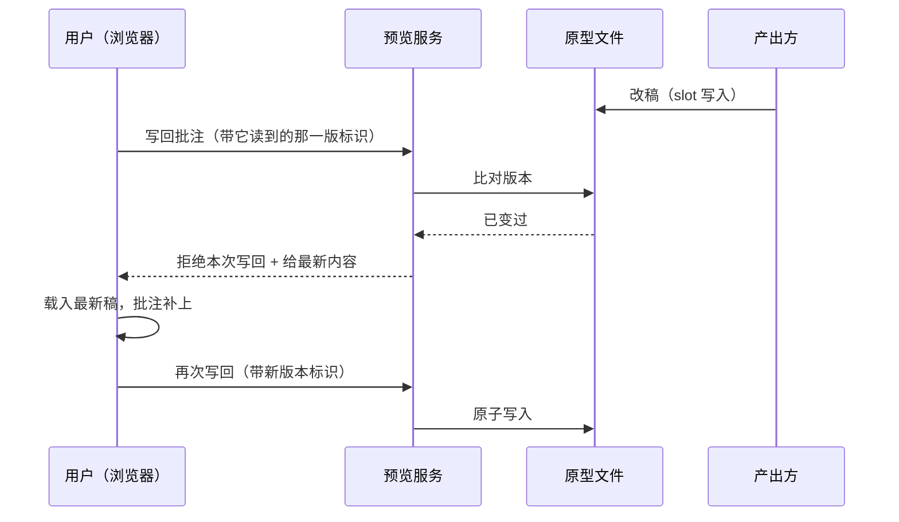

# 原型注解分层与文档日期前缀_00_Overview_顶层架构

> 顶层架构。产品需求见 `2026-08-26-原型注解分层与文档日期前缀-PRD.md`，配套原型 `2026-08-26-原型注解分层-prototype.html`。
> 本文按 RFC 2119 解释 MUST / MUST NOT / SHOULD / MAY。

## 0. 用户确认摘要（业务语言）

本次给"在原型上说话"这件事定下三个固定位置，并补回一条文档命名规则。

- **新增一个位置**：每一屏在设备壳之外多一块自己的注解区，装这一屏的整体说明和这一屏的切换按钮。原先画布右侧那个"一点全部屏一起切"的总开关取消，切状态改成逐屏点自己的。
- **挪走一个位置**：整份原型的设计说明不再常驻画布右侧一列，改成顶部工具栏上的一个按钮，默认收起，点开在下方展开。界面区因此拿回整幅宽度。
- **三个位置成闭集**：说的是某个元素 → 该元素的悬浮气泡；说的是一整屏 → 这一屏的注解区；说的是整份原型 → 设计说明。产出方不再需要临场决定写在哪。
- **用户能就地答话**：AI 写的每一条说明（尤其是标着"待你拍板"的）都能直接在气泡上追加回复，回复与那条说明绑定，产出方拿回来时看得出回的是哪一句。
- **改稿不再被批注卡死，但要先说一声**：产出方要改掉带用户意见的元素时，先把受影响的每条意见列出来、和用户逐条约定怎么处理（已落实 / 作废 / 挪到新元素），约定完才放行。
- **改稿不再被开着的页面盖掉**：用户读稿期间产出方改稿，用户浏览器里那份旧页面不会再把新稿整份覆盖回去。
- **改稿只写最新设计**：定稿之前的每一轮改稿只写此刻的样子，不写"相比上一轮改了什么"；但"相对现有系统的变化"照写不误。
- **文档命名补一条**：规范、计划、报告三类按次产出的文档，文件名一律以创建日期开头。长期固定的那几份（需求清单、待办、索引等）不加。

### 影响面与可逆性（Triage 第 3 问命中，MUST 一并确认）

| 问 | 答 |
|---|---|
| 动了哪些历史数据 | 只动**一份**：本仓库 `docs/report/agentic-principle-gap-report.md` 按其提交日期补前缀，并同步两处引用。其余存量文档、存量原型一律不动、不改名 |
| 影响哪些既有业务 | ①已交付的原型文件：**照常打开、照常用**，新规矩只作用于此后新产出的原型；②产 PRD 的流程：提问批次与三道门的顺序完全不变；③开发流程：不改任何一道门、步骤或准出项的语义，只改命名规则与口径的写法 |
| 出错能不能退回去 | 能。产物是随技能分发的本地文档与本地工具，使用者重装即升级、装回旧版即回退；没有线上服务、没有数据迁移、没有不可逆的对外承诺 |
| 退不回去的部分 | 只有一处：那份存量报告改名后，**旧文件名的外部链接会失效**（本仓库内的两处引用本次同步修正；仓库之外若有人存过旧链接，无法追溯修正） |

## 1. 术语表

| 词 | 指什么 |
|---|---|
| 屏注解区 | 每一屏在设备壳之外的一块区域，装该屏的整体注释与该屏的切换按钮 |
| 设计说明 | 整份原型层面的说明（样式依据 / 覆盖范围 / 开放问题 / 全局注释），全篇唯一一处 |
| 产出方 | 产出与改稿这份原型的一方（AI），与"用户"相对 |
| 放行 | 改稿会动到带用户批注的元素时，与用户逐条约定处理方案后的那一次显式动作 |
| 按次产出 | 为某一次需求 / 某一次任务产出的文档，与长期固定名字的常青档相对 |

## 2. 问题陈述

原型上要说的话有五类诉求（切某屏状态、切某组件形态、注释某元素、注释一整屏、注释整份原型），今天只有两个半位置承接：一个切全部屏的总闸、一处元素气泡、一栏常驻右侧的设计说明。缺的那一层（一整屏）无处可放，于是被写进屏幕内容里——这条禁令从 1.x 就在、仍反复被违反，因为缺的是位置不是严厉程度。同时改稿链路上有两处静默失败（开着的页面覆盖新稿、带批注的元素被工具堵死）与一条丢失的命名规则。

## 3. 目标 / 非目标

目标见 PRD §产品目标 九条，逐条对应本文 §6 的改造点。非目标严格照 PRD §非目标 六条，其中两条是本次的硬边界：

- **不改 `ai-prd` 的提问批次与三道门顺序**（唯一例外：落盘确认门摆待拍板项时带上已有回复）。
- **不改 `ai-dev-workflow` 的任何一道门、步骤或准出项的语义**——在它那侧动的全是命名规则与口径的**投影**，MUST NOT 借这些改动改动任何判据。

## 4. 系统边界（输入/输出）

- **输入**：产出方跑的命令（`preview.mjs` 六→七条子命令的调用）、用户在页面上的点击与文字。
- **输出**：一份单文件、零外链、可离线打开的原型 HTML；一份可被 `annotations` 命令读回的批注结构；随技能分发的一组纪律与模板文本。
- **边界外**：无网络服务（预览服务只绑本机回环）、无数据采集、无模型调用。

## 5. 架构分层

原型这条链路上有三层，本次三层都动，但职责划分不变：

| 层 | 谁提供 | 本次变化 |
|---|---|---|
| **容器**（`ui-prototype.html`）| 固定实现，产出方不许改写 | 增一块注解区外观、增一个可写区、说明栏换位置、批注框架增回复能力 |
| **工具**（`preview.mjs`）| 命令 | 增一个插槽、加屏带注解区、自检增三类、改稿增放行、写回增版本校验、取批注增回复类 |
| **纪律与模板** | 文本 | 描述上面两层的行为，并补齐命名规则 |

**职责铁律不变**：容器只给外观，一切点击语义由产出方写；工具只做能被脚本读出来的检查，MUST NOT 把结构知识写回纪律正文让 agent 去背。

## 5.5 既有系统清单（穷举不判断）

| 既有模块 / 机制 | 从哪知道它的 | 本次可能怎么碰到 | 卡片补了吗 |
|---|---|---|---|
| 容器分区标记（11 个 MARK 区）| `ui-prototype.html:14,57,62,626,631,790,838,845,871,934,949` | 新增一个可写区 → 标记集合变化，`check` 的 `FIXED_REGIONS` 与纪律 §7 三区表同步 | 本次新补 `cards/ai-dev-system.md#原型容器（ui-prototype.html）` |
| 画布两列布局 `.stage` + `.aside-stack` | `ui-prototype.html:548-556`、`:598` | 右列取消 → 两列改单列，`@media(max-width:1080px)` 那条也要跟着收 | 同上 |
| 状态切换卡片与 `setState` 总闸 | `:851-865`、`:884-894` | 整体删除，改为逐屏 | 同上 |
| **未被任何 MARK 保护的原型级交互脚本** | `:876-932` | 本次要改它（总闸、`[data-submit]` 演示），但它不在固定实现区内，`check` 管不到 | 同上 |
| 设计说明栏 `.card-title` + `#proto-notes` | `:867-873` | 移入工具栏面板，`NOTES` 插槽标记保留 | 同上 |
| 批注框架 `serialize()` 的三种状态表达 | `:1053-1073` | 屏注解区按钮改状态 MUST 走这三种，否则状态被烘进文件 | 同上 |
| 批注框架工具栏 `bar.innerHTML` 与 `paint()` | `:1189-1199`、`:1214-1260` | 重排两段、条件显示两枚按钮、新增设计说明入口 | 同上 |
| 批注数据 schema `prd-annotations@1` | `:940` | 增回复 → 是否升版本由实现判断，升了要同改两个测试的逐字断言与 2026-08-25 那份 spec 的 `authority_refs` | 同上 |
| `SLOTS` 六个具名插槽 | `preview.mjs:41-77` | 增至七个 | 本次新补 `cards/ai-dev-system.md#原型工具（preview.mjs）` |
| `cmdScreen` 屏骨架 | `:198-213` | 带注解区外壳，增挂位选项 | 同上 |
| `cmdSlot` 的两道校验（批注块等值、锚点不减）| `:279-303` | 等值不变式开一个口子（仅限已约定清掉、仅在显式放行路径）；`--drop-anchors` 语义改为放行 | 同上 |
| `cmdCheck` 十二类检查 | `:452-600` | 增三类提示级检查 | 同上 |
| `cmdServe` 的 `POST /save`（**不校验版本**）| `:634-720` | 增版本校验与冲突拒绝 | 同上 |
| `文档治理.md` §默认命名 七条范式 + 逃生口 | `文档治理.md:235-245` | 补日期前缀规则，并写明逃生口不豁免前缀 | 本次新补 `cards/ai-dev-system.md#文档治理与命名（ai-dev-workflow）` |
| `UI原型纪律.md` §2/§4/§5/§6/§7/§8 | `UI原型纪律.md:29,49,63-76,77-96,98-172,175,232` | 新增两节、改写六处失准承诺与三处因删总闸失准的表述 | 本次新补 `cards/ai-dev-system.md#UI 原型纪律（ai-prd）` |
| `test/doc-index.test.mjs` 只扫第一层 | `test/doc-index.test.mjs` | 日期前缀认可"拆成目录"形态后 MUST 改递归 | 未读源码，编码时读 |
| **`ctx discover` 的 out-of-scope 警告** | 本次 `ctx discover "原型"` 输出 | 无警告条目（registry 无废弃项登记）；`陷阱项` 列已记入卡片，逐条在 §14 A 表确认 | — |

## 6. Project Map（改造点清单）★ 最常被读

| 批 | 模块 | 分类 | 改动范围（只圈范围）| 依赖 |
|---|---|---|---|---|
| **A** | 原型容器 `ui-prototype.html` | 🔧 修改 | 屏注解区外观（挂下方/挂右侧两形态）；新增自定义脚本可写区；删画布右列与状态切换总闸；主行动按钮演示收敛到本屏；设计说明移入工具栏面板；工具栏两段重排 + 两枚按钮条件显示；说明气泡增回复入口；批注数据承载回复 | 无 |
| **B** | 原型工具 `preview.mjs` | 🔧 修改 | 插槽六→七；`screen` 带注解区外壳 + 挂位选项；`check` 增三类提示；`slot` 改稿放行契约（列清单 → 显式放行 → 清已落实/作废 → 校验挪走项锚点）+ 丢失 AI 说明提示；`annotations` 增回复类；`serve` 写回版本校验 | A |
| **C** | `ai-prd` 纪律与模板 | 🔧 修改 | `UI原型纪律.md` 增「注释三层归属」「屏注解区」两节、可写位置表六→七、§8.2 屏结构补注解区、改写六处失准承诺与三处失准表述、命名改日期在前、增改稿约定与预览刷新两条；`prd写作纪律.md` 增「只写最新现状」；`00-prd生成流程.md` 落盘命名与落盘确认门带回复；`prd质量清单.md`、`prd复核纪律.md`、三类 PRD 模板、`ai-prd/SKILL.md` | A B |
| **D** | `ai-dev-workflow` 命名与可达性 | 🔧 修改 | `文档治理.md` §默认命名 补日期前缀（适用范围 / 常青档例外 / 目录形态 / 与逃生口的优先关系）；六份 references 里写死的文件名范式（**枚举以实测为准**）；五个模板 frontmatter 示例；`路径-lean.md` 补带来源锚点的要点；`00-流程总纲.md` §移出常驻的三篇 结论行扩到含命名地板；`SKILL.md` 加载点清单**并进已有行**（入口 7,947 / 上限 8,000，只剩 53 字节）；`文档归档与账本收敛.md` 四条示例 | 无 |
| **E** | 「三类批注」口径 + 跨文件契约落点 | 🔧 修改 | 9 个文件的同一句口径改成"三类 + 回复"（**只有 3 处字面写着"三类"，MUST NOT 靠字面搜找齐**）；`CLAUDE.md` 与 `docs/index.md` 里写死的"六个具名插槽""三类批注""原型命名三处同改" | A B C |
| **F** | 机器闸与存量 | 🔧 修改 | `prototype-annotations` / `prototype-preview` 逐条改写失准断言并补新断言；`doc-index` 改递归（**MUST 构造子目录用例验证递归真生效**）；存量反例 `docs/report/agentic-principle-gap-report.md` 补前缀 + 同步 `docs/index.md` 与 `migrations/1.6.0.md`（后者 MUST 保持 ≤45 行且「需要的动作」节仍在）| A B D |

> **不变的边界**：`ai-prd` 的 4 批提问与三道门顺序；取批注的唯一入口与既有三类内容的含义；状态层显隐机制与"缺层回落默认态"；原型零外链单文件；`docs/` 下 spec/plan/report 三个目录的归属；两层真相源、TODO、索引、两个固定账本的文件名。

## 7. 模块边界表

| 模块 | Owns（权威于） | 不 Owns | 上游入口 | 下游输出 |
|---|---|---|---|---|
| 容器 | 注解区与按钮的**外观**、状态层显隐、批注框架的写入与序列化 | 任何按钮的**点击语义**、界面业务内容 | `preview.mjs init` 复制 | 单文件 HTML |
| 工具 | 结构契约的可判定部分、插槽区间、放行流程、写回冲突处置 | 结构知识的文字表述（那属纪律，但工具是唯一判定方）| 产出方命令行 | 改后的 HTML、自检报告、批注结构 |
| `UI原型纪律.md` | 三层归属、屏注解区定义、可写位置清单、改稿与写回的 MUST | 结构细节（收在 `check` 里，MUST NOT 抄进正文）| 产出方阅读 | 判据 |
| `文档治理.md` §默认命名 | 目录、文件名范式、日期前缀地板与其例外 | 各 skill 里那些**写死的示例文件名**（是投影，不是定义）| 加载点触发 | 判据 |

## 8. 已定决策（locked-in）

| # | 决策 | 方向 | 影响 |
|---|---|---|---|
| D1 | 状态切换的唯一入口 | 收敛到各屏自己的注解区，画布上不留第二处 | 容器、工具自检、纪律三处的"切换入口"表述 |
| D2 | 注解三层是闭集 | 元素气泡 / 屏注解区 / 设计说明，不设第四处 | 纪律新节、三类 PRD 模板的「不在用户界面内展示」项 |
| D3 | 按钮行为归属 | 容器只给外观，行为一律写进自定义脚本区；改状态 MUST 用容器认得的三种表达 | 容器、`check` 的"按钮无行为"提示、纪律硬条款 |
| D4 | 写回冲突谁赢 | 磁盘上的最新版本永远赢；页面带版本标识写回，不匹配即拒绝并让页面取回最新 | `serve`、批注框架 `write()`、纪律新条 |
| D5 | 改稿动到用户批注 | 由"一律拦住"改为"逐条约定 → 显式放行"；已落实/作废由工具清掉，挪走项校验锚点 | `slot` 的两道校验、`--drop-anchors` 语义、`CLAUDE.md` 那条易错点、纪律六处承诺 |
| D6 | 回复的归属 | 回复挂在被回复的说明上，不是独立批注；说明被删则回复随之删除，出声不阻断 | 批注数据结构、`annotations` 输出、落盘确认门 |
| D7 | 日期前缀是地板 | 不受"项目已有更严格约定"那条逃生口豁免；目录形态同样适用 | `文档治理.md`、全仓范式、Lean 自足册、加载点清单 |
| D8 | 命名统一为日期在前 | 原型与 PRD 都从"日期在后"改为"日期在前" | `ai-prd` 落盘命名、五项表、三类模板 |

## 9. 通信契约（冻结到集成粒度）

| 契约 | 冻结到什么粒度 |
|---|---|
| 批注数据结构 | 用户元素批注 / 全局反馈 / **AI 说明上的回复**三类各自可被 `annotations` 认出；回复 MUST 能答出"这是回复、回的哪条说明（原文照录）、那条是不是待拍板、挂在哪一屏哪个元素、回复正文"五项。字段名与是否升 schema 版本由实现定 |
| 页面 ↔ 预览服务 | 页面写回时 MUST 带上它当初读到的那一版的标识；服务发现文件已变即拒绝本次写回；页面取回最新内容后把批注补上再写。标识的具体形式（时间戳 / 摘要 / 序号）由实现定 |
| 插槽名集合 | 七个具名插槽，第七个承载自定义脚本；名字由实现定，但 MUST 与纪律的可写位置表、`check` 三处一致 |
| 容器认得的状态表达 | 三种，闭集：`.screen` 上的 `state-*` 类、`[data-state]` 元素的按下态、元素自报 `data-anno-runtime` |

## 10. 时序图（只画变动的节点）

## 11. 失败 / 降级模型

| 失败 | 处置 |
|---|---|
| 预览服务写不进文件 | 状态灯转灰、「重试写回」与「复制 JSON」出现，人工把批注交回来的路仍在（现有行为，本次只改这两枚按钮的显示条件与样式）|
| 页面写回被版本冲突拒绝 | 页面自动取回最新稿并把未写回的批注补上，不需要用户重写；用户手动刷新时同样先写回再载入 |
| 产出方在自定义脚本区写错 | `check` 沿用既有的内联脚本可解析检查，报 **P0**（硬错误，非新增检查，是既有检查覆盖到新位置）|
| 注解区按钮没有对应行为 | `check` 报提示级——点了没反应属静默失败，交付时看不出症状 |
| 改稿丢了 AI 侧元素说明 | 逐条列出丢了哪些，提示，不拦 |
| 改稿丢了用户批注锚点且未放行 | **拒绝写入**，列出受影响的每一条 |
| 约定为「挪到新元素」但锚点不在改后界面上 | **拒绝放行** |

## 12. 端到端不变量

1. 原型任何时候都是**单文件、零外链、可离线打开**——新增的注解区与脚本区一律不得引入任何外部资源。
2. 画布上**有且只有**各屏自己的注解区能切状态；设计说明全篇**有且只有**一处。
3. 用户写下的意见，未经与用户逐条约定，**不会**在任何路径上被静默丢弃。
4. 磁盘上的原型永远是最新那一版；页面里的旧版本不能覆盖它。
5. 批注数据块的写入方只有两个：页面工具栏，以及显式放行路径上的工具。**AI 手工编辑批注块仍然禁止。**
6. `docs/spec|plan|report` 下此后新建的按次产出文档，文件名都以 `YYYY-MM-DD-` 开头。

## 13. 子文档路线

| 子 spec | 覆盖 | 状态 |
|---|---|---|
| `2026-08-27-原型注解分层与文档日期前缀-eng-spec.md` | A–F 全部六批（同一仓、同一次交付，不再按边界拆）| 待写 |

> **为什么不拆**：六批全在同一个仓库、同一次版本发布内交付，且 D/E/F 三批是 A/B/C 的投影与核销，拆开会让"同一句口径散在几处"的核销失去单一落点。按 `00-流程总纲.md` §按边界拆 spec 的判据，单仓单次交付不触发拆分。

## 14. 定稿核查小表（A/B 两道核查）

**A. 既有系统对照**（逐项过 §5.5）

| 既有系统/机制 | ①会经过/触发它？ | ②会被它挡在门外？ | ③需额外存/恢复数据？ | 结论 |
|---|---|---|---|---|
| 容器 11 个 MARK 区 | 会——新增第 12 个区 | 会：`check` 的 `FIXED_REGIONS` 硬编码区名，不同步就报"固定区缺失" | 否 | 补进正文 §6 批 A/B；新区**是插槽不是固定区**，MUST NOT 加进 `FIXED_REGIONS` |
| 未被 MARK 保护的交互脚本 `:876-932` | 会——本次要改它 | **不会——这正是隐患**：改坏了没有任何检查拦得住 | 否 | 立 **OQ1**：这段脚本要不要顺势纳入某个 MARK 区 |
| `cmdSlot` 批注块等值不变式 | 会 | 会：放行时要清掉已落实/作废条目，等值必然不成立 | 否 | 已在 §6 批 B 写明"仅限已约定清掉、仅在显式放行路径开口子" |
| `cmdSlot` 锚点不减校验 | 会 | 会：改界面必然换掉锚点 | 否 | 语义由"拒绝"改"未放行则拒绝"，见 D5 |
| `serialize()` 三种状态表达 | 会——注解区按钮改状态必须走它 | 会：走别的方式，状态被烘进文件且零报错 | 否 | 已写成硬约束（§9、D3）；`check` 无法判定第三方脚本改了什么，只能靠纪律 + 「按钮无行为」提示兜一半 → 立 **OQ2** |
| 批注 schema `prd-annotations@1` | 会 | 会：两个测试逐字断言版本号 | **是**——既有原型里的批注数据要能被新框架读出来 | 补进正文 §9；旧数据 MUST 仍可读（回复类缺失即视为无回复）|
| `cmdServe` 无版本校验 | 会 | 不会 | 是——要记住"页面读到的是哪一版" | 见 D4 |
| `check` 十二类检查 | 会 | 会：新增 class 若无样式定义会被报 P1 | 否 | 注解区样式写在 `DESIGN-SYSTEM` 固定区，天然有定义 |
| `文档治理.md` 逃生口 `:245` | 会 | **会：整条豁免掉日期前缀** | 否 | D7 已定；纪律 MUST 显式写明优先关系 |
| `test/doc-index.test.mjs` 只扫第一层 | 会 | 会：拆成目录的产出整体逃出三项检查 | 否 | §6 批 F，且 MUST 构造用例验证递归真生效 |
| `migrations/1.6.0.md` 已发布 | 会——含存量反例的引用 | 会：`installer-migration` 断言它 ≤45 行且含「需要的动作」节 | 否 | §6 批 F 已写明 |
| `SKILL.md` 8,000 字节硬上限 | 会 | **会：只剩 53 字节，新增整行必判红** | 否 | D7 落地方式：MUST 并进已有行 |
| `ctx discover` out-of-scope 警告 | 否——本次无警告条目 | 否 | 否 | 卡片 `陷阱项` 已逐条记录，不另立 |

**B. PRD 逐节覆盖矩阵**

| PRD 节 | ①覆盖在哪 | ②隐患 / 谁保证 | 处置 |
|---|---|---|---|
| §一句话结论 九条 | §6 批 A–F 逐条对应 | — | 已覆盖 |
| §收尾动作 | spec FR-031 / AC-040，plan Task 15 | 只写一句"写进 spec 的准出清单"而不落成任务，准出时必漏；归并落点按口径类型分派，**「功能清单没变化」MUST NOT 读成「无需归并」** | 已落成可核销的任务与验收项 |
| §背景 | §2 | — | 已覆盖 |
| §目标与非目标 | §3 | 非目标 5「MUST NOT 借投影改判据」——没有机器闸能拦住"顺手改了个判据" | 立 **OQ3**：评审门忠实轴的越界项逐条核对 |
| §现状与当前逻辑 | §5.5（逐行核对过，行号一致）| — | 已覆盖 |
| §改动范围 20+ 行 | §6 | "枚举以实测为准、MUST NOT 照抄某个数字"——照抄会漏 | 已在批 D 写明；spec 里 MUST 逐条实测 |
| §不改的现有业务 | §6 末「不变的边界」+ §12 | — | 已覆盖 |
| §详细业务行为 一–九 | §6 + §8 + §9 + §11 | §一「改状态 MUST 用三种表达之一」是硬约束、无机器闸 | OQ2 |
| §流程图 | §5、§8 D2/D3 | — | 已覆盖 |
| §UI 原型 | §5.5 已读该原型批注（2 条全局反馈已落稿、3 条 AI 说明属演示内容）| — | 已覆盖 |
| §核心规则 18 行 | §11 + §6 | — | 已覆盖 |
| §特殊场景与冲突 24 行 | §11 + §12 | "同一天同主题的第二份属改稿，改原文件而不是新建" | 已覆盖，写进 spec 的命名节 |
| §验收标准 三张表 | 全部转成 spec 的 `AC-###` | 覆盖矩阵是 spec 的活 | 待 spec |
| §运营度量 | 不落成本次 AC —— 它发生在本次交付**之后**（spec §6.1 说明）| 若误当成本次验收项会阻塞交付；若无人记录则下次没人回看 | 埋好条件（FR-001/FR-006 + 既有的"屏幕内不得出现说明字样"检查），观察项挂进 `docs/TODO.md` |
| §风险与兜底 13 行 | §11 | "放行变成走过场""自写脚本改状态被烘进文件"两条无机器闸 | OQ2 |
| §非功能、数据与上线 | §4、§11 | — | 已覆盖 |

## 15. 开放问题

| # | 决策问题 | PRD 来源 | 关联锚点 | 为什么重要 | 候选方向 / 倾向 | 事实门状态 | owner |
|---|---|---|---|---|---|---|---|
| OQ1 | `ui-prototype.html:876-932` 那段原型级交互脚本不在任何 MARK 区内，本次要改它——要不要顺势把它纳入一个固定实现区？ | 派生自 A 核查 | §5.5、§6 批 A | 它是"改坏了没人拦得住"的唯一一块；本次删总闸正好动它 | ①纳入新的固定区（`check` 从此管得到）②维持现状 ③并入 `ANNO-FRAMEWORK:JS`。倾向 ① | 已查清（事实已确认，属实现取舍）| 本人，spec 里定 |
| OQ2 | 「按钮行为必须用容器认得的三种状态表达」这条硬约束，除了纪律与「按钮无行为」提示，还要不要加一道可判定的检查？ | §一、§风险与兜底 | §9、§11、D3 | 违反它的后果是静默烘死状态，与本期第 4 件事要堵的是同一类失败 | ①只靠纪律 ②`check` 增一条"自定义脚本区里出现了 `classList.add` 之类直改 DOM 状态的写法"的提示 ③不做。倾向 ② | 已查清（属实现取舍）| 本人，spec 里定 |
| OQ3 | 非目标 5 说"MUST NOT 借这些投影改动任何判据"，怎么核销？ | §非目标 5 | §3 | 投影散在十几个文件，顺手改判据不会报错 | 交给评审门忠实轴的「越界」偏离类型逐条核对 + spec 的替换清单登记 | 已查清 | 本人 |

## 16. 引用

- PRD：`docs/spec/2026-08-26-原型注解分层与文档日期前缀-PRD.md`
- UI 原型：`docs/spec/2026-08-26-原型注解分层-prototype.html`
- 代码事实：`engineering-context/cards/ai-dev-system.md`（本次新补四个域）
