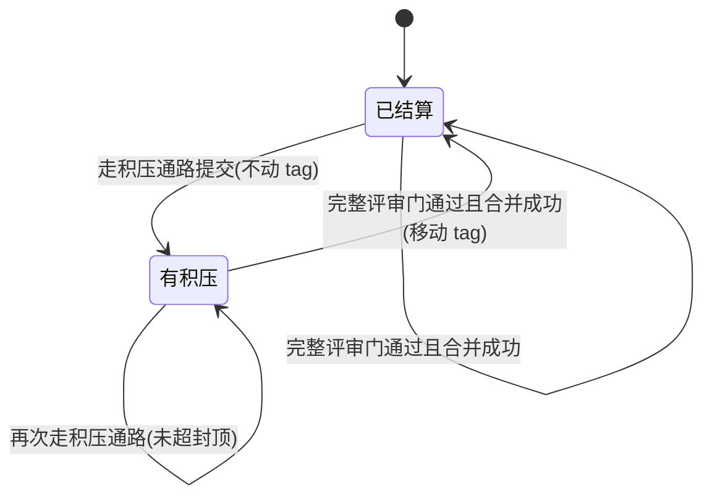

# ai-dev-system_技术 Spec — 评审门积压通路与测试面收窄

> 单仓库的详细技术规范。遵循 `references/core/spec写作纪律.md`：零上下文可动手、RFC2119、无占位符。

## 0. 阅读导引（MUST，前置）

- **一句话目的**：让代码评审门的**派发量**与**触发频率**都与改动的真实风险相称——配套机器闸不再把整套代码轴拉起来，够小的改动可以登记后延到下一次门一起评。

- **端到端场景**：
  1. 开发者改了一份 skill 判据文档并配套改了它的机器闸测试。改造前对象面判为 P+K、派五条轴；改造后可执行文件全是测试、不单独构成 P 面，轴集合收成 `{S, A}`，派两条轴。
  2. 开发者修了一处死链接，共动 12 行 markdown、0 行代码。改造前仍须当场跑完整评审门；改造后机械判定为可积压，提交时带上 `Review-Deferred` trailer，合并进主分支，评审基点 tag 不动。
  3. 三周后该项目做一次正常改动过评审门。评审范围从 `reviewed-through` tag 算起，**自动含住**那 12 行积压；过门且 P0/P1 清零、合并成功后，tag 移到主分支新 HEAD，积压结清。
  4. 开发者改的是鉴权判断，只有 3 行。命中"MUST NOT 积压"清单，**不看行数**，当场跑完整门。
  5. 某项目 `merge-gate="pr"`，手上有未结算积压。开 PR 前 MUST 先结算——积压只在 `direct` 合并方式下可以跨越合并点。

- **核心流程图**：
  ```mermaid
  flowchart TD
    A[编码完成 + 基础验证通过] --> B{命中 MUST NOT 积压清单?}
    B -->|是| G[当场跑完整评审门]
    B -->|否| C{本次改动 代码<20行 且 文档<40行?}
    C -->|否| G
    C -->|是| D{累计积压 代码≤100 且 文档≤200 且 最早≤14天?}
    D -->|否| G
    D -->|是| E{merge-gate = pr 且要开 PR?}
    E -->|是| G
    E -->|否| F[登记 Review-Deferred trailer + 告知用户]
    F --> H[合并, 不动 reviewed-through tag]
    G --> I[判对象面 → 推轴 → 定档 → 派子代理]
    I --> J[P0/P1 清零 → 合并 → tag 移到主分支 HEAD]
  ```

- **决策表**：

  | 本次改动 | 命中禁止清单 | 单次行数 | 累计与时限 | 合并方式 | 走向 |
  |---|---|---|---|---|---|
  | 任意 | 是 | 任意 | 任意 | 任意 | 当场跑完整门 |
  | 任意 | 否 | 超单次阈值 | 任意 | 任意 | 当场跑完整门 |
  | 任意 | 否 | 达标 | 超封顶 | 任意 | 当场跑完整门（本次连同全部积压一起评） |
  | 任意 | 否 | 达标 | 未超 | `pr` 且本次要开 PR | 当场跑完整门 |
  | 任意 | 否 | 达标 | 未超 | `direct`，或 `pr` 但本次不开 PR | 登记积压 |

## 1. 范围

- **本仓库做什么**：改 `ai-dev-workflow` skill 的评审门判据（对象面判定、触发通路、评审范围取法）与完成门的准出项措辞；同步 Lean 自足册、总纲、注入目标项目的片段；新增覆盖这两条新判据的机器闸；**为容纳新增判据而腾出常驻前置量**（FR-017）。
  - **腾预算是一条被迫耦合的动作，不是夹带**：改造前常驻前置量余量只有 1 字节，本次新增的判据（入口加载点清单一行 + 总纲护栏条 + `collab/solo.md` §4）无论怎么压缩都会顶穿门槛，而门槛 **MUST NOT 下调**。它之所以写进本 spec 而不是拆成独立一次改动，是因为两者在同一次里互为前提——不腾预算本次落不了地，腾了预算却不落地则是一次没有需求的改动。
- **不做什么**：
  - MUST NOT 改动评审轴自身的职责定义（A/B/C/D/S/E 各看什么、返回格式、严重度口径一律不动）。
  - MUST NOT 改动对象面的三类闭集（P/K/G 不增不减，本次只改 P 面的**构成条件**）。
  - MUST NOT 改动升档条件与模型档位表。
  - MUST NOT 引入任何新的可选开关或配置字段——积压通路的判定全部由行数与文件类型机械算出，标记块字段不增。
  - MUST NOT 新建 references 分册——本次判据一律进 `代码评审纪律.md` 既有小节。**〈加载点清单〉可以增行，但只允许为 FR-017 的重分类增**（承接 §4.1/§4.2 的触发点），MUST NOT 借本次给别的判据顺手加行。
- **依赖的上游 / 被依赖的下游**：
  - 上游：对象面判定的权威定义 `ai-dev-system/skills/ai-dev-workflow/references/core/代码评审纪律.md:17-40`（本次现读源码）。
  - 下游：`路径-lean.md:9.1`、`00-流程总纲.md:192`、`worktree开发纪律.md:38`、`assets/config-snippets/base.md:11`（本次现读源码，见 §2.2 落点表）。

- **既有系统清单**：

| 既有模块 / 机制 | 从哪知道它的 | 本次可能怎么碰到 | 卡片补了吗 |
|---|---|---|---|
| 对象面判定四步 | `references/core/代码评审纪律.md:15-89` | 改第一步的 P 面构成条件，新增积压通路小节 | 本仓库自身是 skill 分发包，判据文档即真相源，不另建卡片（见 §1 注） |
| Lean 侧评审门投影 | `references/core/路径-lean.md:9.1` | 同步两条新判据，逐条带来源锚点 | 同上 |
| 完成与自动合并门准出项 | `references/core/worktree开发纪律.md:38` | 放宽评审门那一条，新增 tag 更新动作 | 同上 |
| 注入目标项目的片段 | `assets/config-snippets/base.md:11` | 就地写全两条新判据（豁免目录，MUST NOT 改成指名引用） | 同上 |
| 对象面机器闸 | `test/object-surface.test.mjs` | 扩断言覆盖测试文件例外 | 同上 |

> **本仓库不建 `engineering-context/cards/`**：本仓库交付的就是判据文档本身，判据文档即权威真相源，再抄一份卡片会立刻产生两份口径。这是本仓库的既有状态，不是本次引入的例外。

### 1.1 功能需求（MUST 编号）

| 编号 | 需求 |
|---|---|
| FR-001 | P 程序代码面的构成条件增加一条例外：改动范围内的可执行代码文件**全部**是测试文件时，这些文件不单独构成 P 面命中。 |
| FR-002 | 给出"测试文件"的可操作判定口径，使两个不同执行者对同一份改动范围能算出同一个结论。 |
| FR-003 | FR-001 的例外命中、且同时命中 K 面时，轴集合为 `{S, A}`。A 规范轴在此场景的参照物是测试代码本身，且 MUST 另查该测试会不会恒绿（哑闸）。 |
| FR-004 | 改动范围内的可执行代码文件只要有任意一个不是测试文件，FR-001 的例外即不成立，P 面照常命中、轴集合照常为 `{A, B, C, D}` 并与其它面取并集。 |
| FR-005 | 新增**积压通路**：本次改动的代码行 <20 且文档行 <40 时，该改动 MAY 不当场跑评审门，改为登记后延至下一次过门时一并评审。 |
| FR-006 | 积压设封顶：自评审基点起累计的积压达到代码 >100 行、或文档 >200 行、或最早一条积压 commit 距今 >14 天时，MUST 当场跑完整评审门，MUST NOT 继续积压。 |
| FR-007 | 三类改动无论行数多小一律 MUST NOT 积压：①安全与鉴权面；②流程与门禁判据本身；③对外契约变更。 |
| FR-008 | 积压以 commit trailer `Review-Deferred:` 登记，内容含本次代码行数、文档行数与一句话摘要。 |
| FR-009 | 评审范围的基点改为可移动的：存在 `reviewed-through` tag 时取该 tag，否则退回目标主分支。评审范围为 `git diff <基点>...HEAD` 并入未提交路径。 |
| FR-010 | `reviewed-through` tag 在完整评审门通过、P0/P1 清零且合并成功后，MUST 移到目标主分支的新 HEAD；走积压通路合并时 MUST NOT 移动它。合并失败时 MUST NOT 移动它。 |
| FR-011 | `reviewed-through` tag 不存在时 MUST 退回主分支基点并照常执行，MUST NOT 报错、MUST NOT 阻断门禁；它是本地资产，MUST NOT 要求推送到远端。 |
| FR-012 | 走不走积压通路由执行者按 FR-005/FR-006/FR-007 机械判定，MUST NOT 逐次征求拍板人同意；但走了积压通路时 MUST 当场一句话告知拍板人（本次行数、累计行数、基点）。 |
| FR-013 | 完成与自动合并门的评审门准出项放宽为"已过门**或**积压已按判据登记"，且该放宽**仅对 `merge-gate="direct"` 成立**；`merge-gate="pr"` 的项目 MUST 在开 PR 前把积压结清。 |
| FR-014 | 积压通路只豁免代码评审门这一道：工作区隔离门、兼容取舍确认门、spec 过稿门、以及编码后的基础验证（测试跑绿、无编译/语法错）一律 MUST NOT 因积压而跳过。 |
| FR-015 | 上述判据 MUST 同步到全部复述落点（见 §2.2），三处复述措辞不一致时以 `代码评审纪律.md` 为准。 |
| FR-016 | 新增机器闸覆盖 FR-001/FR-003/FR-004 的测试文件例外与 FR-005~FR-013 的积压通路，闸 MUST 做反向自检（故意改坏判据要判红）。 |
| FR-017 | 本次新增判据会把**常驻前置量**顶过 50,000 字节门槛（改造前余量仅 1 字节），因此 MUST 按 `test/resident-budget.test.mjs` 顶部注释指定的处置顺序扩大拆分范围腾出空间，MUST NOT 下调门槛值。本次的落地方式是把 `代码事实纪律.md` §4.1 与 §4.2 由「前置」改标为「触发式」，并在 `SKILL.md`〈加载点清单〉补一行承接它们的触发点。 |

**编号规则（MUST）**：格式为 `FR-###` / `AC-###`，三位零填充；永不复用、永不重排；删除的原地保留编号并改写成"**已撤销** —— 原因"。`FR-###` 与 §6 的 `Invariant N:` 是两套独立编号。

## 2. 数据模型 / 数据结构

本次不引入程序数据结构。引入两项**仓库级状态**：

| 标识 | 载体 | 稳定性 | 归一化 |
|---|---|---|---|
| `reviewed-through` | Git 轻量 tag（本地） | 每次完整评审门通过并合并成功后移动一次；其余时刻不动 | tag 名固定为字面 `reviewed-through`，MUST NOT 加前缀、后缀或版本号 |
| `Review-Deferred` | commit message trailer | 随 commit 永久固化，MUST NOT 事后改写 | 形如 `Review-Deferred: 代码 N 行 / 文档 M 行 —— 摘要`，N/M 为十进制整数 |

**行数的归一化口径**：取 `git diff <范围> --numstat` 每行的 added + deleted 之和，按文件分类累加——文件属**可执行代码文件**（与 P 面同一套判据）计入代码行，其余计入文档行。二进制文件 `--numstat` 输出 `-`，MUST 按代码行计 0 并在告知里点名该文件，MUST NOT 当作不存在。

## 3. 接口契约

本次不新增程序接口。新增三条**命令级契约**，执行者按它们取值：

| 契约 | 命令 | 出参 | 调用方 |
|---|---|---|---|
| 取评审基点 | `git rev-parse -q --verify refs/tags/reviewed-through`，失败则取目标主分支 | 一个 commit-ish | 评审门第零步 |
| 算积压量 | `git diff <基点>...HEAD --numstat` | 每文件 added/deleted | 积压准入判定 |
| 取最早积压时间 | `git log <基点>..HEAD --grep='^Review-Deferred:' --format=%cI \| tail -1` | ISO 8601 时间戳，无输出即无积压 | 时间封顶判定 |

## 4. 核心逻辑 / 流程

### 4.1 评审门的第零步（新增）：定范围与定通路

现有四步（判对象面 → 推轴 → 定档 → 结论写首行）之前插入一步，伪码：

```
基点 = tag("reviewed-through") ?? 目标主分支
范围 = diff(基点, HEAD) ∪ 未提交路径

若 范围 命中 禁止积压清单:        → 当场跑（理由记为"禁止清单"）
否则若 本分支改动(diff(主分支,HEAD)) 代码行 ≥20 或 文档行 ≥40:  → 当场跑（理由记为"超单次阈值"）
否则若 范围 代码行 >100 或 文档行 >200 或 最早积压距今 >14 天:   → 当场跑（理由记为"超封顶"）
否则若 merge-gate == "pr" 且 本次要开 PR:                    → 当场跑（理由记为"PR 前结算"）
否则:                                                       → 积压
```

**单次阈值与累计封顶用的是两个不同的范围**，MUST NOT 混为一谈：单次看**本次任务分支**（`git diff <目标主分支>...HEAD`），累计看**自基点起的全部未结算量**（`git diff <基点>...HEAD`）。合一会让累计封顶永远用不上——第二次积压时累计就已超过单次阈值。

### 4.2 积压路径的动作

1. 提交时 MUST 在 commit message 末尾加一行 `Review-Deferred: 代码 N 行 / 文档 M 行 —— 一句话摘要`。
2. MUST 一句话告知拍板人：本次行数、累计行数、基点 commit 短 sha。
3. 按 `merge-gate` 照常合并，**MUST NOT 移动 `reviewed-through` tag**。
4. 基础验证（测试跑绿、无编译/语法错）照常执行，MUST NOT 因积压跳过。

### 4.3 结算路径的动作

1. 按第零步算出的范围跑完整评审门（判面 → 推轴 → 定档 → 派子代理）。**范围含此前全部积压**，因此报告首行的对象面按整个范围算，而不是按本次任务分支算。
2. 报告首行在既有四项之后追加一项：`结算积压：代码 N 行 / 文档 M 行 / 最早 YYYY-MM-DD`；本次无积压时写 `结算积压：无`。
3. P0/P1 清零、合并成功后 MUST 执行 `git tag -f reviewed-through <目标主分支 HEAD>`。合并失败时 MUST NOT 执行。

### 4.4 测试文件例外的判定

判定发生在对象面第一步，对改动范围内的每个可执行代码文件逐个问：**它是不是测试文件**。两条判据同时成立才算：

1. 它位于项目既有测试目录内（探测方式见 `测试资产纪律.md` §2），或文件名匹配 `*.test.*` / `*_test.*` / `test_*.*` / `*.spec.*` 之一；
2. 它不被任何非测试的可执行代码文件 import / require / 加载。

**两条都成立的文件不计入 P 面的构成**。范围内的可执行代码文件**全部**满足时 P 面不命中；**只要有一个不满足**，P 面照常命中且**整个范围**按 P 面处理（MUST NOT 只把非测试那部分算进 P 面而把测试那部分摘出去——轴是按面派的，不是按文件派的）。

## 5. 错误处理 / 降级 / 失败模型

| 失败分类 | 恢复行为 | 重启后存活性 | 操作员干预点 |
|---|---|---|---|
| `reviewed-through` tag 不存在 | 退回目标主分支基点，照常执行 | tag 是本地资产，clone 后不存在是正常状态 | 无需干预 |
| tag 指向的 commit 已不可达（分支被重写） | 退回目标主分支基点，并在报告首行注明"基点失效已退回主分支" | 同上 | 拍板人可决定是否补跑一次全量评审 |
| `git log --grep` 取不到最早积压时间但 diff 非空 | 视为时间封顶不命中，按行数两条判定；MUST 在告知里注明"积压未登记 trailer" | 说明此前有人漏登记 | 拍板人决定是否当场结算 |
| 合并失败 | 保留 worktree，MUST NOT 移动 tag | 积压保持未结算 | 按既有合并门规则处理 |

## 6. 安全 / 鉴权 / 配置 / 不变量

本次不触碰鉴权、密钥或持久资源。三条流程不变量：

```
Invariant 1: 任何被积压的改动，在下一次完整评审门时 MUST 落在评审范围内。
- 强制机制：评审范围以 reviewed-through tag 为基点，而积压路径 MUST NOT 移动该 tag。
- 违反时：机器闸判红；执行者 MUST 手工把基点回退到最后一次确认过门的 commit 再跑。
```

```
Invariant 2: 积压通路 MUST NOT 使轴集合为空，也 MUST NOT 使任何一轴被裁剪。
- 强制机制：它改的是"什么时候跑"，不改"跑哪几条轴"；结算时轴集合照 §4.3 按整个范围算。
- 违反时：视为未过门。
```

```
Invariant 3: 积压 MUST NOT 跨越 PR 边界。
- 强制机制：merge-gate="pr" 的项目在开 PR 前判定为"当场跑"，见 §4.1 第四条分支。
- 违反时：PR 描述里附不出完整的各轴报告结论，视为未过门。
```

## 7. 可观测性

留痕落点两处，都是既有载体：

- **commit trailer**：`Review-Deferred:` 行是积压的唯一机器可读记录。`git log --grep='^Review-Deferred:'` 即可枚举全部积压。
- **评审报告首行**：既有四项之后追加 `结算积压` 一项（见 §4.3 第 2 条）。

MUST NOT 为此新增任何日志文件或台账文档——git 本身就是账本，另立台账会产生第二份需要同步的真相。

## 8. 兼容性 / 迁移

### 8.1 兼容取舍决策（用户拍板，MUST）

| 被改变的既有行为 | 谁在依赖它 | 用户决定 | 到期日 | 到期动作 | 确认时间 |
|---|---|---|---|---|---|
| 改动范围有任何可执行文件即命中 P 面 → 五轴 | 装了本 skill 的全部项目 | 不兼容：可执行文件全是测试时不构成 P 面，轴集合 `{S, A}` | — | — | 2026-09-14 |
| 代码评审门无条件当场跑 | 装了本 skill 的全部项目 | 不兼容：新增积压通路 | — | — | 2026-09-14 |
| 完成与合并门准出项要求"代码评审门已通过" | 装了本 skill 的全部项目 | 不兼容：`direct` 放宽为"已过门或积压已登记"；`pr` **不放宽** | — | — | 2026-09-14 |
| 评审范围恒为 `git diff 主分支...HEAD` | 装了本 skill 的全部项目 | 不兼容：改为以 `reviewed-through` tag 为基点，tag 缺失时退回主分支（等价于旧行为） | — | — | 2026-09-14 |

> 第四条对存量项目**行为等价**：它们本地没有该 tag，一律退回主分支基点，与改造前一致。第一次完整过门后才建立 tag。因此本次升级**零手动动作**，按 `docs/spec/2026-07-16-skill版本管理与迁移机制.md` 的判据 MUST NOT 新建迁移指南。

### 8.2 替换清单（Replacement Ledger，MUST）

| 被取代物 | 类型 | 取代者 | 处置 | 保留理由 + 到期日 |
|---|---|---|---|---|
| `代码评审纪律.md` §第一步 P 面判定依据里"范围里存在可执行代码文件"这一句的无例外形态 | 判据文本 | 同句 + 测试文件例外 | 改写 | — |
| `代码评审纪律.md` §门禁 首条"编码完成…后 MUST 执行本门"的无条件形态 | 判据文本 | 同条 + 第零步定通路 | 改写 | — |
| `worktree开发纪律.md:38` 准出项"代码评审门已通过"的无条件形态 | 判据文本 | 同条 + 积压已登记的替代成立条件 | 改写 | — |
| `路径-lean.md:9.1` 第一条"实现完成…后 MUST 执行本门" | 判据文本 | 同条 + Lean 侧积压要点 | 改写 | — |
| `assets/config-snippets/base.md:11` 评审门条目的无条件形态 | 判据文本（注入目标项目） | 同条 + 两条新判据就地写全 | 改写 | — |
| 子代理 prompt 模板 §评审对象 里写死的 `git diff 【目标主分支】...HEAD` | 判据文本 | `git diff 【评审基点】...HEAD` + 基点取法说明 | 改写 | — |
| `00-流程总纲.md` §"不裁剪"护栏第 4 条的旧句「MUST NOT 因为"改动很小"就一个子代理都不派」 | 判据文本 | 同条改写成「就把这道门**免掉**」+ 积压是推后不是取消 | 改写 | — |
| `路径-lean.md` §9.1 与 §13 护栏第 4 条的同一句旧措辞 | 判据文本 | 同上 | 改写 | — |
| `references/collab/solo.md` §4 的「这一条不因"改动很小""就我一个人用"而豁免」 | 判据文本 | 同条改写成「而免掉」+ 积压是推后不是取消 | 改写 | — |
| `路径-lean.md` §9.3〈评审对象〉里写死的 `git diff 【目标主分支】...HEAD` | 判据文本 | `git diff 【评审基点】...HEAD` + 基点取法说明 | 改写 | — |
| `代码事实纪律.md` §4.1 / §4.2 的〈何时读本节〉标注「前置」，及 §4 里"§4.1 与 §4.2 同为前置"那半句 | 判据文本（加载时机分类） | 两节各自改标「触发式」；§4 那半句改写成指向它们各自的触发点 | 改写 | —（FR-017）|

> 本次无函数、文件、配置项或开关被删除，故无"引用数归零"类核销项；核销对象全部是判据文本的旧形态，C 残留轴按"旧表述是否还残留在别处"核销。

### 8.3 数据迁移 / 灰度

无数据迁移。存量项目无 `reviewed-through` tag 时行为与改造前等价（见 §8.1 注），无需灰度。

## 9. 【含 AI 时】AI 契约补充

不适用：本次改的是给 AI 读的判据文档，不是运行期含 AI 推理的功能。

## 10.（有状态时）状态机

积压状态只有两态，转移图：



| 状态 | 含义 | 允许的转移 → 目标态 | 触发条件 | 幂等/恢复 |
|---|---|---|---|---|
| 已结算 | `git diff reviewed-through...HEAD` 内无带 `Review-Deferred` trailer 的 commit | → 有积压；→ 已结算 | 提交并合并 | 重复移动 tag 到同一 commit 幂等；tag 丢失时退回主分支基点，最坏结果是多评一些已评过的改动，不会漏评 |
| 有积压 | 上述范围内存在带该 trailer 的 commit | → 有积压；→ 已结算 | 见转移图 | 重复登记 trailer 不会互相覆盖（各自在各自的 commit 上）；漏登记 trailer 时按 §5 第三行降级 |

## 11. 完成定义（Definition of Done）

| 编号 | 验收项 | 满足 |
|---|---|---|
| AC-001 | §0 阅读导引齐全（一句话目的 + 端到端场景 + 流程图 + 决策表） | — |
| AC-002 | `代码评审纪律.md` §第一步 含测试文件例外与两条判定口径，且含"只要有一个不满足则整个范围按 P 面处理"的反向条款 | FR-001 / FR-002 / FR-004 |
| AC-003 | `代码评审纪律.md` §第二步 或 §评审轴 写明该例外命中时轴集合为 `{S, A}`，且 A 轴在此 MUST 另查哑闸 | FR-003 |
| AC-004 | `代码评审纪律.md` §门禁 新增第零步，含五条分支判定与"两个范围 MUST NOT 混为一谈"的消歧 | FR-005 / FR-006 / FR-009 |
| AC-005 | 三类禁止积压的改动逐条在场，且写明"不看行数" | FR-007 |
| AC-006 | `Review-Deferred` trailer 的格式与 `reviewed-through` tag 的移动/不移动时机各自在场 | FR-008 / FR-010 |
| AC-007 | tag 缺失、tag 失效两种降级各自在场，且明写 MUST NOT 报错、MUST NOT 要求推送 | FR-011 |
| AC-008 | 决策归属（机械判定，不逐次问）与告知义务（一句话，含三项内容）两条同时在场 | FR-012 |
| AC-009 | `worktree开发纪律.md` 准出项已放宽，且 `pr` 不放宽这一条在场 | FR-013 |
| AC-010 | "积压只豁免评审门这一道"与"基础验证不豁免"两条在场 | FR-014 |
| AC-011 | `路径-lean.md`、`00-流程总纲.md`、`assets/config-snippets/base.md` 三处复述齐全，Lean 侧每条要点带来源锚点 | FR-015 |
| AC-012 | `node --test test/*.test.mjs` 全绿 | FR-016 |
| AC-013 | 新增机器闸覆盖测试文件例外与积压通路，且反向自检记录已写进本 spec §13 之外的报告或 commit 说明（故意改坏判据判红、恢复转绿） | FR-016 |
| AC-014 | §8.1 兼容取舍每条都有用户确认结论 | — |
| AC-015 | §8.2 替换清单逐条核销：旧表述在全仓无残留 | — |
| AC-016 | 代码评审门逐轴通过（轴集合按 `代码评审纪律.md` §门禁 算），P0/P1 已清零。**本次改的是门禁判据本身，命中 FR-007 第②类，MUST 当场跑，MUST NOT 用本次新造的积压通路给自己开口子** | — |
| AC-017 | `ai-dev-system/VERSION` 已 bump；按 §8.1 注的判据**未**新建迁移指南 | — |
| AC-018 | 仓库根 `CLAUDE.md` 的标记块与〈改动时注意〉已同步两条新判据 | FR-015 |
| AC-019 | `node --test test/resident-budget.test.mjs` 绿（常驻前置量 ≤ 50,000）；`代码事实纪律.md` §4.1/§4.2 的标注、§4 里对它们的描述、`SKILL.md`〈加载点清单〉对应行三处**互不矛盾**；门槛值**未被下调** | FR-017 |

**覆盖自查**：FR-001→AC-002；FR-002→AC-002；FR-003→AC-003；FR-004→AC-002；FR-005→AC-004；FR-006→AC-004；FR-007→AC-005；FR-008→AC-006；FR-009→AC-004；FR-010→AC-006；FR-011→AC-007；FR-012→AC-008；FR-013→AC-009；FR-014→AC-010；FR-015→AC-011/AC-018；FR-016→AC-012/AC-013；FR-017→AC-019。每条 `FR-###` 均至少被一条 `AC-###` 覆盖，无缺口。

## 12. 待澄清点

无。四条兼容取舍与三项数值（单次阈值、累计封顶、时间封顶）均已于 2026-09-14 由拍板人逐条确认。

## 13. 过稿记录（MUST）

- 2026-09-14｜已定稿｜摆出 §1 范围与"不做什么"、§1.1 的 16 条功能需求（归三组呈现）、§8.1 四条兼容取舍结论、以及两处需过目的判断（单次阈值按整条任务分支算而非按单个 commit 算；存量项目零手动动作故不建迁移指南）。拍板人答"定稿，往下走"，无意见。
